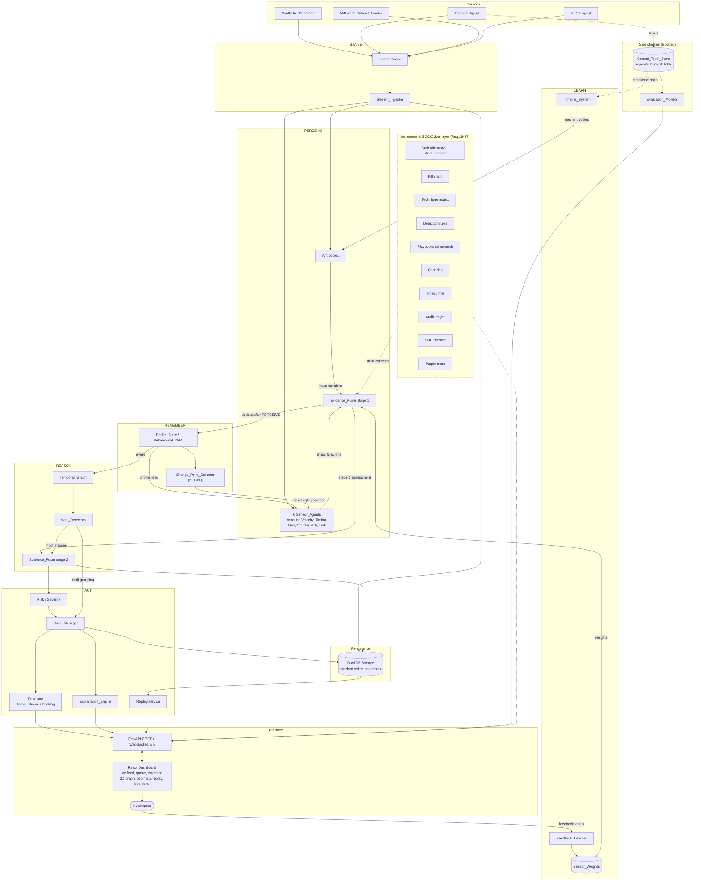
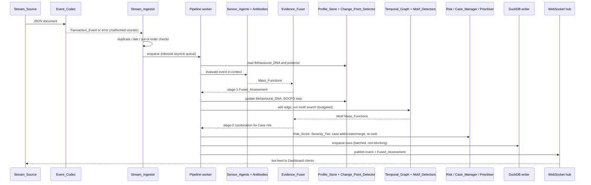

# Design Document: HELIX Fraud Immune System

## Overview

- Purpose: a living fraud immune system that runs as a closed control loop over a continuous transaction stream instead of a one-shot batch pipeline, surfacing ranked, explained Cases under a hard alert budget.
- Loop: SENSE (ingest and parse) → PERCEIVE (sensor swarm and evidence fusion) → REMEMBER (Behavioural_DNA and change points) → REASON (temporal graph and motifs) → ACT (risk, cases, prioritisation, explanation) → LEARN (feedback weights, attacker co-evolution, antibodies).
- Single-process asyncio core with a deterministic synchronous pipeline per event: one event passes through all stages with no awaits inside the pipeline, so runs are reproducible, replayable and directly property-testable.
- Pure functions for fusion, risk and severity: no I/O or hidden state, so Hypothesis can exercise them in isolation and replay recomputes identical values.
- Simulated clock: all time-dependent logic (windows, budget periods, decay, lateness) reads an injected clock, so tests and replays control time and sped-up demos stay consistent.
- Ground truth isolation: Attacker_Agent labels live behind the `evaluation`/`immune` module boundary and in a separate DuckDB table, so no detection-path module can import or query them.
- Two-stage fusion: stage 1 fuses Sensor_Agent and Antibody Mass_Functions in PERCEIVE; stage 2 combines the stage-1 result with Motif Mass_Functions after REASON, consistent with Req 13.2.
- Combination order: the full unnormalised conjunctive combination of all discounted Mass_Functions is computed first, then Dempster normalisation or the Yager fallback is applied once, so order independence holds in both the normal and high-conflict cases (Req 6.6, 6.7).
- Honest limitations:
  - Single node; no horizontal scaling or failover.
  - NetworkX is pure Python, so graph and motif search speed bounds REASON throughput.
  - BOCPD is truncated to a configured maximum run length, which approximates the full posterior.
  - The GIL limits CPU parallelism; sharding inside one process improves ordering isolation, not raw throughput.
  - 50 ms p95 latency at 200 events/s is a target to measure, not a guarantee.
  - The SOC/cyber layer (Req 28-37) is deferred to Increment 4.

## Architecture




### One Transaction_Event end to end



### Concurrency model

Ingest handlers (generator, attacker, loader, REST) parse documents and put Transaction_Events on a single bounded asyncio inbound queue, which drives the backpressure signal. The MVP runs one pipeline worker task that drains the queue and runs the synchronous pipeline per event; this gives a per-account ordering guarantee (Req 1.3) for free. If throughput requires it, the pipeline can be sharded by `hash(account) % N` into N queues and workers, which preserves per-account ordering but requires cross-shard care for graph and case state. A separate batched DuckDB writer task drains a write queue and commits in batches, because DuckDB allows only one writer process and per-event commits would dominate latency. A snapshot task periodically persists profile, graph and case state for replay and restart. A WebSocket pub/sub hub fans out live events and queue updates to connected clients without blocking the worker; processing continues when no client is connected (Req 1.13).

## Project Structure

```text
backend/
  helix/
    config/        # HELIX_Config, range validation
    codec/         # Event_Codec, Auth_Event_Codec
    ingest/        # Stream_Ingestor, dedup, lateness, backpressure
    sim/           # Synthetic_Generator, simulated clock
    datasets/      # AMLworld Dataset_Loader, pattern-file parser, DuckDB external sort
    sensors/       # Amount, Velocity, Timing, Geo, Counterparty, Drift
    fusion/        # Mass_Function, discounting, Dempster/Yager (pure)
    memory/        # Profile_Store, Behavioural_DNA
    changepoint/   # BOCPD Change_Point_Detector
    graph/         # Temporal_Graph
    motifs/        # Motif_Detectors
    risk/          # Risk_Score, Severity_Tier (pure)
    cases/         # Case_Manager, Prioritiser
    explain/       # Explanation_Engine, Evidence_Chain
    replay/        # Replay service
    learn/         # Feedback_Learner, Sensor_Weights
    attacker/      # Attacker_Agent, Pattern_Genome
    immune/        # Immune_System, Antibody_Pool
    evaluation/    # Evaluation_Monitor, Ground_Truth_Store access
    storage/       # DuckDB batched writer, snapshots
    api/           # FastAPI REST + WebSocket hub
  tests/
    unit/
    property/
    fixtures/
      aml/         # hand-written ~50-row *_Trans.csv and *_Patterns.txt fixtures
data/              # AMLworld CSVs, gitignored (see note below)
frontend/
  src/
    api/
    store/
    components/
      LiveFeed/
      CaseQueue/
      EvidencePanel/
      Network3D/
      GeoMap/
      ReplaySlider/
      LoopPanel/
      Controls/
docs/
  architecture.png
```

`data/` holds the AMLworld files (`HI-Small_Trans.csv`, `HI-Small_Patterns.txt`, etc.). They are downloaded manually from Kaggle ("ibm-transactions-for-anti-money-laundering-aml", which requires a Kaggle account) and are never committed: the root `.gitignore` contains `data/*` with `!data/.gitkeep`. The dataset is released under CDLA-Sharing-1.0.

### Pinned dependencies

Versions are recent releases chosen for Python 3.10 compatibility (networkx 3.4.x and numpy 2.2.x are the last lines supporting 3.10). Verify each at install time and adjust pins if a release has been yanked or conflicts.

| Python package | Pin | JS package | Pin |
|---|---|---|---|
| fastapi | 0.115.6 | react / react-dom | 18.3.1 |
| uvicorn[standard] | 0.32.1 | vite | 6.0.7 |
| pydantic | 2.10.4 | typescript | 5.7.2 |
| numpy | 2.2.1 | zustand | 5.0.2 |
| networkx | 3.4.2 | react-force-graph-3d | 1.26.0 |
| duckdb | 1.1.3 | deck.gl | 9.0.38 |
| sortedcontainers | 2.4.0 | react-map-gl | 7.1.8 |
| hypothesis | 6.123.2 | maplibre-gl | 4.7.1 |
| pytest | 8.3.4 | | |
| pytest-asyncio | 0.25.0 | | |

River is not required and is omitted: the online statistics HELIX needs (running mean/variance, decayed histograms, sliding-window counts) are hand-rolled, which keeps them deterministic, snapshot-friendly and testable as pure functions. The requirements' target-stack mention of River is therefore not followed.

## Components and Interfaces

Shared primitives used below (full definitions in Data Models):

```python
@dataclass(frozen=True, slots=True)
class Mass:            # focal sets {F}, {L}, Θ = {F, L}
    f: float; l: float; t: float
VACUOUS = Mass(0.0, 0.0, 1.0)

def ramp(u: float, a: float, s: float) -> float:   # a·(1 - e^(-max(0,u)/s)), in [0, a)
    return a * (1.0 - math.exp(-max(0.0, u) / s))
```

All time reads go through `SimClock`; all randomness goes through a seeded `numpy.random.Generator` owned by the component.

### 1. Event_Codec

Parses JSON into an immutable `TransactionEvent` and formats it back; the single source of the schema.

```python
class TransactionEvent(BaseModel):
    model_config = ConfigDict(frozen=True, extra="ignore")
    tx_id: Id64; ts: AwareDatetime; src: Id64; dst: Id64
    amount: Annotated[Decimal, Field(ge=Decimal("0.01"), le=Decimal("999999999.99"), decimal_places=2)]
    currency: Annotated[str, Field(pattern=r"^[A-Z]{3}$")]
    channel: Id64 | None = None; mcc: Id64 | None = None
    lat: Annotated[float, Field(ge=-90, le=90)] | None = None
    lon: Annotated[float, Field(ge=-180, le=180)] | None = None
    device_id: Id64 | None = None; session_id: Id64 | None = None

def parse(raw: str | bytes) -> TransactionEvent | CodecError: ...   # model_validate_json
def format(ev: TransactionEvent) -> str: ...                         # exclude_none=True
```

- `Id64 = Annotated[str, StringConstraints(min_length=1, max_length=64)]`.
- `amount`: `decimal_places=2` rejects 1.234 rather than rounding; an after-validator quantises to `Decimal("0.01")` so `5` → `5.00`. Parsing uses `model_validate_json`, so JSON numbers are read from their text and 0.10 stays exact. Formatting writes the amount as the string `f"{amount:.2f}"`; the parser accepts a number or a string.
- `ts`: a before-validator requires an ISO 8601 string (rejects epoch integers); `AwareDatetime` rejects naive values. Output uses `isoformat()`, which keeps the offset.
- Missing and null Optional_Fields both become `None`, distinct from `""`, `0` and `0.0`; `exclude_none` omits them on output, so the round trip is the identity.
- `CodecError` lists `(field_path, rule)` from every Pydantic error, not just the first.

Covers: Req 2.1-2.7, 2.9.

### 2. Stream_Ingestor

Admits each parsed, non-duplicate event exactly once, in per-account timestamp order, and signals backpressure.

```python
class StreamIngestor:
    def submit(self, raw: str | bytes | TransactionEvent) -> IngestResult: ...  # ACCEPTED | DUPLICATE | REJECTED
    async def next_event(self) -> AdmittedEvent: ...      # event + Lateness(kind, seconds)
    backpressure: bool                                    # read by sources
    counters: IngestCounters                              # malformed, duplicate, out_of_order, late
```

- Dedup: `seen: dict[tx_id, ts]` plus a min-heap of `(sim_ts, tx_id)`; entries older than `dedup_ttl` (≥ Graph_Window, validated at startup) are evicted. Dedup runs at `submit`, before enqueue and before publication.
- Ordering: one bounded-by-policy FIFO of account tokens plus a per-account min-heap keyed `(ts, arrival_seq)`. The worker pops a token for account A and takes A's minimum, so queued events of one account leave in non-decreasing ts with arrival-order ties. One worker means at most one event per account is in the loop.
- Lateness at delivery, with `latest[A]` = latest processed ts: `lag = latest[A] - ts`; `lag > tol` → LATE (flag and `lag` seconds go to the Evidence_Chain); `0 < lag ≤ tol` → out-of-order counter +1; otherwise in order.
- Backpressure hysteresis: set when `len > limit`; cleared when `len ≤ limit // 2`. Events are never dropped. The generator and attacker pause while the flag is set; REST ingest still accepts and returns `X-Backpressure: 1`.
- Rejected documents go to the rejected-events log with raw text, receipt time and offending field names, then ingestion continues.

Covers: Req 1.1-1.10, 1.13, 2.8.

### 3. SimClock and Synthetic_Generator

`SimClock` supplies stream time to every component; the generator produces seeded legitimate traffic.

```python
class SimClock(Protocol):
    def now(self) -> datetime: ...                # aware UTC
    def advance(self, dt: timedelta) -> None: ... # tests / fast replay
class SyntheticGenerator:
    def __init__(self, cfg: GeneratorConfig, clock: SimClock, gt: GroundTruthWriter, seed: int | None): ...
    def events_until(self, t: datetime) -> Iterator[TransactionEvent]: ...
```

- `rng = np.random.default_rng(seed if seed is not None else cfg.default_seed)`; every draw comes from `rng`, so a seed and config give an identical sequence.
- Profile per account: lognormal amount (`μ ~ N(ln 60, 0.8)`, `σ ~ U(0.3, 0.8)`), a 24-bit active-hours mask (contiguous block of 6-14 h), home lat/lon (city + jitter), channel mix (Dirichlet), and a counterparty list of 1-50 other accounts (never itself).
- Emission: deterministic spacing `1/rate` with bounded jitter (exponential gaps would break the ±10% per-10 s window). Each tick picks an account active at that hour with probability 0.97, otherwise any account; in-profile events stay within 30 km of home and go to a listed counterparty.
- Behaviour changes: `n = floor(frac·N + 0.5)` accounts chosen without replacement, each with one of relocation, salary increase, new payee or travel, and a start time. All change records are written to the Ground_Truth_Store at start, so each precedes its first affected event. Travel reverts after its duration.
- Each Optional_Field is omitted independently with probability `omit_frac` (left absent, no placeholder).
- Config validation collects every out-of-range setting before refusing to start.

Covers: Req 3.1-3.12.

### 3a. Dataset_Loader (AMLworld)

Replays IBM AMLworld `*_Trans.csv` files (HI/LI × Small/Medium/Large) through the normal SENSE path, with labels and optional `*_Patterns.txt` membership written to the Ground_Truth_Store first. Lives in `helix/datasets/`.

```python
@dataclass(frozen=True, slots=True)
class ReplayScope:
    start: datetime | None = None; end: datetime | None = None   # [start, end), aware UTC
    max_rows: int | None = None                                  # None = no limit

@dataclass(frozen=True, slots=True)
class LoadReport:
    path: Path; parsed: int; skipped: int; out_of_scope: int; laundering: int
    sorted_externally: bool; first_ts: datetime | None; last_ts: datetime | None
    patterns: dict[str, int]          # pattern type -> AMLworld_Patterns loaded
    pattern_rows_matched: int; unmatched_pattern_rows: int

class DatasetLoader:
    def __init__(self, cfg: DatasetConfig, ingest: StreamIngestor, clock: SimClock, gt: GroundTruthWriter): ...
    def load(self, path: Path, patterns_path: Path | None = None, scope: ReplayScope = ReplayScope()) -> LoadReport | LoaderError: ...
    async def replay(self, speed: float | Literal["max"]) -> LoadReport: ...
def parse_row(fields: list[str], row: int, stem: str, tz: ZoneInfo) -> tuple[TransactionEvent, bool] | RowError: ...
def format_row(ev: TransactionEvent, laundering: bool, tz: ZoneInfo) -> list[str]: ...
```

Row parsing:

- Streaming `csv.reader` over `open(path, encoding="utf-8-sig", newline="")`; the file is never loaded into memory. `utf-8-sig` strips an optional BOM.
- Header: exactly 11 columns, checked positionally against `Timestamp, From Bank, Account, To Bank, Account, Amount Received, Receiving Currency, Amount Paid, Payment Currency, Payment Format, Is Laundering`. Names are never used as dict keys, so the duplicate `Account` is harmless. A short or mismatched header is a `LoaderError` (missing column) and nothing is labelled or emitted.
- `src = f"{int(from_bank)}:{from_acct}"`, `dst = f"{int(to_bank)}:{to_acct}"`. Bank IDs go through `int()` because AMLworld pads bank IDs inconsistently (e.g. `010` vs `10`).
- `tx_id = f"aml-{path.stem}-{row}"`, where `row` is the 1-based data row number in the original file (header excluded), so ids are stable after sorting.
- Timestamp: try `strptime(s, "%Y/%m/%d %H:%M")`, then `datetime.fromisoformat(s)`. A naive result gets `tzinfo=cfg.dataset_tz` (default `UTC`) and is converted to UTC; an explicit offset is honoured.
- Amount: `Decimal(amount_paid).quantize(Decimal("0.01"), ROUND_HALF_EVEN)`. Rows that quantise below 0.01 (tiny Bitcoin amounts) are skipped as unparseable with reason `amount_below_min`.
- Currency: AMLworld uses names ("US Dollar", "Euro", "Bitcoin", ...), not ISO codes. A fixed table in `helix/datasets/currencies.py` maps each name to a 3-letter code (`US Dollar → USD`, `Bitcoin → XBT`, ...); an unknown name skips the row with reason `unknown_currency`. `format_row` uses the inverse table.
- `channel = payment_format`; all other Optional_Fields are missing. `Is Laundering` (`"0"`/`"1"`) is returned beside the event and never placed on it.
- Amount Received and Receiving Currency are explicitly ignored (Req 4.15): they are not stored, scored or emitted. `format_row` writes the Amount Paid and Payment Currency values into those two columns, which keeps the round trip (Property 74) exact on the parsed fields.
- Any parse failure returns `RowError(row, reason)`; the loader logs it, increments `skipped` and continues.

Ordering and scope:

- AMLworld files are mostly time-ordered. Pass 1 is a streaming check that parses only the Timestamp column and stops at the first `ts < prev_ts`.
- If ordered, the source is the `csv.reader` itself, and reading stops early once `ts ≥ scope.end`.
- If not, DuckDB performs an external sort (used from the start: it is already a dependency, it spills to disk, and it is fast): `SET threads=1; SET preserve_insertion_order=true;` then `CREATE TEMP TABLE aml AS SELECT row_number() OVER () AS row, * FROM read_csv(?, header=true, all_varchar=true, names=[...11 positional names...])`, then `SELECT * FROM aml ORDER BY <parsed ts>, row`. Reading as `all_varchar` keeps `parse_row` the single parser for both paths. A fixture test asserts the DuckDB `row` equals the `csv.reader` row number.
- Scope is applied after ordering: rows with `start ≤ ts < end` are kept, in `(ts, row)` order, until `max_rows` are kept. Other rows count as `out_of_scope` and are neither labelled nor emitted (Property 76).
- `load()` makes one ordered pass over the in-scope rows and writes every label (`FRAUD` for `Is Laundering = 1`, otherwise `LEGIT`, source `LOADER`) through `GroundTruthWriter` in batches. It also builds `content_index: dict[RowKey, deque[tx_id]]` for laundering rows only (a few thousand in HI-Small). All of this finishes before `replay()` can start, so every label precedes its event (Req 4.5).

Pattern-file parser (`helix/datasets/patterns.py`):

- Line-oriented state machine. `BEGIN LAUNDERING ATTEMPT - <TYPE>[: detail]` opens a pattern (`TYPE` matched by `[A-Z]+(?:-[A-Z]+)?`); `END LAUNDERING ATTEMPT` closes it. Lines in between are CSV transaction rows in the `*_Trans.csv` column order. Blank lines are skipped. A row outside a block, or an unknown TYPE, is logged and counted as unmatched.
- `pattern_id = f"{stem}-p{n}"` in file order.
- Each row is normalised with the same `parse_row` rules into a `RowKey` (ts, src, dst, amount paid, payment currency, format, all 11 raw fields after normalisation), then matched by popping the first unclaimed tx_id from `content_index[key]`. Duplicate-content rows therefore match distinct transactions in row order. No available match (including rows outside the scope) increments `unmatched_pattern_rows` and logs the row (Property 75).
- Each match writes `GroundTruthRecord(event_id=tx_id, label="FRAUD", source=LOADER, pattern_id, pattern_type)`.
- Assumption: pattern rows are all laundering-labelled. If a real file breaks this, the high unmatched count shows it in the LoadReport.

Speed modes:

- Real time × multiplier (1 to 1,000,000, default 60): emission time for event i is `t0_wall + (ts_i - ts_0) / speed`; the SimClock is set to `ts_i` at emission; jitter is checked against the 100 ms bound (Req 4.4).
- `"max"`: no sleeping. The loader awaits `not ingest.backpressure`, then submits the next event. The SimClock runs in event-driven mode: the pipeline worker advances it to each dequeued event's `ts` (monotone max), so windows, decay and budget periods follow recorded time regardless of queue depth. Events still pass one at a time through every stage (Req 4.17).
- At the end of `replay()`, `EvaluationMonitor.aml_report()` computes precision, recall, admissions per budget period and the captured fraud fraction against `LOADER` labels. When patterns were loaded, it also computes the per-type detection rate (patterns with ≥ 1 member that is a Detected_Event), with `CYCLE → Round_Trip_Cycle`, `FAN-OUT → Fan_Out`, `FAN-IN → Fan_In` and the other five types marked `unmapped`.

Scale and fidelity notes:

- HI-Small is about 5M rows; at the 200 events/s throughput target that is about 7 h end to end. The practical demo setting is `"max"` plus a scope window, for example the first 3 days.
- NetworkX stores roughly 0.5-1 KB per multigraph edge with attributes, so millions of in-window edges need several GB of RAM. Use a scoped subset for the live demo and run full files only for offline evaluation (`helix replay --speed max --no-ui`).
- Geo_Sensor, device and session evidence, and Auth_Sensor are vacuous on AMLworld (no lat/lon, device, session or auth data). This is expected and shows up as Uncertainty_Mass, not as risk.
- Minute-precision timestamps produce many equal timestamps; ties are broken by row order. The 1-minute Velocity_Sensor window is coarse on this data, so the longer windows carry most of the velocity signal.

Covers: Req 4.1-4.22.

### 4. Sensor_Agents

Six independent specialists, each mapping (event, pre-update DNA, context) to a Mass_Function plus the features used.

```python
class SensorAgent(Protocol):
    name: str
    def evaluate(self, ev: TransactionEvent, dna_before: DNAView, ctx: SensorContext) -> SensorOutput: ...

@dataclass(frozen=True)
class SensorOutput:
    mass: Mass
    features: Mapping[str, float | str | None]
    vacuous_reason: str | None        # "missing:lat,lon" | "history:3" | None
```

`DNAView` is a read-only snapshot, so sensors cannot affect each other and invocation order does not matter. Parameters satisfy `a + b ≤ 1`, so `mF < a` and `mL ≤ b` always give `mF + mL < 1` and `Θ = 1 - mF - mL ∈ (0, 1]`.

| Sensor | Formula | Why mF is monotone |
|---|---|---|
| Amount | `z = abs(x-μ)/max(σ, ε)`; `mF = ramp(z - z0, a, s)`; `mL = b·e^(-z)·(1 - mF/a)` | `max(0, z - z0)` is non-decreasing in z and `1 - e^(-u/s)` is increasing in u |
| Velocity | `c_i` = count in (t - W_i, t] incl. current, W = 1 min, 1 h, 24 h; `E_i = max(E_min, W_i/mean_iat)`; `r = max_i c_i/E_i`; `mF = ramp(r - r0, a, s)`; `mL = b·e^(-r)·(1 - mF/a)` | `max` is non-decreasing in each `c_i` with the others fixed; E_i does not depend on counts |
| Timing | `p = freq_h(hour)·freq_w(weekday)` (decayed relative frequencies); `mF = a·clip(1 - p/p_ref, 0, 1)`; `mL = b·clip(p/p_ref - 1, 0, 1)` | p is non-decreasing in each frequency with the other fixed, so `1 - p/p_ref` is non-increasing in p |
| Geo | `d` = haversine km to last located event, `dt = abs(t - t_prev)` h; `v = inf` if `dt = 0 and d > 0`, `0` if `d = 0`, else `d/dt`; `mF = 0` if `v ≤ vmax` else `a·(1 - vmax/v)`; `mL = b·(1 - v/vmax)` if `v ≤ vmax` else 0 | `1 - vmax/v` is increasing for v > vmax, equals 0 at vmax, and reaches `a` at v = inf |
| Counterparty | known dst: `(mF, mL) = (c1, l1)`; unknown: `(c2, 0)` with `c2 > c1` | strict inequality by construction (defaults c1 = 0, l1 = 0.3, c2 = 0.35) |
| Drift | ABRUPT_BREAK → `(abrupt_mass, 0)`; REGIME_SHIFT → `(0, regime_mass)`; NONE / reset → vacuous | read from the Change_Point_Detector state (§8) |

- `p_ref` is a configured constant (default 1/168, the uniform slot probability), not the data-dependent maximum. A data-dependent maximum would move when one frequency changes and break the "other held fixed" monotonicity.
- Vacuous rules, checked before any formula:
  - Amount, Velocity, Timing, Counterparty and Drift emit vacuous when `dna.count < Minimum_History_Count`.
  - Geo below the minimum halves `mF` and `mL`, so Θ ≥ 0.5.
  - Any required event field that is absent, null or `""` → vacuous with `missing:<fields>`. Latitude and longitude are missing together.
  - A DNA feature with no recorded value (for example no prior location) → vacuous.
- Runner: `run_sensors(ev, dna, ctx) -> list[SensorResult(name, outcome, output)]`. Each call is wrapped in `try`, timed with `perf_counter()` and checked with `is_valid(mass)` (each mass in [0, 1], sum within 1e-9). The outcome is SUCCESS, ERROR, INVALID_OUTPUT or TIMEOUT, and anything but SUCCESS becomes vacuous. Python cannot preempt a synchronous call, so the budget is detect-and-substitute: a slow sensor still delays the event, but its output is discarded and flagged. Every invocation is recorded with its features.

Covers: Req 5.1-5.15, 7.1-7.4, 7.7.

### 5. Evidence_Fuser (pure)

Discounts and combines contributions on {F, L}; no I/O, no state.

```python
@dataclass(frozen=True)
class Contribution:
    contributor_id: str; kind: ContributorType; mass: Mass; weight: float

def conjunctive(ms: Iterable[Mass]) -> tuple[float, float, float, float]: ...  # f, l, t, empty
def fuse(cs: Sequence[Contribution], high_conflict: float) -> tuple[FusedAssessment, list[FusionError]]: ...
```

- Validation: a contribution with an invalid mass or `weight ∉ [0, 1]` is excluded and returned as `FusionError(contributor_id, tx_id, reason)`.
- Discount: `m' = (w·f, w·l, 1 - w + w·t)`.
- Unnormalised conjunctive fold, starting from `(F, L, T, E) = (0, 0, 1, 0)` and combining with each `(f, l, t)`:
  - `F ← F·(f + t) + T·f`
  - `L ← L·(l + t) + T·l`
  - `T ← T·t`
  - `E ← E + F·l + L·f` (computed with the pre-update F and L)
  
  The four terms always sum to 1. This is the conjunctive rule on a 2-element frame, which is commutative and associative.
- Conflict `K = E`. If `K < 1 and K ≤ high_conflict`, apply Dempster: divide F, L, T by `1 - K`. Otherwise apply Yager: `T += K`, keep F and L, set `high_conflict = True`, and report the unreduced K. Normalisation happens once after the whole fold, so the choice of rule does not depend on order.
- Empty input or all `w = 0` folds to `(0, 0, 1, 0)`, so the result is vacuous with Bel 0, Pl 1, U 1 and K 0. A vacuous term is the fold's identity, which gives the identity and zero-weight criteria.
- Floats: inputs are sorted by `contributor_id` before folding, so any permutation gives bit-identical output (confluence holds exactly in production). The property test also folds raw permutations, where float rounding makes associativity hold only approximately. That test uses tolerance 1e-9, and the error grows like `1/(1 - K)` near K = 1. `math.fsum` is used for the validity sum.
- Missing fields (Req 7.5): removing Optional_Fields only replaces some masses with vacuous ones. Dropping a term `(f, l, t)` from the fold multiplies `T` by `1/t` and increases `1 - K` by at most a factor of `1/t`. This follows from `F·f + L·l + T·(1 - t) ≥ 0`, so normalised Θ never decreases outside the Yager branch. Antibodies keep this true by never matching on missing dimensions (§18).
- Stage 2: `fuse([Contribution("stage1", FUSED, stage1.mass, 1.0)] + motif_contribs, θ)`, the same function.

Covers: Req 6.1-6.11, 7.5, 13.2.

### 6. Risk and Severity (pure)

```python
def risk(fa: FusedAssessment) -> float: return fa.belief + 0.5 * fa.uncertainty   # pignistic BetP(F)
def tier(score: float, bands: Bands) -> SeverityTier: ...
def validate_bands(bands: Bands, alert_threshold: float) -> list[ConfigError]: ...
```

- `tier`: return the band with `lo ≤ s < hi`; CRITICAL also accepts `s == 1.0`. A score below the lowest band, which only a motif-created Case can have, maps to LOW.
- `validate_bands`: the bands must be in tier order, start at the alerting threshold and end at 1.0, have `lo < hi`, and satisfy `hi_k == lo_{k+1}` exactly (no gaps or overlaps). Ordered contiguous bands make `tier` monotone in s.
- Case risk: `max(max_tx_risk, risk(stage2(best_tx, motifs)))` when Motifs are attached, otherwise `max_tx_risk`.

Covers: Req 13.1-13.3, 13.7, 13.8, 13.11, 13.12.

### 7. Profile_Store / Behavioural_DNA

Maintains per-account decayed statistics, read before update and applied after PERCEIVE.

```python
class ProfileStore(Protocol):
    def view(self, account: str) -> DNAView: ...                  # empty DNA if unknown, count 0
    def apply(self, ev: TransactionEvent) -> None: ...
    def withhold(self, account: str, tx_ids: set[str]) -> None: ... # case reached HIGH/CRITICAL
    def release(self, account: str, tx_ids: set[str]) -> None: ...  # FALSE_POSITIVE
    def exclude(self, account: str, tx_ids: set[str]) -> None: ...  # CONFIRMED_FRAUD
    def rebase(self, account: str, since_tx: str) -> None: ...      # confirmed Regime_Shift
```

- Decay: `Δt = max(0, ts - t_last)` (late or earlier events get Δt = 0) and `d = 0.5^(Δt/h)`. Naive form: `W = d·W + 1`, `S1 = d·S1 + x`, `S2 = d·S2 + x²`, `mean = S1/W`, `var = S2/W - mean²`. To avoid cancellation in `S2/W - mean²`, the implementation uses the weighted West update: decay `W` and `M2` by `d`, then `W += 1`, `δ = x - mean`, `mean += δ/W`, `M2 += δ·(x - mean)`, `var = M2/W`. In exact arithmetic this equals the naive form. The model property compares against batch weights `0.5^((T_n - T_i)/h)`, where `T_i` is the running max timestamp (which encodes the Δt = 0 rule). Amount and inter-arrival seconds each get one accumulator.
- Other DNA fields:
  - decayed hour[24] and weekday[7] histograms (decay all bins by `d`, then add 1)
  - last location `(lat, lon, ts)`
  - decayed channel counts
  - known counterparty set
  - event count
  - recent timestamps (24 h, kept sorted) for Velocity
  
  All updates are O(1) amortised, so update time does not grow with history.
- Missing Optional_Fields leave their derived stats untouched (no location update when lat or lon is missing, no channel update when channel is missing).
- Withholding: each account keeps a base checkpoint (DNA + CPD state) and an applied-event log within the withholding horizon (default 7 d). Older entries are folded into the base. To remove events, rebuild the account from base + log minus those events, replayed in original application order.
  - Why recompute instead of subtracting: removing an event changes the next event's inter-arrival time, the last-location chain, the Δt decay of everything after it, and counterparty membership. Subtraction cannot be exact; replay is exact by construction.
  - Cost is O(n) per removal and removals are rare (once per Case reaching HIGH).
  - If the source account already has an open HIGH/CRITICAL Case and the stage-1 risk is at or above the alerting threshold, `apply` withholds up front, which skips the rebuild in the common case.
  - Events older than the horizon cannot be removed exactly; that case is logged.
- `release` applies the withheld events now in timestamp order (normal `apply`, Δt = 0 rule, and dst added to counterparties). `exclude` drops them permanently.
- Rebase: rebuild amount, inter-arrival, hour/weekday, location and channel stats from log events since the change point; keep the counterparty set and the event count. This runs before the account's next event.

Covers: Req 8.1-8.14, 19.7.

### 8. Change_Point_Detector

Per-account BOCPD (Adams & MacKay 2007) with a Regime_Shift / Abrupt_Break state machine.

```python
class ChangePointDetector(Protocol):
    def update(self, account: str, x_amount: float, x_iat: float | None, tx_id: str, ts: datetime) -> CPDState: ...
    def state(self, account: str) -> CPDState: ...   # kind: NONE | ABRUPT_BREAK | REGIME_SHIFT, candidate, history
```

- Features are `log(amount)` and `log1p(inter-arrival seconds)`. Each has a Normal-Gamma prior `(μ0, κ0, α0, β0)` per run length with a Student-t predictive (`ν = 2α`, `scale² = β(κ+1)/(ακ)`). The features are treated as independent, so the predictive is the product. A missing iat (first event) contributes factor 1.
- Recursion in log space (`logsumexp`), with constant hazard `H = 1/λ` (λ = 100):
  - growth: `P(r+1) ∝ P(r)·π_r·(1 - H)`
  - change: `P(0) ∝ Σ_r P(r)·π_r·H`
  - Run length is truncated at `R_max = 300`, with overflow mass merged into `R_max`, then the vector is normalised.
- Detection signal: with constant hazard, `P(r_t = 0 | x_1:t) = H` identically, so it cannot be thresholded. HELIX uses short-run mass `s_t = Σ_{r ≤ r_small} P(r_t = r)` (`r_small = 2`, configurable). A candidate is recorded on the rising edge `s_t > θ_cp and s_{t-1} ≤ θ_cp`, and the detector arms only after `r_small + 1` updates. The rising edge stops the next few events from re-triggering. The record holds the account, tx_id, ts, `s_t` and the estimated start `t - argmax_r P(r_t)` (used by rebase).
- State machine:
  - NONE → ABRUPT_BREAK on a candidate.
  - After Regime_Confirmation_Count consecutive non-triggering events, ABRUPT_BREAK → REGIME_SHIFT and `ProfileStore.rebase` is called.
  - A new candidate from any state → ABRUPT_BREAK with the count restarted; the previous candidate stays in history.
  - REGIME_SHIFT holds until the next candidate.
- Any non-finite value in the posterior resets it to the prior (`P(0) = 1`) with state NONE; history is kept.
- Cost is O(R_max) per event, and memory is O(accounts × R_max). At 100 k accounts, lower R_max or prune entries with mass < 1e-12.

Covers: Req 9.1-9.10.

### 9. Temporal_Graph

```python
class TemporalGraph:
    def add(self, ev: TransactionEvent) -> bool: ...      # False if too old or duplicate
    def query(self, account: str, hops: int, start: datetime, end: datetime) -> Subgraph: ...
```

- `nx.MultiDiGraph` with edge key = tx_id and attributes `ts`, `amount`, `currency`. An `edge_ids: set[str]` set gives O(1) duplicate checks.
- Eviction index is a min-heap of `(ts, tx_id, u, v)`, not a deque, because late events arrive out of ts order and would break popleft ordering.
- `add`:
  1. Reject if `ts < latest - window` or the tx_id is present.
  2. Add the edge, creating nodes as needed.
  3. If `ts > latest`, set `latest = ts` and pop edges while `heap[0].ts < latest - window` (an edge exactly on the boundary is kept).
  4. After each removal, delete endpoints whose degree is 0.
- `query`: validate `1 ≤ hops ≤ 6` and `start ≤ end`. BFS from the account over successors and predecessors, keeping only edges with `start ≤ ts ≤ end`, and return a copied `Subgraph`. An unknown account returns an empty subgraph. The query never mutates graph state.

Covers: Req 10.1-10.11.

### 10. Motif_Detectors

Incremental, edge-anchored detectors sharing a per-edge time budget.

```python
class MotifDetector(Protocol):
    motif_type: MotifType
    def on_edge(self, e: Edge, g: TemporalGraph, deadline: float) -> MotifResult: ...  # instances, truncated
```

- Round_Trip_Cycle. For a new edge `u→v` at time t (the common case, where e is the newest edge in its cycle), run a backward DFS from `u` over in-edges with strictly decreasing ts in `[t - 72h, t)`, up to 5 more hops, with no repeated account, stopping at `v`. Each hit is a path `v ⇝ u` with increasing ts that `e` closes. For a late edge, the detector also runs a forward DFS from `v` over edges with ts > t and joins it with the backward search on a meeting account, under the same bounds.
- Fan_Out / Fan_In: per node, a ts-ordered deque of `(ts, counterparty, tx_id)` (insort for late edges) plus `Counter[counterparty]`. Entries older than `t - 24h` are evicted. Emit when the number of distinct counterparties is ≥ 8.
- Structuring: per source, a deque of in-band `(ts, amount, tx_id)` with `0.9·RT ≤ amount < RT`, compared in Decimal. Evict entries older than 48 h and emit when there are ≥ 3.
- Mule_Chain: for new `u→v` (amount a, time t), take in-edges `w→u` with `t - 60min ≤ t' ≤ t` and `a ≥ 0.8·a'`. Each forms a chain `w→u→v`, which is extended backward recursively under the same rule (no repeated accounts). Every chain of ≥ 3 accounts is emitted. Late edges also get a symmetric forward extension.
- Dedup: `emitted[type]: set[frozenset[tx_id]]`.
- Budget: `perf_counter() > deadline` is checked inside every DFS/extension loop. On timeout the detector returns what it has found with `truncated = True`, the truncation is recorded per type, and the edge stays in the graph.
- Each participating event gets `Mass(m_type, 0, 1 - m_type)`.
- Brute-force reference detectors (full enumeration over ≤ 200 events) live only in `tests/oracles/`.

Covers: Req 11.1-11.12.

### 11. Case_Manager

Owns Cases, membership indexes and the investigator workflow.

```python
class CaseManager:
    def on_scored_event(self, ev: TransactionEvent, fa: FusedAssessment, risk: float) -> CaseChange | None: ...
    def on_motif(self, inst: MotifInstance) -> CaseChange: ...
    def open(self, case_id: str, investigator: str) -> Case: ...         # Conflict on assignee/CLOSED
    def submit_label(self, case_id: str, by: str, label: Label, note: str) -> Case: ...
    def escalate(self, case_id: str, by: str) -> Case: ...
```

- Indexes: `tx_to_case: dict[tx_id, case_id]` and `account_to_cases: dict[account, set[case_id]]`, both over open Cases only.
- Scored event (Req 13.4-13.6): if risk < threshold, do nothing. Otherwise, if any open Case contains `ev.src`, add the event to the one with the latest `updated_at`; else create a Case.
- Motif: `hit = {tx_to_case[x] for x in inst.tx_ids if x in tx_to_case}`. Zero hits → create; one → add; two or more → merge, then add.
- Merge: the survivor is `min(cases, key=(created_at, seq_no))`, where Case IDs `C-<seq_no>` compare numerically. It takes the union of events, accounts and Evidence_Chain entries keyed `(contributor_id, tx_id)`. Non-survivors become CLOSED with `merged_into` and leave the Active_Queue and Backlog.
- After every add, merge or create: recompute Risk_Score, `Expected_Loss = risk × Σ amount`, `Case_Priority = EL - Investigation_Cost` and the tier, then notify the Prioritiser. When a Case first reaches HIGH, call `ProfileStore.withhold`.
- Workflow: OPEN → IN_REVIEW (open by an investigator; records assignee and time) → CLOSED (label by the assignee; note ≤ 2000 characters). Escalation sets the tier to CRITICAL with a sticky `escalated` flag, so recompute never downgrades it. Opening, labelling or escalating against the wrong state or assignee raises `CaseConflict`, which the API maps to 409. History is an append-only list of `(ts, prev, new, actor)`.

Covers: Req 12.1-12.7, 13.4-13.6, 13.9, 13.10, 15.1-15.3, 18.1-18.8.

### 12. Prioritiser

```python
class Prioritiser:
    def upsert(self, case: CaseKey) -> Placement: ...    # ACTIVE | BACKLOG
    def remove(self, case_id: str) -> None: ...
    def on_tick(self, now: datetime) -> None: ...        # period boundary
    def request_change(self, name: str, value: float) -> None: ...  # pending until next period
```

- `active` and `backlog` are `SortedList`s keyed `(-priority, created_at, seq_no)`. `admitted_now` counts Active Cases admitted in the current period. Period index = `floor((now - start)/period)`.
- Admission:
  - `priority ≤ 0` → Backlog.
  - Else if `admitted_now < budget` → Active.
  - Else let `c` be the last unopened Case admitted this period (lowest priority, latest created by key order). If `c.priority < new.priority`, displace `c` to the Backlog and admit the new Case; otherwise the new Case goes to the Backlog.
  - Displacement is restricted to current-period admissions so that the Req 14.4 count stays ≤ budget.
- A priority change removes and reinserts the Case (O(log n)). An Active Case whose priority falls to ≤ 0 moves to the Backlog.
- Period boundary: apply pending Alert_Budget / Investigation_Cost changes (recording name, old, new and time), reset `admitted_now`, then admit Backlog Cases with priority > 0 in key order until the budget is reached.
- Out-of-range change requests are rejected with the permitted range.

Covers: Req 14.1-14.11, 14.15.

### 13. Evidence_Chain and serialisation

```python
@dataclass(frozen=True)
class EvidenceEntry:
    ts: datetime; tx_id: str; contributor_id: str; kind: EntryKind   # SENSOR | MOTIF | ANTIBODY | FUSED | CHANGE_POINT | MISSING_FIELD | SENSOR_FAILURE | LATE | TRUNCATION
    mass: Mass | None; weight: float | None; features: Mapping[str, Scalar]; detail: Mapping[str, Scalar]
def dumps(chain: EvidenceChain) -> str: ...
def loads(s: str) -> EvidenceChain: ...      # raises EvidenceChainError(field_path)
```

- Entries are held in a dict keyed `(contributor_id, tx_id)` (one per pair, union on merge) and iterated sorted by `(ts, tx_id, contributor_id)`. Non-contributor records use reserved IDs (`~fused`, `~missing:lat`, ...). Appends never modify earlier entries.
- `dumps`: `json.dumps(allow_nan=False)` with floats written via `repr`, which round-trips IEEE doubles exactly. Decimal amounts are strings and datetimes are ISO with offset.
- `loads` is strict: `parse_constant` rejects NaN/Infinity, a Pydantic model with `extra="forbid"` validates the structure, and each mass is checked against the Mass_Function definition. The whole document is validated before any return or write, so nothing partial is produced.
- Reproducibility: `fuse()` over the stored undiscounted masses and weights recomputes every `~fused` entry.

Covers: Req 15.1-15.8.

### 14. Explanation_Engine

```python
Template = Callable[[EvidenceEntry], str]
def explain(case: CaseSnapshot, chain: EvidenceChain | None, templates: Mapping[ContributorType, Template]) -> Explanation: ...
# Explanation(summary, reasons, mitigating, insufficient)
```

- From the discounted masses `f' = w·f` and `l' = w·l`:
  - `f' > l'` → reasons, sorted by `(-f', name)`
  - `l' > f'` → mitigating, sorted by `(-l', name)`
  - `f' == l'` (including vacuous) → insufficient, sorted by name, citing `vacuous_reason`
- Each item has the name, weight, tx_ids and comparison values from the type template:
  - Sensor: observed vs DNA baseline
  - Motif: type and accounts
  - Antibody: ID and matched features
  - Rule: ID and version
  - Indicator: value and confidence
  
  Types without a template use a generic template showing the three masses.
- Summary line: `"{tier} | risk {r:.3f} | Bel {b:.3f} Pl {p:.3f} U {u:.3f} K {k:.3f} | at risk {amt:.2f} {ccy}"`, with one amount per currency in ISO-code order.
- Determinism: the engine reads only chain values, sorts the chain canonically first, uses no clock and no locale-dependent formatting. An empty or absent chain gives the summary from the stored Fused_Assessment plus "no contributing evidence".

Covers: Req 16.1-16.10.

### 15. Replay service

```python
class ReplayService:
    def timeline(self, case_id: str) -> ReplayTimeline: ...
    def at(self, case_id: str, t: datetime) -> ReplayFrame: ...       # error with [start, end] if t outside
    def recompute(self, case_id: str) -> list[FusedAssessment]: ...  # replay property
```

- `timeline`: span `[first_contrib_ts - lead, case.updated_at]`. Events involving Case accounts are read from Storage and ordered by `(ts, tx_id)`, each with its stored sensor masses and Fused_Assessment.
- `at(T)`: subgraph from stored edges with ts in `[T - window, T]` (bounded by hop depth and max nodes, truncation flagged) plus Fused_Assessments with ts ≤ T. The data comes from Storage; nothing is recomputed.
- `recompute`:
  1. Load the latest DNA/CPD snapshot at or before the timeline start, the Sensor_Weights in effect then (scan of the WeightRecord log) and the active Antibodies.
  2. Build a fresh pipeline with the same HELIX_Config and side effects off (no Storage, publishing, Cases or learning).
  3. Feed the source accounts' logged events from the snapshot time onward in their original processing sequence (`seq_no`, not ts, so lateness handling repeats). WeightRecords are applied as their timestamps are passed.

Covers: Req 17.1-17.9.

### 16. Feedback_Learner

```python
class FeedbackLearner:
    def on_label(self, case_id: str, label: Label, chain: EvidenceChain, now: datetime) -> list[WeightRecord]: ...
    def rollback(self, t: datetime, now: datetime) -> list[WeightRecord]: ...   # RollbackRangeError
    def weight(self, contributor_id: str) -> float: ...
```

- `on_label`: if `case_id ∈ applied` the call is a no-op. Otherwise, for each non-Canary contributor with undiscounted `f > l`: `w' = clamp(w ± lr, lo, hi)`, so `|w' - w| ≤ lr`. Each change is written as `WeightRecord(contributor_id, old, new, ts, case_id)` to Storage first and then applied to the live dict. The single worker means every later fusion sees the new value.
- `rollback(T)`: valid for `earliest_record_or_startup ≤ T ≤ now`. For each contributor, restore the latest record at or before T (or its initial weight) and append a record with a rollback marker. Labels are kept.
- Canary contributors are fixed at 1.0 and never touched.

Covers: Req 19.1-19.6, 19.8-19.13.

### 17. Attacker_Agent

```python
@dataclass(frozen=True)
class PatternGenome:
    genome_id: str; ptype: PatternType; params: Mapping[str, float | int]; parent_id: str | None
class AttackerAgent:
    def __init__(self, cfg, clock, ingestor, gt: GroundTruthWriter, detected: DetectedEventsView, targets: TargetPool, seed: int): ...
    def tick(self, now: datetime) -> None: ...
```

- Owns `rng = default_rng(seed)`. The initial population has one genome per type: Round_Trip_Cycle, Fan_Out, Fan_In, Structuring, Mule_Chain, account takeover and card-testing. Account takeover emits Auth_Events only from Increment 4; before that it emits only its transaction leg.
- Campaign generators: `gen[ptype](genome, rng, now, targets) -> list[Event]` with 1 to `max_events` events, sorted by ts. `TargetPool` is a Canary-free view of the generator's accounts plus fresh mule IDs.
- Injection, per event: write the Ground_Truth_Store record (event ID, FRAUD, campaign, genome, parent). If the write fails, withhold the event and log it; otherwise `ingestor.submit`. Rate cap per stream-hour: inject only while `injected + 1 ≤ frac × ingested_this_hour`, otherwise defer. Ingested only grows, so the hourly ratio holds at hour end.
- Evasion score: when a campaign is complete and its detection window has elapsed, `1 - |events ∩ detected| / |events|`. `DetectedEventsView` comes from Active_Queue admissions; the attacker never reads ground truth for scoring.
- Evolution:
  1. Select the top K genomes by `(-evasion, genome_id)`.
  2. Create N children per parent. Each numeric parameter gets Gaussian jitter (σ = 10% of its range) and integers get ±1/±2; values are clipped to bounds. With probability `p_topo`, hop count or cycle length changes by ±1.
  3. Resample until the child differs from its parent (forced integer step after 5 tries).
  4. Above the population cap, retire the lowest evasion scores; retired records are kept.

Covers: Req 20.1, 20.3-20.11, 20.13, 20.15, 20.16 (20.2 with Increment 4).

### 18. Immune_System

```python
@dataclass
class Antibody:
    ab_id: str; center: np.ndarray; half_width: np.ndarray; mass_f: float
    parent_id: str | None; origin: str; created_at: datetime; tags: tuple[str, ...]
    cf_matches: deque; fp_matches: deque; fp_count: int; retired: tuple[datetime, str] | None
class ImmuneSystem:
    def evaluate(self, fv: np.ndarray) -> list[Contribution]: ...    # PERCEIVE, no ground truth
    def on_miss(self, event_id: str) -> None: ...                    # called by MissDetector only
    def on_confirmed_low_risk_case(self, case: CaseSnapshot) -> None: ...
```

- Feature vector `f(event) ∈ [0, 1]^d`, built from SensorOutput features:
  - `min(z/10, 1)`
  - `log(amount)/log(1e9)`
  - `(sin h + 1)/2` and `(cos h + 1)/2`
  - `min(r/10, 1)`
  - counterparty-unknown flag
  - `min(v/vmax/10, 1)`
  - 5-way motif-type one-hot (zeros for plain events)
  
  Missing inputs are NaN.
- Match: `all(abs(f - c) ≤ h)` over the antibody's dimensions. A NaN in any of those dimensions means no match, so missing data never adds evidence (keeps Req 7.5). Evaluation is vectorised over the pool (≤ 200 × d). A match emits `Mass(mass_f, 0, 1 - mass_f)` as contributor `antibody:<id>`.
- Clonal selection: from signature `f0`, create 10 clones (configurable) using the immune system's own seeded rng, with `c = clip(f0·(1 + U(-0.1, 0.1)), 0, 1)` and `h = h0·(1 + U(-0.1, 0.1))`.
- Negative selection: the Self_Set is a reservoir sample (Algorithm R, capacity 5000) of `(tx_id, fv)`, excluding Canary-referencing events. When a Case is labelled CONFIRMED_FRAUD, its events are purged.
  - Activate a clone if `|Self| ≥ 1000` and its self-match rate is < 0.5%.
  - Discard it (recording the rate) if the rate is ≥ 0.5%.
  - Hold it if the Self_Set is too small; a held clone expires after 60 min.
- Pool: at most 200 active. When full, retire the lowest affinity (CF matches - FP matches over 24 h), earliest created among ties. More than 3 FP labels → retire. Lineage records (origin, parent, created, matches, retired and why) are kept after retirement. Tags come from the origin genome type or the origin Case.
- Ground truth: only `immune/miss_detector.py` imports `GroundTruthReader`. It records each undetected attack event once after `ts + deadline` and passes only the event ID to `on_miss`.

Covers: Req 21.1-21.15.

### 19. Evaluation_Monitor and Ground_Truth_Store access

```python
class GroundTruthWriter: def write(self, rec: GroundTruthRecord) -> None: ...   # attacker, generator, loader
class GroundTruthReader: def labels_since(self, t: datetime) -> Iterator[GroundTruthRecord]: ...
class EvaluationMonitor:
    def on_period_end(self, p: PeriodStats) -> PeriodReport: ...   # admitted, backlog, captured fraction | "not applicable"
    def metrics(self) -> Metrics: ...                               # precision, recall, alerts/h, latency, per-lineage stats
```

- `GroundTruthReader` lives in `helix/evaluation/ground_truth.py` and is the only code that queries the `ground_truth` table. The detection-path Storage facade has no method for that table.
- An import-linter "forbidden" contract stops `sensors`, `fusion`, `memory`, `changepoint`, `graph`, `motifs`, `risk`, `cases`, `explain`, `learn` and `attacker` from importing `helix.evaluation.ground_truth`. Only `helix.evaluation` and `helix.immune.miss_detector` may import it.
- A pytest AST scan of all imports enforces the same rule if import-linter is unavailable.
- Honest note: this is an architectural guard inside one Python process, not a security boundary.
- Captured fraud fraction = GT fraud amount in admitted Cases / GT fraud amount ingested; it is "not applicable" when the denominator is 0.

Covers: Req 14.12, 14.13, 20.12, 20.14, 21.15, 24.11.

### 20. Storage

```python
class Storage:
    def open(self, path: Path) -> None: ...            # schema check; refuse and leave file untouched on mismatch
    def enqueue(self, table: str, row: Row) -> None: ... # non-blocking
    async def writer(self) -> None: ...               # batch flush loop
    def snapshot(self, dna: bytes, cpd: bytes, ts: datetime) -> None: ...
    def restore(self) -> RestoredState: ...
```

- One DuckDB file. The writer task drains an asyncio queue and flushes every 500 ms or 1000 rows, whichever comes first. Each flush is a single transaction of `executemany` per table, run via `asyncio.to_thread`.
- `schema_version` table: the file is opened read-only first. A missing or mismatched version means refuse to start without modifying the file; a missing file creates a fresh schema.
- Snapshots of DNA and CPD state are versioned binary blobs (numpy arrays as bytes), taken every `snapshot_interval` (5-3600 s) and at shutdown after the final flush.
- Restore loads Cases, queue membership, history, labels, weights, antibodies and the latest snapshot. The graph is rebuilt from stored transactions in `[latest_ts - window, latest_ts]`.
- Degraded mode: after 3 consecutive failed flushes, rows stay in an in-memory buffer (bounded with a warning), retries back off, and `/api/v1/status` reports `storage_degraded`. The first successful flush clears it.
- Ground truth goes to a separate `ground_truth` table. WeightRecords are insert-only.

Covers: Req 24.1-24.11.

### 21. API_Server

FastAPI app plus WebSocket hub. No authentication or authorisation is implemented (prototype scope, Req 27); this is safe only on loopback.

| Method | Path | Req |
|---|---|---|
| POST | `/api/v1/events` | 23.1, 23.6 |
| GET | `/api/v1/cases?page_size&page_token` | 23.1, 23.8 |
| GET | `/api/v1/cases/{id}` | 23.1, 23.5 |
| GET | `/api/v1/cases/{id}/evidence` | 23.1, 15 |
| GET | `/api/v1/cases/{id}/subgraph` | 17.1, 17.3 |
| GET | `/api/v1/cases/{id}/subgraph/{account}/neighbours` | 17.2, 17.6 |
| GET | `/api/v1/cases/{id}/replay` | 17.4 |
| GET | `/api/v1/cases/{id}/replay/at?t=` | 17.5, 17.7 |
| POST | `/api/v1/cases/{id}/open` | 18.2, 18.6 |
| POST | `/api/v1/cases/{id}/feedback` | 18.3, 18.7 |
| POST | `/api/v1/cases/{id}/escalate` | 18.4, 18.8 |
| GET / PATCH | `/api/v1/config` | 14.10, 14.11 |
| GET | `/api/v1/metrics`, `/api/v1/metrics/latency` | 23.1, 25.5, 25.6 |
| POST | `/api/v1/weights/rollback` | 19.9, 19.10 |
| POST | `/api/v1/sim/{generator,attacker}/{start,stop}` | 22.7 |
| GET | `/api/v1/status` | 24.10, 25.7 |
| GET | `/openapi.json` (built in) | 23.3 |

- WebSocket channels: `/ws/events`, `/ws/cases`, `/ws/metrics` (metrics at ≥ 1 Hz). Each client gets a bounded queue; when it is full the oldest item is dropped, so a slow client never blocks the worker.
- Errors: Pydantic validation → 422 with `[{field, reason}]`; unknown Case → 404; `CaseConflict` → 409. Handlers validate before mutating anything.
- Page tokens are opaque base64 of the last sort key.
- CORS: `CORSMiddleware(allow_origins=[cfg.dashboard_origin])`, never `*`.
- WebSocket handshake: if the origin header differs from the configured origin, `close(1008)` before `accept()`.
- Bind defaults to `127.0.0.1`. If `not ipaddress.ip_address(host).is_loopback` (including `0.0.0.0` and `::`), a warning naming the address and the missing auth is logged before serving.

Covers: Req 23.1-23.9, 25.4-25.7, 27.1-27.4.

### 22. Dashboard

React 18 + Vite + TypeScript with a Zustand store (`events` ring of 200, `queue`, `backlogCount`, `selectedCase`, `metrics`, `connection`).

```ts
interface WsClient { connect(): void; onMessage(ch: Channel, fn: (m: unknown) => void): void; status: "open" | "down" }
// reconnect delay: min(30_000, 1_000 * 2 ** attempt) ms; on reopen: refetch REST snapshot
```

- Components:
  - `LiveFeed`: newest first, 200 rows.
  - `CaseQueue`: tier text + colour, U to 2 dp, backlog count.
  - `EvidencePanel`: reasons, chain, and per-contributor stacked bars of `f'`, `l'` and `t'` at 100% width; missing-field and history conditions, or "none contributed".
  - `Network3D`: `react-force-graph-3d`, with case nodes distinguished, motif edges labelled and a truncation badge.
  - `GeoMap`: deck.gl `ScatterplotLayer` + `PathLayer` over `react-map-gl/maplibre`, with an omitted-count label. The default is a local blank style, so no external tile requests are made.
  - `ReplaySlider`: debounced calls to `/replay/at`.
  - `LoopPanel`: per-stage throughput and latency, weights, pool size and metrics.
  - `Controls`: label, escalate, budget/cost (range-checked client-side), generator/attacker start/stop, each with a 5 s confirm timeout and error toast.
- Disconnect: the indicator shows on `onclose`, and the last data is retained.
- Accessibility:
  - Severity is never conveyed by colour alone.
  - Focus order is Controls → CaseQueue → EvidencePanel. The queue uses arrow-key navigation, Enter opens a Case, and a visible `:focus-visible` ring is shown.
  - New alerts are announced via `aria-live="polite"` (`assertive` for CRITICAL).
  - WCAG conformance still needs manual testing with assistive technology.

Covers: Req 22.1-22.15, 7.8, 7.9.

### 23. SOC/cyber layer (Increment 4)

- Auth_Event_Codec and Auth_Sensor, Detection_Rules, Indicator matches and Canary touches plug into the Evidence_Fuser as new `ContributorType`s, using the same `Contribution` interface and Evidence_Chain entries.
- Kill_Chain_Stage is an extra field on each Evidence_Chain entry. The multiplier is a Prioritiser hook applied before `Case_Priority`.
- Rule_Engine, Playbook_Runner, Indicator_Store, Audit_Ledger, SOC_Console and Purple_Team get their own modules, `/api/v1/soc/*` routes and DuckDB tables.
- The detection core needs no structural change. Detailed design is deferred to Increment 4.

Covers: Req 28-37, 22.16, 23.10, 24.12 (deferred).

### 24. Dataset streaming into the live API_Server (Req 39)

Today the Dataset_Loader only runs headless (`scripts/aml_replay.py` builds an `AppState` and calls `loader.replay`). The Dataset_Feeder moves that wiring into the API_Server as a background task beside the generator feeder `_feed`, so `/ws/events`, the CaseQueue and every view show dataset traffic. The loader itself is unchanged; the feeder only owns lifecycle, status and the CLI. New module `helix/datasets/feed.py`, routes in `helix/api/dataset_routes.py`.

```python
class FeedStatus(str, Enum):
    DISABLED = "DISABLED"; LOADING = "LOADING"; WARMING_UP = "WARMING_UP"
    STREAMING = "STREAMING"; DONE = "DONE"; FAILED = "FAILED"

@dataclass(frozen=True, slots=True)
class DatasetSpec:                      # from the CLI, validated before serving
    kind: Literal["amlworld", "csv"]
    trans: Path; patterns: Path | None = None; mapping: Path | None = None
    speed: float | Literal["max"] = "max"; max_rows: int | None = None
    warmup: bool = False; warmup_until: datetime | None = None   # Req 40.7

@dataclass(slots=True)
class FeedProgress:
    status: FeedStatus; rows_read: int = 0; skipped: int = 0
    skip_reasons: dict[str, int] = field(default_factory=dict)
    in_scope: int = 0; submitted: int = 0
    warmup: WarmupReport | None = None; error: str | None = None

class DatasetFeeder:
    def __init__(self, spec: DatasetSpec, state: AppState, loader: DatasetLoader): ...
    def precheck(self) -> None: ...                   # raises DatasetStartupError(path, reason)
    async def run(self) -> None: ...                  # spawned by AppState.start() as "dataset"
    def progress(self) -> FeedProgress: ...           # read by GET /api/v1/dataset
```

- CLI (`helix/api/__main__.py`): `--dataset {amlworld,csv}`, `--trans`, `--patterns`, `--mapping`, `--speed max|N` (default `max`), `--max-rows N` (default 20,000, 0 = no limit, same default as `aml_replay.py`), `--warmup`, `--warmup-until ISO8601`. `--dataset` with `--generator` is an argparse error (exit 2, "--dataset and --generator are mutually exclusive"). `--patterns` is accepted only with `amlworld`; `--mapping` is required with `csv`.
- Startup: `precheck()` runs in `build_state` before uvicorn starts. It opens each file, checks the header (positional AMLworld header, or the Column_Mapping's columns for `csv`) and validates the Column_Mapping. On failure it prints `dataset: <path>: <reason>` to stderr and exits 1 (Req 39.9). Reading the full file stays in the background so the server answers quickly.
- Clock: in dataset mode the `ManualClock` starts at 2000-01-01T00:00Z (as in `aml_replay.py`) and is set to the first in-scope timestamp after `load()`; the worker then advances it event by event (event-driven SimClock, §3a).
- Lifecycle: `run()` sets `LOADING`, calls `loader.load(...)` via `asyncio.to_thread` (labels and pattern membership go to the Ground_Truth_Store here, before any submit, Req 39.4), then `STREAMING` (or `WARMING_UP`, §25) and awaits `loader.replay(speed)`. The loader already awaits `not ingest.backpressure` before each submit, so the feeder inherits pause-without-drop (Req 39.2) and timestamp order (Req 39.3). A `LoaderError` or exception sets `FAILED` with the reason; the server keeps running.
- Progress: the loader gains a read-only `progress` counter (`rows_read`, `skipped`, `skip_reasons`, `emitted`) that it updates as it goes; `FeedProgress.submitted = emitted`. Progress = `submitted / in_scope`.
- Generator exclusion: in dataset mode `build_state` configures the Synthetic_Generator only when `--attacker` is given, because the Attacker_Agent draws its account pool from the generator. The generator is never started, and `POST /sim/generator/start` returns 409 `{"detail": "dataset streaming is active"}` while `state.dataset` is set (Req 39.8). Attacker labels keep source `ATTACKER`; dataset labels keep source `LOADER`, so the two are scored apart.
- `GET /api/v1/dataset` returns `{status, kind, files, rows_read, skipped, skip_reasons, in_scope, submitted, progress, warmup, evaluation}`. `status` is `DISABLED` and the other fields are null when no `--dataset` was given. `evaluation` comes from `EvaluationMonitor.dataset_summary()` (the only ground-truth reader, so the boundary test of Property 70 still passes) and is extended with per-type fields:

  | Field | Definition |
  |---|---|
  | `patterns`, `detected_patterns` | as in §3a: patterns of the type, patterns with ≥ 1 member that is a Detected_Event |
  | `recall` | member tx_ids of type-T patterns that are Detected_Events / all member tx_ids of type-T patterns |
  | `precision` | over Cases holding a Motif of the type mapped to T (`CYCLE → Round_Trip_Cycle`, `FAN-OUT → Fan_Out`, `FAN-IN → Fan_In`): Detected_Events with a FRAUD label / all Detected_Events in those Cases; `null` with `reason: "unmapped"` for the other five types |

  The monitor already receives Case changes; it records the Motif types per admitted Case from the published Case summaries (no detection-path change).
- Demo_Script: `scripts/demo.ps1` gains `-Dataset amlworld|csv`, `-Trans`, `-Patterns`, `-Mapping`, `-Speed`, `-MaxRows`, `-Warmup`. With `-Dataset`, it passes `--dataset ... --trans ...` and omits `--generator`; `-Trans` is required and is checked with `Test-Path` before anything starts.
- Choice: `--speed max` is the default in dataset mode (not `dataset.speed = 60`) because real-time AMLworld replay is days long; `--speed 60` restores the Requirement 4 default.

Covers: Req 39.1-39.10.

### 25. Company data onboarding (Req 40)

A Column_Mapping turns any bank CSV export into Transaction_Events without code. The CSV_Adapter reuses the Dataset_Loader's ordering, scope, external sort and batching by giving `DatasetLoader` a pluggable row parser; AMLworld keeps `parse_row`, generic CSV uses `MappedRowParser`. New modules `helix/datasets/mapping.py`, `helix/datasets/csv_adapter.py`, `helix/datasets/onboard.py`, `helix/datasets/warmup.py`.

```python
class ColumnRef(BaseModel):            # one of name / index / constant
    name: str | None = None; index: int | None = None; constant: str | None = None
    transform: Literal["none", "strip", "int", "upper"] = "strip"

class TimestampSpec(BaseModel):
    source: ColumnRef
    format: str = "iso8601"            # "iso8601" | "epoch_s" | "epoch_ms" | strptime pattern
    tz: str = "UTC"                    # IANA name, applied to naive values

class AmountSpec(BaseModel):
    source: ColumnRef; decimal: str = "."; thousands: str = ""
    negative: Literal["reject", "abs"] = "reject"

class LabelSpec(BaseModel):
    source: ColumnRef; fraud_values: list[str]; legit_values: list[str]

class ColumnMapping(BaseModel):        # frozen, extra="forbid"
    version: Literal[1] = 1; name: str
    delimiter: str = ","; encoding: str = "utf-8-sig"
    tx_id: ColumnRef | None = None     # None -> f"{name}-{stem}-{row}"
    timestamp: TimestampSpec
    src_account: list[ColumnRef]; dst_account: list[ColumnRef]; join: str = ":"
    amount: AmountSpec
    currency: ColumnRef; currency_names: dict[str, str] = {}   # e.g. "US Dollar" -> "USD"
    channel: ColumnRef | None = None; merchant_category: ColumnRef | None = None
    lat: ColumnRef | None = None; lon: ColumnRef | None = None
    device_id: ColumnRef | None = None; session_id: ColumnRef | None = None
    label: LabelSpec | None = None

def load_mapping(path: Path) -> ColumnMapping | list[MappingError]: ...   # all errors at once
def dump_mapping(m: ColumnMapping, fmt: Literal["yaml", "json"]) -> str: ...
class MappedRowParser:
    def __init__(self, m: ColumnMapping, header: list[str], stem: str): ...
    def parse(self, fields: list[str], row: int) -> tuple[TransactionEvent, Label | None] | RowError: ...
    def format(self, ev: TransactionEvent, label: Label | None) -> list[str]: ...
```

- Validation (Req 40.1) works like `HelixConfig.validate()`: Pydantic for types, then a walk that collects every `MappingError(path, reason)`: missing required source, more than one of name/index/constant, unknown key (Pydantic `extra="forbid"` names the Transaction_Event field), `strptime` pattern that fails a self-test format/parse, unknown IANA zone, a currency constant or table value that is not 3 uppercase letters, overlapping fraud and legit values, and (once the header is known) a column name that is not in the header.
- Parsing (Req 40.2-40.4): resolve each `ColumnRef` by header name or 0-based index (index covers duplicate headers such as AMLworld's two `Account` columns), apply `transform`, join multi-column accounts with `join`. Amounts remove `thousands`, replace `decimal` with `.`, become `Decimal`, are quantised to 0.01 with ROUND_HALF_EVEN, and are then checked by the Event_Codec rules (> 0). Every failure is a `RowError(row, reason)` with reasons `missing_column`, `bad_timestamp`, `bad_amount`, `amount_below_min`, `negative_amount`, `unknown_currency` or `bad_coordinate`. The loader counts `skipped` per reason and continues. The label column is returned beside the event, written by the loader through `GroundTruthWriter` (source `LOADER`) and never placed on the event; a value in neither list writes no label.
- Formatting (Req 40.5) is the inverse for round-trip tests and fixture generation. A Transaction_Event is representable under a mapping when its fields map to columns (not constants, except a constant currency equal to the event's) and its timestamp survives the mapping's format precision; `strptime` patterns without seconds are tested only with events whose seconds are zero.
- Shipped mappings at the repository root: `mappings/amlworld.yaml` (index-based columns, bank `int` transform, the `currencies.py` name table, `Is Laundering` as the label) and `mappings/generic_bank.yaml` (named columns `TxnRef, PostedAt, DebitAccount, CreditAccount, Amount, Currency, Channel, MCC, DeviceId, Lat, Lon, IsFraud`, `%d/%m/%Y %H:%M:%S` in `Europe/London`, `,` thousands). Fixtures: `backend/tests/fixtures/onboarding/generic_bank.csv` (about 30 rows, including bad rows) and the existing `tests/fixtures/aml/HI-Fixture_Trans.csv` for the AMLworld mapping.
- Choice: `mappings/amlworld.yaml` exists to prove the adapter (Property 84); `--dataset amlworld` still uses the dedicated Dataset_Loader because it also parses pattern files.

Warm_Up_Mode (Req 40.7, 40.8):

```python
@dataclass(frozen=True, slots=True)
class WarmupReport:
    events: int; duration_s: float; events_per_s: float
    accounts: int; accounts_ready: int        # applied DNA count >= Minimum_History_Count
    until: datetime | None
```

- The warm-up rows are all rows, or the rows with `ts < --warmup-until`. They stream at `"max"` under backpressure whatever `--speed` says.
- While `status == WARMING_UP`, `Helix.warmup` is true. In that state the Case_Manager's create/add path is skipped (no Cases, so no Prioritiser admissions, Playbook_Actions or labels), the Immune_System Self_Set offer is skipped, and `ProfileStore.withhold` is never reached. SENSE through REASON still run, so DNA, BOCPD state and the Temporal_Graph are built. Events are still published on `/ws/events` with `"warmup": true`.
- Switch: when the last warm-up row has been delivered (`ingestor.counters.delivered` catches up with the submitted count), the feeder computes the WarmupReport (`accounts_ready` from `ProfileStore` applied counts), logs it, clears `Helix.warmup` and streams the remaining rows at `--speed`. After the file ends, HELIX stays live for `POST /api/v1/events`.
- Choice: Cases are suppressed during warm-up, not created and marked. Historical alerts would flood the queue and the budget, and marked Cases would need their own exclusion rules everywhere.
- Limitation: warm-up does not consult labels, because ground truth must stay out of the detection path. Historical fraud therefore enters Behavioural_DNA. The README says so.

Onboard_Validator (Req 40.9): `python -m helix.datasets.onboard --mapping M --trans F [--rows 1000]`, wrapped by `scripts/onboard.ps1 -Mapping -Trans [-Rows]`. It loads and validates the mapping (exit 1 with every error), reads at most N rows with `MappedRowParser` (no AppState, no GroundTruthWriter), and prints:

```text
Mapping generic-bank v1 OK
Rows read 1000: parsed 987, rejected 13
  bad_timestamp     9  rows 14, 88, 201, ...
  negative_amount   4  rows 5, 6, 640, 912
Field coverage (of parsed rows): tx_id 100%  timestamp 100%  ...  lat 41.2%  device_id 0.0%
Labels: FRAUD 12, LEGIT 975, none 0
Timestamps 2024-03-01T00:00:12Z .. 2024-03-02T23:59:40Z (in order: no, external sort will be used)
```

Exit codes: 0 when at least one row parsed, 1 for an invalid mapping or zero parsed rows, 2 for a missing or unreadable file.

Covers: Req 40.1-40.10.

### 26. Investigator workload reduction (Req 41)

New modules `helix/cases/triage.py` (Auto_Triage), `helix/cases/suggest.py` (Label_Suggester, pure), plus `Helix.label_bulk` in `helix/core/pipeline.py`, a `bulk-feedback` route and a `WorkloadMeter` in `helix/api/state.py`.

```python
class ClosureReason(str, Enum):
    LABELLED = "LABELLED"; MERGED = "MERGED"; AUTO_CLEARED = "AUTO_CLEARED"
# Case gains: closure_reason: ClosureReason | None = None; closed_at: datetime | None = None

class TriageConfig(BaseModel):                       # new HelixConfig section "triage"
    enabled: bool = False
    auto_clear_after_s: Annotated[float, Range(60, 30 * _DAY)] = 86_400
    sweep_interval_s: Annotated[float, Range(1, _DAY)] = 60
    suggest_fraud_belief: Annotated[float, Range(0, 1)] = 0.7
    suggest_fp_belief: Annotated[float, Range(0, 1)] = 0.2   # cross-field: fp < fraud

class AutoTriage:
    def __init__(self, cfg: TriageConfig, cases: CaseManager, prioritiser: Prioritiser, audit: AuditLedger | None): ...
    def eligible(self, case: Case, now: datetime) -> bool: ...
    def sweep(self, now: datetime) -> list[str]: ...   # closed case ids, ascending seq_no

@dataclass(frozen=True, slots=True)
class SuggestedLabel:
    label: Literal["CONFIRMED_FRAUD", "FALSE_POSITIVE", "NONE"]; confidence: float; reason: str
def suggest(fa: FusedAssessment, cfg: TriageConfig) -> SuggestedLabel: ...
```

Auto_Triage (Req 41.1-41.3):

- `eligible`: `tier is LOW`, `status is OPEN`, not `escalated`, no Canary reference, not `withheld`, and `now - updated_at ≥ auto_clear_after_s`. `updated_at` is stream time and changes on every event, Motif, tier or workflow change. IN_REVIEW Cases are never cleared, because an Investigator has claimed them.
- Choice: idle time is measured in stream time (the SimClock), not wall-clock time. This keeps sweeps deterministic and testable, and lets a max-speed dataset replay exercise triage. SLA_Timers stay wall-clock (Req 36.2).
- The pipeline worker calls `sweep(clock.now())` after an event when stream time has passed the next `sweep_interval_s` boundary, so it never runs mid-event. Only when `triage.enabled`.
- Closing goes through a new `CaseManager.auto_clear(case_id, now)`: status CLOSED, `closure_reason = AUTO_CLEARED`, `label` stays None, history entry `action="auto_clear", prev="OPEN", new="CLOSED", actor="system"`. Then `prioritiser.remove(case_id)`, the same removal a labelled closure uses, and a `CaseChange(action="auto_clear")` on `/ws/cases`.
- It does not call `Helix.label`, so `feedback_hooks` never run. The Feedback_Learner, the Immune_System, Indicator extraction and the profile release/exclude are untouched. LOW Cases are never withheld, so the DNA needs no release. When `helix.audit` is set, it appends `category="CASE_AUTO_CLEARED", payload={case_id, idle_s}, actor="system"` (Req 41.3).
- Later events for the same account open a new Case (Req 12.5 sees no open Case).
- Choice: the existing `label` path stays unchanged. `ClosureReason.LABELLED` and `MERGED` are set where those closures already happen, so every CLOSED Case has a reason.

Label_Suggester (Req 41.4, 41.5):

- Input: the Case's current assessment, which is the stage-2 `case_risk` assessment when Motifs are attached and `best_fa` otherwise.
- With `b = Bel(FRAUD)`, `p = Pl(FRAUD)`, `u = p - b`:
  - `b ≥ suggest_fraud_belief` → `CONFIRMED_FRAUD`, confidence `b`.
  - `b ≤ suggest_fp_belief` → `FALSE_POSITIVE`, confidence `1 - b`.
  - otherwise → `NONE`, confidence 0.
- The reason is a fixed template: `"Belief 0.82, plausibility 0.95, unknown 0.13: committed evidence supports fraud"` / `"...: little committed fraud evidence; most of the risk is unknown (u=0.71)"` / `"...: evidence is between the suggestion thresholds"`. Values are rounded to 2 dp.
- Honest caveat: on an alerted Case (risk ≥ 0.6), a FALSE_POSITIVE suggestion means "the score is driven by missing evidence", not "the evidence shows legitimate behaviour". `1 - b` counts unknown mass, so the reason always prints `u` beside it.
- `CaseSummary` and `CaseDetail` (REST and `/ws/cases`) gain `suggested_label: {label, confidence, reason}`, computed at serialisation and never stored. Only `Helix.label` / `label_bulk` write `case.label`.

Bulk feedback (Req 41.6, 41.7):

```python
class BulkFeedbackRequest(BaseModel):   # POST /api/v1/cases/bulk-feedback
    by: str; label: Label; note: str = ""; case_ids: list[CaseIdStr]   # 1-50, distinct
class BulkFailure(BaseModel): case_id: str; reason: str; status: Literal[404, 409, 422]
```

- Phase 1 (validate, no mutation): request shape (0 or > 50 ids, duplicates, note > 2,000 chars) → 422 listing the offending ids. Then per Case: unknown → 404; CLOSED, or IN_REVIEW with `assignee != by` → 409. An OPEN Case is valid only when unassigned, and is treated as opened by `by`.
- When any failure is found, the response uses the most severe status in the order 422 > 404 > 409, with `{"failures": [...]}` covering every failing id, and nothing changes.
- Phase 2 (apply): for each id in request order, `open_case` if OPEN, then `Helix.label(...)`. Each Case is a normal Feedback_Label: the learner, Immune_System, audit and indicator hooks run once per Case.
- There is no `await` between phases, so on the single asyncio worker loop no event can interleave and the validated state holds for phase 2. Phase 2 uses the same checks as phase 1, so it cannot fail on a validated batch. If it raises anyway, the handler logs it and returns 500 (treated as a bug; a test asserts it never happens).
- Choice: one label and note for the whole batch. The batch shares a decision; mixed labels are separate requests.

Workload metrics (Req 41.10): `WorkloadMeter` keeps deques of `(monotonic_s, investigator)` for labels and `monotonic_s` for auto-clears, fed by a feedback hook and by the triage sweep. `GET /api/v1/metrics` gains:

```json
"workload": {"labelled_last_hour": 14, "labelled_last_hour_by": {"ana": 9, "ben": 5},
             "labelled_total": 51, "auto_cleared_total": 230, "auto_cleared_last_hour": 40,
             "bulk_requests_total": 3}
```

Wall-clock time is used here, unlike the triage idle time, because it measures human throughput.

Dashboard (Req 39.5, 39.6, 41.5, 41.8, 41.9):

- `components/Dataset/DatasetPanel.tsx`: polls `GET /dataset` every 2 s while the status is not DONE or FAILED. It shows the status as text, a `<progress>` with a text percentage, rows read/skipped with reasons, the warm-up report, and the per-pattern table with "unavailable (no motif)" for unmapped precision. With `DISABLED`, it shows "Dataset streaming is not enabled" (Req 38.10 pattern).
- `EvidencePanel/SuggestedLabel.tsx`: label text, confidence as a percentage, the reason, and the fixed text "Suggestion only: the investigator decides". It has no apply button.
- `CaseQueue`: a checkbox per row (`aria-label="Select C-12 for bulk labelling"`) outside the listbox option's click target, so arrow navigation is unchanged. Selecting at least 2 Cases shows a bulk bar ("2 selected: Confirm fraud / False positive / Clear"). The action opens a modal `role="alertdialog"` ("Label 2 cases as FALSE_POSITIVE?") with focus trapped on Confirm/Cancel; Escape cancels. The request goes only after Confirm. The result or each failure is announced in an `aria-live="polite"` region. The investigator name comes from the Controls field.
- `EvidencePanel/useShortcuts.ts`: a `keydown` listener on the panel root (`tabIndex=-1` focus target) that maps `f/F`, `p/P` and `e/E` to the same `CaseActions` handlers as the buttons. It returns early when `ctrlKey || altKey || metaKey`, `e.repeat`, no Case is selected, or the target is `input, textarea, select, [contenteditable]`. The buttons carry `aria-keyshortcuts="F"` etc., and a visible "Keyboard: F confirm fraud, P false positive, E escalate" line sits in the panel.
- Single-key shortcuts are active only while focus is inside the panel, which satisfies WCAG 2.1.4 (character key shortcuts) without a remap setting.

Covers: Req 41.1-41.10.

## Data Models

`TransactionEvent` is defined in §1. Value objects are frozen, slotted dataclasses; mutable per-account state (`BehaviouralDNA`, `CPDState`, `Case`, `Antibody`) uses plain slotted dataclasses owned by exactly one component and exposed to others only through read-only views. API payloads and `HelixConfig` are Pydantic models.

### Evidence and fusion

```python
class ContributorType(StrEnum): SENSOR="SENSOR"; ANTIBODY="ANTIBODY"; MOTIF="MOTIF"; FUSED="FUSED"   # + RULE, INDICATOR, CANARY, AUTH (Increment 4)
class SensorOutcome(StrEnum): SUCCESS="SUCCESS"; ERROR="ERROR"; INVALID_OUTPUT="INVALID_OUTPUT"; TIMEOUT="TIMEOUT"

@dataclass(frozen=True, slots=True)
class Mass:                      # invariant: each in [0, 1], fsum == 1 within 1e-9
    f: float; l: float; t: float

@dataclass(frozen=True, slots=True)
class Contribution:              # §5
    contributor_id: str; kind: ContributorType; mass: Mass; weight: float   # weight in [0, 1]

@dataclass(frozen=True, slots=True)
class FusedAssessment:
    tx_id: str; stage: Literal[1, 2]
    mass: Mass                   # normalised (Dempster) or Yager result
    belief: float                # = mass.f
    plausibility: float          # = mass.f + mass.t
    uncertainty: float           # = mass.t
    conflict: float              # K, unreduced
    high_conflict: bool
    contributions: tuple[Contribution, ...]   # undiscounted masses + weights, for replay

@dataclass(frozen=True, slots=True)
class SensorResult:              # one per Sensor_Agent invocation (Req 5.12)
    tx_id: str; name: str; outcome: SensorOutcome
    output: SensorOutput         # §4; vacuous unless outcome is SUCCESS
    elapsed_ms: float
```

### Memory and change points

```python
@dataclass(slots=True)
class DecayedStats:              # weighted West update, §7
    w: float = 0.0; mean: float = 0.0; m2: float = 0.0

@dataclass(slots=True)
class BehaviouralDNA:
    account: str
    count: int = 0                                   # applied events
    t_last: datetime | None = None                   # running max ts (Δt = 0 rule)
    amount: DecayedStats = field(default_factory=DecayedStats)
    iat: DecayedStats = field(default_factory=DecayedStats)            # inter-arrival seconds
    hour_hist: np.ndarray = field(default_factory=lambda: np.zeros(24))
    weekday_hist: np.ndarray = field(default_factory=lambda: np.zeros(7))
    channel_counts: dict[str, float] = field(default_factory=dict)     # decayed
    last_location: tuple[float, float, datetime] | None = None         # lat, lon, ts
    counterparties: set[str] = field(default_factory=set)
    recent_ts: SortedList[datetime] = field(default_factory=SortedList) # last 24 h, Velocity

class CPDKind(StrEnum): NONE="NONE"; ABRUPT_BREAK="ABRUPT_BREAK"; REGIME_SHIFT="REGIME_SHIFT"

@dataclass(frozen=True, slots=True)
class ChangePointRecord:
    account: str; tx_id: str; ts: datetime
    short_run_mass: float        # s_t at the rising edge
    est_start: datetime          # t - argmax_r P(r_t), used by rebase
    outcome: CPDKind             # ABRUPT_BREAK until confirmed REGIME_SHIFT or superseded

@dataclass(slots=True)
class CPDState:
    account: str
    log_p: np.ndarray            # run-length log posterior, length ≤ R_max + 1
    suff: np.ndarray             # Normal-Gamma (μ, κ, α, β) per run length per feature, shape (R, 2, 4)
    kind: CPDKind = CPDKind.NONE
    candidate: ChangePointRecord | None = None
    quiet_count: int = 0         # consecutive non-triggering events since candidate
    s_prev: float = 0.0; updates: int = 0
    history: list[ChangePointRecord] = field(default_factory=list)
```

### Graph, motifs and evidence chain

```python
class MotifType(StrEnum): ROUND_TRIP="ROUND_TRIP_CYCLE"; FAN_OUT="FAN_OUT"; FAN_IN="FAN_IN"; STRUCTURING="STRUCTURING"; MULE_CHAIN="MULE_CHAIN"

@dataclass(frozen=True, slots=True)
class Edge:
    tx_id: str; src: str; dst: str; ts: datetime; amount: Decimal; currency: str

@dataclass(frozen=True, slots=True)
class MotifInstance:
    motif_id: str; motif_type: MotifType
    tx_ids: frozenset[str]       # dedup key with motif_type (Req 11.11)
    accounts: tuple[str, ...]    # path order for cycles and chains
    ts_start: datetime; ts_end: datetime
    mass: Mass; truncated: bool

class EntryKind(StrEnum): SENSOR="SENSOR"; MOTIF="MOTIF"; ANTIBODY="ANTIBODY"; FUSED="FUSED"; CHANGE_POINT="CHANGE_POINT"; MISSING_FIELD="MISSING_FIELD"; SENSOR_FAILURE="SENSOR_FAILURE"; LATE="LATE"; TRUNCATION="TRUNCATION"

@dataclass(frozen=True, slots=True)
class EvidenceEntry:             # §13
    ts: datetime; tx_id: str; contributor_id: str; kind: EntryKind
    mass: Mass | None; weight: float | None
    features: Mapping[str, Scalar]; detail: Mapping[str, Scalar]

@dataclass(frozen=True, slots=True)
class EvidenceChain:
    case_id: str
    entries: Mapping[tuple[str, str], EvidenceEntry]   # key (contributor_id, tx_id); iterated by (ts, tx_id, contributor_id)
    schema: int = 1
```

### Cases

```python
class CaseStatus(StrEnum): OPEN="OPEN"; IN_REVIEW="IN_REVIEW"; CLOSED="CLOSED"
class SeverityTier(StrEnum): LOW="LOW"; MEDIUM="MEDIUM"; HIGH="HIGH"; CRITICAL="CRITICAL"
class Label(StrEnum): CONFIRMED_FRAUD="CONFIRMED_FRAUD"; FALSE_POSITIVE="FALSE_POSITIVE"
class Placement(StrEnum): ACTIVE="ACTIVE"; BACKLOG="BACKLOG"; NONE="NONE"

@dataclass(frozen=True, slots=True)
class CaseHistoryEntry:          # append-only
    case_id: str; ts: datetime; action: str   # create | add | merge | open | label | escalate | tier | placement
    prev: Scalar; new: Scalar; actor: str     # "system" or investigator id

@dataclass(slots=True)
class Case:
    case_id: str                 # "C-<seq_no>"
    seq_no: int
    status: CaseStatus
    tier: SeverityTier
    risk: float                  # [0, 1]
    risk_at_creation: float      # Req 21.2 low-risk confirmed-fraud trigger
    expected_loss: Decimal
    priority: Decimal            # expected_loss - Investigation_Cost
    accounts: set[str]
    tx_ids: set[str]
    assignee: str | None
    created_at: datetime; updated_at: datetime
    admitted_period: int | None  # budget period index when admitted to the Active_Queue
    placement: Placement
    merged_into: str | None      # set only on CLOSED non-survivors
    label: Label | None; label_note: str | None   # note ≤ 2000 chars
    escalated: bool              # sticky CRITICAL
    history: list[CaseHistoryEntry]
```

### Learning, attacker and immune state

```python
@dataclass(frozen=True, slots=True)
class WeightRecord:              # insert-only
    contributor_id: str; old: float; new: float; ts: datetime
    case_id: str | None          # None for rollback records
    rollback_to: datetime | None

class PatternType(StrEnum): ROUND_TRIP="ROUND_TRIP"; FAN_OUT="FAN_OUT"; FAN_IN="FAN_IN"; STRUCTURING="STRUCTURING"; MULE_CHAIN="MULE_CHAIN"; ACCOUNT_TAKEOVER="ACCOUNT_TAKEOVER"; CARD_TESTING="CARD_TESTING"

@dataclass(frozen=True, slots=True)
class PatternGenome:             # §17
    genome_id: str; ptype: PatternType
    params: Mapping[str, float | int]   # each clipped to its declared bounds
    parent_id: str | None
    evasion: float | None        # None until a campaign has been scored
    generation: int; retired: bool = False

@dataclass(frozen=True, slots=True)
class AttackCampaign:
    campaign_id: str; genome_id: str; started_at: datetime
    event_ids: tuple[str, ...]   # sorted by ts; 1..max_events
    window_end: datetime         # last ts + detection window
    evasion: float | None        # 1 - |detected ∩ events| / |events|

@dataclass(frozen=True, slots=True)
class AntibodyLineage:
    origin: str                  # "miss:<event_id>" | "case:<case_id>"
    parent_id: str | None; created_at: datetime; tags: tuple[str, ...]
    retired_at: datetime | None = None
    retire_reason: Literal["pool_capacity", "false_positive_limit"] | None = None

@dataclass(slots=True)
class AntibodyStats:
    cf_matches: deque[datetime]; fp_matches: deque[datetime]   # pruned to the affinity window
    fp_count: int = 0; total_matches: int = 0; self_match_rate: float | None = None

@dataclass(slots=True)
class Antibody:                  # §18, lineage and stats grouped
    ab_id: str
    center: np.ndarray           # [0, 1]^d; NaN = dimension not used
    half_width: np.ndarray       # > 0 on used dimensions
    mass_f: float                # emits Mass(mass_f, 0, 1 - mass_f)
    lineage: AntibodyLineage
    stats: AntibodyStats
    active: bool                 # False while held, discarded or retired

class GTSource(StrEnum): ATTACKER="ATTACKER"; GENERATOR="GENERATOR"; LOADER="LOADER"

@dataclass(frozen=True, slots=True)
class GroundTruthRecord:         # written only through GroundTruthWriter
    event_id: str                # tx_id, or account id for behaviour changes
    label: Literal["FRAUD", "LEGIT", "LEGIT_CHANGE"]   # LEGIT: AMLworld Is Laundering = 0
    source: GTSource
    campaign_id: str | None; genome_id: str | None; parent_genome_id: str | None
    change_kind: Literal["relocation", "salary", "new_payee", "travel"] | None
    pattern_id: str | None = None; pattern_type: str | None = None   # AMLworld_Pattern membership (§3a)
    written_at: datetime
```

### HelixConfig

Ranges are declared as `Range` metadata rather than Pydantic constraints, so loading never stops at the first bad value. Pydantic still checks types; `validate()` then walks every leaf, checks ranges and cross-field rules, and returns every problem at once.

```python
@dataclass(frozen=True)
class Range:
    lo: float; hi: float; lo_open: bool = False; runtime: bool = False   # runtime: PATCH-able

@dataclass(frozen=True)
class ConfigError:
    path: str                    # "fusion.high_conflict"
    value: object; rule: str     # "must be in (0, 1]"

class IngestConfig(BaseModel):
    lateness_tolerance_s: Annotated[float, Range(0, 86_400)] = 300
    backpressure_limit: Annotated[int, Range(100, 1_000_000)] = 10_000
    dedup_ttl_s: Annotated[float, Range(60, 2_592_000)] = 259_200

class FusionConfig(BaseModel):
    high_conflict: Annotated[float, Range(0, 1, lo_open=True)] = 0.95
    sensor_budget_ms: Annotated[float, Range(1, 1_000)] = 10

class PrioritiserConfig(BaseModel):
    alert_budget: Annotated[int, Range(1, 1_000, runtime=True)] = 20
    investigation_cost: Annotated[float, Range(0, 1e9, runtime=True)] = 50.0
    period_s: Annotated[int, Range(60, 86_400)] = 3_600

class RiskConfig(BaseModel):
    alert_threshold: Annotated[float, Range(0, 1)] = 0.6
    bands: tuple[Band, ...] = DEFAULT_BANDS          # checked by validate_bands (§6)

class HelixConfig(BaseModel):
    model_config = ConfigDict(frozen=True, extra="forbid")
    ingest: IngestConfig = IngestConfig()
    fusion: FusionConfig = FusionConfig()
    memory: MemoryConfig = MemoryConfig()            # half_life_days [1, 365]
    graph: GraphConfig = GraphConfig()               # window, motif_budget_ms [1, 1000]
    risk: RiskConfig = RiskConfig()
    prioritiser: PrioritiserConfig = PrioritiserConfig()
    replay: ReplayConfig = ReplayConfig()            # hops [1, 4], max_nodes [50, 500], lead_h [0, 168]
    storage: StorageConfig = StorageConfig()         # snapshot_interval_s [5, 3600]
    generator: GeneratorConfig = GeneratorConfig()
    attacker: AttackerConfig = AttackerConfig()
    immune: ImmuneConfig = ImmuneConfig()
    api: ApiConfig = ApiConfig()                     # bind_host, dashboard_origin

    def validate(self) -> list[ConfigError]:
        errs = [e for path, value, rng in walk_ranges(self) if (e := check(path, value, rng))]
        errs += validate_bands(self.risk.bands, self.risk.alert_threshold)
        if self.ingest.dedup_ttl_s < self.graph.window_s:
            errs.append(ConfigError("ingest.dedup_ttl_s", self.ingest.dedup_ttl_s, ">= graph.window_s"))
        return errs              # startup: non-empty → log all, exit non-zero
```

Runtime changes (`PATCH /api/v1/config`) build a candidate copy with `model_copy(update=...)`, run `validate()` on it, and accept only fields whose `Range.runtime` is true.

### DuckDB schema

| Table | Key columns | PK |
|---|---|---|
| `events` | seq_no, tx_id, ts, src, dst, amount DECIMAL(11,2), currency, optional fields, late, lateness_s, received_at | tx_id |
| `assessments` | tx_id, stage, f, l, t, belief, plausibility, uncertainty, conflict, high_conflict, risk, contributions JSON | (tx_id, stage) |
| `evidence_entries` | case_id, contributor_id, tx_id, ts, kind, f, l, t, weight, features JSON, detail JSON | (case_id, contributor_id, tx_id) |
| `cases` | case_id, seq_no, status, tier, risk, risk_at_creation, expected_loss, priority, accounts VARCHAR[], tx_ids VARCHAR[], assignee, created_at, updated_at, admitted_period, placement, merged_into, label, escalated | case_id |
| `case_history` | case_id, entry_no, ts, action, prev, new, actor | (case_id, entry_no) |
| `feedback` | case_id, label, by, note, ts | case_id |
| `weight_history` | record_no, contributor_id, old, new, ts, case_id, rollback_to | record_no |
| `antibodies` | ab_id, center DOUBLE[], half_width DOUBLE[], mass_f, active, lineage JSON, stats JSON | ab_id |
| `motif_instances` | motif_id, motif_type, tx_ids VARCHAR[], accounts VARCHAR[], ts_start, ts_end, truncated | motif_id |
| `rejected_events` | reject_no, received_at, raw, fields VARCHAR[], source | reject_no |
| `config_changes` | change_no, name, old, new, ts, applies_from_period | change_no |
| `snapshots` | snapshot_no, kind (DNA, CPD), version, ts, blob BLOB | snapshot_no |
| `schema_version` | version, applied_at | version |
| `ground_truth` | event_id, label, source, campaign_id, genome_id, parent_genome_id, change_kind, written_at | event_id |

`ground_truth` is separate from the detection tables. Only `helix.evaluation` (through `GroundTruthReader`) and `helix.immune.miss_detector` may open it; writes go through `GroundTruthWriter`. The detection-path Storage facade exposes no method for the table. A test scans every module's imports (AST) and fails if any other package imports `helix.evaluation.ground_truth` or names the table in SQL. `weight_history`, `case_history` and `config_changes` are insert-only.

### WebSocket messages

`/ws/events`, one scored event:

```json
{
  "channel": "events", "type": "event.scored", "seq": 18234,
  "event": {"tx_id": "T-9f31", "ts": "2025-03-14T10:22:05.120+00:00", "src": "A-1042", "dst": "A-7781",
            "amount": "949.00", "currency": "GBP", "channel": "web", "lat": 51.507, "lon": -0.128},
  "assessment": {"stage": 1, "belief": 0.412, "plausibility": 0.871, "uncertainty": 0.459,
                 "conflict": 0.083, "high_conflict": false},
  "risk": 0.6415, "late": false, "case_id": "C-311"
}
```

`/ws/cases`, one Case summary:

```json
{
  "channel": "cases", "type": "case.updated", "seq": 4410,
  "case": {"case_id": "C-311", "status": "OPEN", "tier": "HIGH", "risk": 0.8123, "uncertainty": 0.21,
           "priority": "2140.55", "expected_loss": "2190.55", "placement": "ACTIVE",
           "amount_at_risk": [{"currency": "GBP", "amount": "2696.80"}],
           "accounts": ["A-1042", "A-7781", "A-3310"], "tx_count": 4, "motifs": ["STRUCTURING"],
           "assignee": null, "updated_at": "2025-03-14T10:22:05.180+00:00"},
  "backlog_count": 37
}
```

Amounts and priorities are decimal strings; `seq` is monotone per channel so clients can detect gaps and refetch over REST.

## Correctness Properties

*A property is a characteristic or behavior that should hold true across all valid executions of a system-essentially, a formal statement about what the system should do. Properties serve as the bridge between human-readable specifications and machine-verifiable correctness guarantees.*

### Property 1: Codec round-trip

*For any* valid TransactionEvent with any combination of missing Optional_Fields and any 2-decimal amount in [0.01, 999,999,999.99], `parse(format(e))` SHALL equal `e` with the amount as the exact same `Decimal`, the formatted amount SHALL have exactly 2 fractional digits, missing fields SHALL be omitted, null and absent SHALL parse identically, and adding undefined keys to the document SHALL not change the parse result.

**Validates: Requirements 2.1, 2.4, 2.5, 2.6, 2.7, 2.9**

### Property 2: Codec rejects invalid documents completely

*For any* valid document altered to violate a non-empty set of schema rules, `parse` SHALL return a `CodecError` whose field set equals exactly the violated fields, SHALL produce no TransactionEvent, and the Stream_Ingestor SHALL increment the malformed counter by 1, log the document and accept the next valid document.

**Validates: Requirements 1.10, 2.2, 2.3, 2.8**

### Property 3: Exactly-once delivery

*For any* submitted sequence of documents containing duplicates within the retention horizon, each first-seen valid event SHALL be delivered exactly once, no duplicate SHALL be delivered or published, and the duplicate counter SHALL equal the number of duplicates.

**Validates: Requirements 1.1, 1.6, 1.7**

### Property 4: Per-account delivery order

*For any* interleaving of queued events across accounts, the delivered events of each source account SHALL be in non-decreasing timestamp order with ties in arrival order.

**Validates: Requirements 1.2, 1.3**

### Property 5: Lateness classification

*For any* latest processed timestamp, event timestamp and tolerance in [0 s, 24 h], with `lag = latest - ts`, the event SHALL be delivered, marked LATE with lateness `lag` seconds iff `lag > tol`, and counted out-of-order iff `0 < lag ≤ tol`.

**Validates: Requirements 1.4, 1.5**

### Property 6: Backpressure hysteresis

*For any* sequence of enqueue and dequeue operations and any limit in [100, 1,000,000], the backpressure flag SHALL equal the hysteresis model (set when length > limit, cleared when length ≤ limit/2, otherwise unchanged), and no queued event SHALL be dropped.

**Validates: Requirements 1.8, 1.9**

### Property 7: Generator determinism and validity

*For any* seed in [0, 2³²-1] and valid generator configuration, two runs on a simulated clock SHALL produce identical event sequences, and every produced event SHALL format and parse without error with source ≠ destination and omitted fields absent.

**Validates: Requirements 3.3, 3.10, 3.11**

### Property 8: Configuration range validation

*For any* HelixConfig with an arbitrary set of out-of-range settings, `validate()` SHALL return an error naming each out-of-range setting and no others, and startup SHALL be refused iff that set is non-empty.

**Validates: Requirements 3.12, 6.11, 8.8, 11.12, 13.12, 14.15, 17.9, 19.3, 24.4**

### Property 9: Contributor output validity

*For any* event, DNA and context, every sensor output after runner substitution, every motif contribution and every antibody contribution SHALL be a valid Mass_Function (each mass in [0, 1], sum within 1e-9).

**Validates: Requirements 5.13, 5.14, 11.6, 21.8**

### Property 10: Amount monotonicity

*For any* DNA with at least Minimum_History_Count events and any two amounts with `z1 ≤ z2`, the Amount_Sensor mass on {FRAUD} for `z1` SHALL be ≤ the mass for `z2`.

**Validates: Requirements 5.3**

### Property 11: Velocity monotonicity

*For any* window counts `(c_1m, c_1h, c_24h)` and any increase of one count with the other two fixed, the Velocity_Sensor mass on {FRAUD} SHALL not decrease.

**Validates: Requirements 5.4**

### Property 12: Timing monotonicity

*For any* hour-of-day and weekday frequencies, lowering one frequency with the other fixed SHALL not decrease the Timing_Sensor mass on {FRAUD}.

**Validates: Requirements 5.5**

### Property 13: Geo speed and monotonicity

*For any* two located events, the Geo_Sensor SHALL use `v = haversine / |dt|` (infinite when `dt = 0` and distance > 0), SHALL emit mass 0 on {FRAUD} when `v ≤ vmax`, and its mass on {FRAUD} SHALL be non-decreasing in `v` above `vmax`.

**Validates: Requirements 5.6, 5.7, 5.8**

### Property 14: Counterparty novelty

*For any* event and DNA with sufficient history, the Counterparty_Sensor mass on {FRAUD} for an unknown destination SHALL be strictly greater than for a known destination, all else equal.

**Validates: Requirements 5.10**

### Property 15: Sensor independence

*For any* event and DNA, any permutation of sensor invocation order and any subset of other sensors forced to raise, time out or return invalid output, each remaining sensor's Mass_Function SHALL be identical, and each forced sensor SHALL yield the Vacuous_Mass_Function with its failure type recorded.

**Validates: Requirements 5.2, 5.14**

### Property 16: Missing data or short history is vacuous

*For any* event whose required field is absent, null or `""` (latitude and longitude missing together), or whose DNA lacks the required feature, the sensor SHALL emit the Vacuous_Mass_Function with a reason naming the missing fields; *for any* DNA with fewer than Minimum_History_Count events, Amount, Velocity, Timing, Counterparty and Drift SHALL emit vacuous with reason `history:<count>`, and Geo SHALL emit Uncertainty_Mass ≥ 0.5.

**Validates: Requirements 5.9, 5.15, 7.1, 7.2, 7.3, 7.4, 7.7, 9.9**

### Property 17: Fusion validity

*For any* list of valid contributions with weights in [0, 1], the Fused_Assessment SHALL have masses in [0, 1] summing to 1 within 1e-9, K in [0, 1], Bel ≤ Pl and `Pl - Bel = U` within 1e-9.

**Validates: Requirements 6.1, 6.5**

### Property 18: Fusion agrees with an exact reference

*For any* list of valid contributions, `fuse` SHALL equal a naive `fractions.Fraction` implementation of discounting, unnormalised conjunction, K, and the Dempster or Yager branch (including the high-conflict flag) within 1e-9.

**Validates: Requirements 6.2, 6.6, 6.7**

### Property 19: Fusion confluence

*For any* list of valid contributions, including lists with `K > high_conflict` or `K = 1`, every permutation SHALL produce Fused_Assessments equal within 1e-9 when folded raw, and bit-identical through production `fuse`.

**Validates: Requirements 6.3, 6.7**

### Property 20: Vacuous identity

*For any* valid Mass_Function m, combining m with the Vacuous_Mass_Function SHALL return m within 1e-9 with K = 0.

**Validates: Requirements 6.4**

### Property 21: Zero weight equals omission

*For any* list of contributions and any contributor given weight 0, the Fused_Assessment SHALL equal, within 1e-9, the assessment computed without that contributor.

**Validates: Requirements 6.8**

### Property 22: Empty input fuses to vacuous

*For any* contribution list that is empty or has every weight 0, the result SHALL be Bel 0, Pl 1, U 1, K 0.

**Validates: Requirements 6.9**

### Property 23: Invalid contributions are excluded

*For any* valid list with invalid contributions (bad mass or weight outside [0, 1]) inserted at any positions, the result SHALL equal the result for the valid list alone, with one FusionError per invalid contributor naming the contributor and the event.

**Validates: Requirements 6.10**

### Property 24: Removing optional fields never lowers uncertainty

*For any* event, fixed Profile_Store, Change_Point_Detector, graph and antibody state, and any subset of Optional_Fields removed, the Uncertainty_Mass of the reduced event's assessment SHALL be ≥ that of the complete event within 1e-9 whenever neither assessment is high-conflict.

**Validates: Requirements 7.5**

### Property 25: Risk is the pignistic transform

*For any* Fused_Assessment, `risk` SHALL equal `Bel + 0.5·U` and lie in [0, 1]; *for any* Case, the Case risk SHALL equal the maximum event risk when no Motif is attached and SHALL be ≥ it otherwise.

**Validates: Requirements 13.1, 13.2, 13.3**

### Property 26: Severity monotonicity and band boundaries

*For any* valid bands and scores `s1 ≤ s2` in [alerting threshold, 1.0], `tier(s1) ≤ tier(s2)`; every band's lower bound SHALL map to that band, every value just below it to the previous band, and 1.0 to CRITICAL.

**Validates: Requirements 13.7, 13.8**

### Property 27: Band validation

*For any* band configuration, `validate_bands` SHALL return no error iff the bands are in tier order, have `lo < hi`, are contiguous with no overlap, start at the alerting threshold and end at 1.0; otherwise it SHALL return an error naming the band settings.

**Validates: Requirements 13.11**

### Property 28: Alert routing

*For any* set of open Cases and scored event, an event with risk below the threshold SHALL leave membership unchanged; otherwise it SHALL join the most recently updated open Case containing its source account, or create a new Case if none exists.

**Validates: Requirements 13.4, 13.5, 13.6**

### Property 29: DNA online statistics equal batch

*For any* sequence of 1 to 10,000 events (including out-of-order timestamps and missing Optional_Fields), the online decayed mean and variance of amount and inter-arrival time SHALL equal the batch values with weights `0.5^((T_n - T_i)/h)` over the running-max timestamps within relative 1e-6 (absolute 1e-9 at 0), and statistics derived from a missing field SHALL be unchanged by that event.

**Validates: Requirements 8.1, 8.3, 8.5, 8.6, 8.7**

### Property 30: Sensors see only pre-event DNA

*For any* account history and next event, the DNAView passed to sensors SHALL equal the DNA built from previously applied events only (empty with count 0 for a new account).

**Validates: Requirements 8.4, 8.14**

### Property 31: Withholding equals never applying

*For any* applied history and any subset S of its events within the withholding horizon, withholding or removing S, then optionally excluding it, SHALL produce DNA and CPD state equal within 1e-6 to a history in which S was never applied.

**Validates: Requirements 8.10, 8.11, 8.13**

### Property 32: Release equals timestamp-order application

*For any* withheld set released by FALSE_POSITIVE, the resulting DNA SHALL equal applying those events once each, in timestamp order, to the current DNA, with each destination added to the known counterparty set and Canary-referencing events skipped.

**Validates: Requirements 8.12, 19.7**

### Property 33: BOCPD posterior validity

*For any* finite feature sequence, after every update each run-length probability SHALL be in [0, 1] and the probabilities SHALL sum to 1 within 1e-9.

**Validates: Requirements 9.1, 9.2**

### Property 34: Change-point state machine

*For any* sequence of trigger and non-trigger updates, the detector state SHALL match the model: NONE → ABRUPT_BREAK on a candidate; ABRUPT_BREAK → REGIME_SHIFT after Regime_Confirmation_Count consecutive non-triggering updates; any new candidate → ABRUPT_BREAK with the count restarted and the earlier candidate kept in history; and with sufficient history the Drift_Sensor SHALL emit `(≥ abrupt_mass, 0)` for ABRUPT_BREAK, `(0, ≥ regime_mass)` for REGIME_SHIFT and vacuous for NONE.

**Validates: Requirements 5.11, 9.3, 9.4, 9.5, 9.6, 9.8**

### Property 35: Non-finite posterior resets

*For any* detector state with a non-finite value injected into the posterior, the next step SHALL reset the posterior to the prior with state NONE, preserve the change-point history, and the Drift_Sensor SHALL emit vacuous.

**Validates: Requirements 9.10**

### Property 36: Graph window invariant and node cleanup

*For any* event sequence, after each add every edge SHALL satisfy `ts ≥ latest - window` (boundary edges kept), every accepted event within the window SHALL have exactly one edge, and no node SHALL have degree 0.

**Validates: Requirements 10.1, 10.2, 10.3, 10.4, 10.5**

### Property 37: Queries are correct and do not mutate

*For any* graph and valid query, the result SHALL equal a BFS oracle over both edge directions restricted to the time range, and nodes, edges and `latest` SHALL be unchanged; invalid hop depths or ranges SHALL be rejected naming the parameter, and unknown accounts SHALL return an empty subgraph.

**Validates: Requirements 10.6, 10.7, 10.8, 10.11**

### Property 38: Duplicate and too-old edges are ignored

*For any* graph, adding an event whose tx_id is present or whose `ts < latest - window` SHALL leave nodes, edges and `latest` unchanged.

**Validates: Requirements 10.9, 10.10**

### Property 39: Motif completeness

*For any* sequence of up to 200 events with an injected built-in Motif and no truncation, the detectors SHALL emit an instance of that type whose tx_ids include every injected tx_id, as checked against the brute-force reference.

**Validates: Requirements 11.1, 11.8**

### Property 40: Motif soundness

*For any* event sequence, every emitted instance SHALL satisfy its type's glossary definition per the brute-force reference, including the cycle invariant (2 to 6 distinct accounts, strictly increasing timestamps, duration ≤ 72 h) and the listed fields of each type.

**Validates: Requirements 11.2, 11.3, 11.4, 11.5, 11.7, 11.9**

### Property 41: No duplicate motif emission

*For any* event sequence, including replayed and late edges, each (Motif type, tx_id set) pair SHALL be emitted at most once.

**Validates: Requirements 11.11**

### Property 42: At most one open Case per event

*For any* sequence of scored events and Motif instances, after every add, merge or create operation each event SHALL belong to at most one open Case.

**Validates: Requirements 12.1, 12.3, 12.6**

### Property 43: Merge survivor rule

*For any* set of merged Cases, the survivor SHALL be the minimum by (creation time, Case sequence number), and every other Case SHALL be CLOSED with `merged_into` set and absent from the Active_Queue and Backlog.

**Validates: Requirements 12.4, 12.5**

### Property 44: Merge union without duplicates

*For any* merge, the survivor's events, accounts and Evidence_Chain entries SHALL equal the union of the inputs plus the Motif's, with at most one entry per (contributor, tx_id) and every earlier entry unchanged.

**Validates: Requirements 12.2, 15.1, 15.2, 15.3**

### Property 45: Alert budget invariant

*For any* sequence of Case upserts, priority changes and ticks, the number of Active Cases admitted in each budget period and not displaced SHALL be ≤ the Alert_Budget in effect for that period.

**Validates: Requirements 14.3, 14.4**

### Property 46: Queue ordering

*For any* state, the Active_Queue and Backlog SHALL each be sorted by Case_Priority descending, then creation time ascending.

**Validates: Requirements 14.1**

### Property 47: Admission and displacement

*For any* state and arriving Case, a priority ≤ 0 SHALL go to the Backlog; otherwise the Case SHALL be admitted if budget remains, else displace the lowest-priority unopened current-period Case (the later-created among ties) only if that Case's priority is strictly lower, and otherwise go to the Backlog.

**Validates: Requirements 14.5, 14.6, 14.7, 14.8**

### Property 48: Period refill and pending changes

*For any* period boundary, pending Alert_Budget and Investigation_Cost changes SHALL take effect, and Backlog Cases with priority > 0 SHALL be admitted in priority order until the new budget is reached or none remain; in-range changes SHALL not alter the current queues, and out-of-range changes SHALL be rejected with the value unchanged.

**Validates: Requirements 14.9, 14.10, 14.11**

### Property 49: Evidence chain reproducibility

*For any* Case, re-running `fuse` on the stored undiscounted masses and weights SHALL reproduce every stored Fused_Assessment value within 1e-9.

**Validates: Requirements 15.6**

### Property 50: Evidence chain JSON round-trip and ordering

*For any* Evidence_Chain built from entries in any insertion order, iteration SHALL be ordered by (ts, tx_id, contributor_id), and `loads(dumps(c))` SHALL equal `c` field by field with the same order and exactly equal floats.

**Validates: Requirements 15.5, 15.7**

### Property 51: Malformed evidence chains are rejected

*For any* serialised chain mutated by malformed JSON, a removed required field, a non-finite number or an invalid mass, `loads` SHALL raise an error naming the offending field, return no partial chain and write nothing to Storage.

**Validates: Requirements 15.8**

### Property 52: Explanation determinism

*For any* Evidence_Chain, permuting entry insertion order, changing the wall clock or rebuilding the engine SHALL produce byte-identical explanations.

**Validates: Requirements 16.2**

### Property 53: Explanation partition and ordering

*For any* Evidence_Chain, each contributor SHALL appear in exactly one of reasons (`f' > l'`), mitigating (`l' > f'`) or insufficient (`f' = l'`); reasons SHALL be ordered by (`-f'`, name) and mitigating by (`-l'`, name); and each item SHALL carry its name, weight, tx_ids and the comparison values for its type.

**Validates: Requirements 16.1, 16.3, 16.4, 16.5, 16.7, 16.8**

### Property 54: Replay reproduces stored assessments

*For any* processed event stream and Case, `recompute` from the stored snapshot, weights and antibodies at the timeline start SHALL reproduce every stored Fused_Assessment within 1e-9.

**Validates: Requirements 17.8**

### Property 55: Point-in-time isolation

*For any* Case and T within its timeline, the returned subgraph SHALL contain only edges with ts in [T - window, T], and the returned assessments only events with ts ≤ T.

**Validates: Requirements 17.5, 22.6**

### Property 56: Workflow state machine

*For any* sequence of open, label and escalate commands by arbitrary investigators, the Case SHALL follow the model (OPEN → IN_REVIEW → CLOSED; escalation sets CRITICAL without changing status); every request the model rejects (wrong assignee, wrong status, CLOSED target, bad label, note > 2,000 characters) SHALL raise a conflict or validation error and leave the Case unchanged; and history SHALL be append-only in ascending time.

**Validates: Requirements 18.1, 18.2, 18.3, 18.4, 18.5, 18.6, 18.7, 18.8**

### Property 57: Weight bounds and step size

*For any* sequence of labels and rollbacks, every non-Canary weight SHALL stay within [lower, upper], and each label SHALL change any weight by at most the learning rate.

**Validates: Requirements 19.4, 19.6**

### Property 58: Only qualifying contributors learn

*For any* labelled Case, exactly the non-Canary contributors in its chain with undiscounted `f > l` SHALL change weight (up for CONFIRMED_FRAUD, down for FALSE_POSITIVE, clamped); all other weights SHALL be unchanged.

**Validates: Requirements 19.1, 19.2, 19.5, 19.12**

### Property 59: Rollback restores the latest value at or before T

*For any* weight history and T in the valid range, rollback SHALL set each weight to its latest record at or before T (or its initial value) and keep every label; *for any* T outside the range it SHALL be rejected with all weights unchanged.

**Validates: Requirements 19.9, 19.10**

### Property 60: At most one label applied per Case

*For any* sequence of label submissions, including repeats and merged Cases, weight changes SHALL be applied for at most one label per Case.

**Validates: Requirements 19.11**

### Property 61: Attacker seed determinism

*For any* seed, configuration and fixed detection-outcome sequence, two runs SHALL produce identical genomes, campaigns and events.

**Validates: Requirements 20.13**

### Property 62: Child genome validity

*For any* parent genome and seed, every child SHALL differ from its parent in at least one dimension, keep every parameter within bounds and record its parent id; parent selection SHALL be the top K by (-evasion, id); and the active population SHALL never exceed the cap.

**Validates: Requirements 20.6, 20.7, 20.15**

### Property 63: Ground truth before injection

*For any* campaign and any pattern of ground-truth write failures, every injected event SHALL have its ground-truth record written before `submit`, and no event whose write failed SHALL be injected.

**Validates: Requirements 20.10, 20.11**

### Property 64: Attack rate cap

*For any* legitimate traffic profile and campaign schedule, injected attack events in each stream-hour SHALL be ≤ the attack fraction of all events ingested in that hour.

**Validates: Requirements 20.9**

### Property 65: No attack marker

*For any* campaign, injected events SHALL be in non-decreasing timestamp order and SHALL be indistinguishable in schema from legitimate events: formatting SHALL yield only schema-defined keys, with no campaign, genome or label field.

**Validates: Requirements 20.8**

### Property 66: Negative selection

*For any* Self_Set (excluding Canary and CONFIRMED_FRAUD events) and candidate, a candidate SHALL be activated only if the Self_Set has at least the minimum size and its self-match rate is strictly below the limit, and SHALL be discarded with its rate recorded if the rate is at or above the limit.

**Validates: Requirements 21.3, 21.4, 21.7**

### Property 67: Antibody pool cap and retirement

*For any* sequence of activations and labels, the active pool size SHALL be ≤ the maximum, and each capacity retirement SHALL remove an antibody with the lowest affinity, the earliest created among ties.

**Validates: Requirements 21.9, 21.10**

### Property 68: Retired antibodies are silent

*For any* antibody retired by capacity or the false-positive limit, and any later feature vector, it SHALL emit no contribution.

**Validates: Requirements 21.11**

### Property 69: Immune learning never loses detections

*For any* genome and seed, replaying the same campaign after activating antibodies from its misses SHALL place at least as many events in Cases within the detection deadline as before.

**Validates: Requirements 21.14**

### Property 70: Ground truth isolation

*For any* module under `helix/` other than `helix.evaluation` and `helix.immune.miss_detector`, its imports SHALL not include `helix.evaluation.ground_truth` and its SQL strings SHALL not name the `ground_truth` table.

**Validates: Requirements 20.12, 21.15, 24.11**

### Property 71: Persistence round-trip

*For any* reachable HELIX state, snapshot and flush followed by restore SHALL yield Cases, queue membership, histories, labels, weights, antibodies, DNA and CPD state equal to the original.

**Validates: Requirements 24.5, 24.6**

### Property 72: Graph rebuild equals the pre-shutdown graph

*For any* processed event stream, the graph rebuilt from Storage over `[latest_ts - window, latest_ts]` SHALL equal the pre-shutdown graph (nodes, edges and attributes).

**Validates: Requirements 24.7**

### Property 73: Latency reports never invent values

*For any* latency window, zero samples SHALL report percentiles as "unavailable" with count 0, never 0 ms; otherwise p50 ≤ p95 ≤ p99, each within [min, max] of the samples.

**Validates: Requirements 25.5, 25.6**

### Property 74: Dataset_Loader CSV round-trip

*For any* valid AMLworld row, parse then format then parse SHALL equal the first parse, and the laundering label SHALL never appear in an emitted event.

**Validates: Requirements 4.6, 4.10**

### Property 75: Pattern rows map to exactly one loaded transaction or are counted unmatched

*For any* loaded set of AMLworld rows (including duplicate-content rows) and any patterns file whose rows are drawn from those rows plus rows that match nothing, each pattern row SHALL be matched to exactly one loaded tx_id, no loaded tx_id SHALL be claimed by two rows of the same pattern, and the unmatched-pattern-row counter SHALL equal the number of pattern rows with no available loaded match.

**Validates: Requirements 4.18, 4.19**

### Property 76: Scope filtering emits exactly the in-window, under-limit rows in order

*For any* AMLworld row sequence (in or out of timestamp order, with ties) and any scope (start, end, max_rows, each possibly unset), the emitted tx_ids SHALL equal the first `max_rows` rows with `start ≤ ts < end` in `(ts, row)` order, and the Ground_Truth_Store SHALL contain labels for exactly those tx_ids.

**Validates: Requirements 4.3, 4.16**

### Increment 4 (SOC, Req 28-37): properties deferred

Full properties are written with the Increment 4 design. Headline properties:

- Auth codec round-trip: *for any* valid Auth_Event, `parse(format(a))` SHALL equal `a` (Req 28.4).
- Kill-chain maximum: *for any* Case, its most advanced stage SHALL equal the maximum stage over its chain entries (Req 29.5).
- Audit ledger tamper-evidence: *for any* append-only ledger, verification SHALL report valid; *for any* modification, deletion or reordering, it SHALL report a broken entry at or before the first affected index (Req 35.5, 35.6).
- STIX round-trip: *for any* valid Indicator set, export then import SHALL produce equal Indicators (Req 34.5).
- Detection_Rule YAML round-trip: *for any* valid rule, parse, format, parse SHALL equal the original (Req 31.8).
- Canary always creates a Case: *for any* event referencing a Canary and any alerting threshold, a Case SHALL be created or updated during that event's processing (Req 33.3).

### Property 77: Dataset stream order equals timestamp order, and nothing is dropped under backpressure

*For any* AMLworld or mapped CSV row sequence (in or out of timestamp order, with ties, valid and unparseable rows), any `max_rows` and any backpressure schedule on a fake Stream_Ingestor, the sequence of Transaction_Events the Dataset_Feeder submits SHALL equal the parseable in-scope rows stable-sorted by parsed timestamp (ties in row order) and truncated to `max_rows`, with no submit while backpressure is signalled and every row submitted exactly once.

**Validates: Requirements 39.2, 39.3**

### Property 78: Streamed labels reach only the Ground_Truth_Store

*For any* streamed row set with laundering labels, pattern membership or a mapped label column, every label SHALL be written to the Ground_Truth_Store before the first submit, and no submitted Transaction_Event or `/ws/events` payload SHALL contain a label, pattern or label-column field or value.

**Validates: Requirements 39.4, 40.4**

### Property 79: Per-pattern metrics match the oracle

*For any* set of Ground_Truth_Store labels, AMLworld_Pattern memberships, Detected_Events and admitted Cases with Motif types, the per-type `patterns`, `detected_patterns`, `recall` and `precision` SHALL equal a direct set-based recomputation of the §24 definitions, and `precision` SHALL be unavailable exactly for types that map to no Motif type.

**Validates: Requirements 39.6**

### Property 80: Column_Mapping validation reports every error

*For any* valid Column_Mapping altered with a non-empty set of rule violations (missing required source, unknown field, invalid timestamp format or zone, bad currency code, overlapping label values), validation SHALL return errors whose path set equals exactly the violated paths, and SHALL return no Column_Mapping.

**Validates: Requirements 40.1**

### Property 81: Column_Mapping document round-trip

*For any* valid Column_Mapping and format in {YAML, JSON}, `load_mapping(dump_mapping(m, fmt))` SHALL equal `m`.

**Validates: Requirements 40.6**

### Property 82: Mapped row round-trip

*For any* valid Column_Mapping and any Transaction_Event representable under it (with any subset of mapped Optional_Fields missing and any label or none), `parse(format(e, label))` SHALL return an event equal to `e` with the same `Decimal` amount, and the same label.

**Validates: Requirements 40.2, 40.5**

### Property 83: Unparseable rows are skipped without affecting valid rows

*For any* row sequence where a chosen subset of valid rows is corrupted, the CSV_Adapter SHALL skip exactly the corrupted rows with a reason each, `parsed + skipped` SHALL equal the rows read, and the events produced from the uncorrupted rows SHALL equal those produced when the corrupted rows are absent.

**Validates: Requirements 40.3**

### Property 84: AMLworld Column_Mapping agrees with the Dataset_Loader

*For any* AMLworld row (both timestamp forms, padded bank IDs, mapped and unknown currency names, sub-cent amounts, 0/1 labels), the CSV_Adapter with `mappings/amlworld.yaml` SHALL return the same Transaction_Event and laundering label as `parse_row`, or a skip with the same reason, with the transaction identifier compared after the documented prefix difference.

**Validates: Requirements 40.2, 40.10**

### Property 85: Warm-up builds memory without Cases

*For any* event sequence streamed in Warm_Up_Mode, the Case_Manager SHALL hold no Cases, no Feedback_Label or Playbook_Action SHALL be recorded, the Behavioural_DNA SHALL equal a fresh Profile_Store fed the same events in delivery order, and `accounts_ready` SHALL equal the number of accounts with at least Minimum_History_Count applied events.

**Validates: Requirements 40.7, 40.8**

### Property 86: Auto-triage closes exactly the eligible Cases

*For any* set of Cases with random tiers, statuses, assignees, escalation, Canary references, withheld flags and `updated_at` values, and any sweep time, `sweep` SHALL close exactly the Cases satisfying the §26 eligibility predicate, each with Closure_Reason AUTO_CLEARED, an empty Feedback_Label, a `system` history entry and no Active_Queue or Backlog placement, and SHALL leave every other Case unchanged.

**Validates: Requirements 41.1**

### Property 87: AUTO_CLEARED never reaches the learner

*For any* interleaving of events, open, label, escalate and auto-clear sweep commands (a `RuleBasedStateMachine`), the Feedback_Learner and Immune_System hooks SHALL receive exactly one call per stored Feedback_Label and none for an AUTO_CLEARED closure, and the Sensor_Weights, weight history and Antibody_Pool SHALL equal those of a run that receives only the stored Feedback_Labels in the same order.

**Validates: Requirements 41.2, 41.5**

### Property 88: Suggested label is bounded, monotone and deterministic

*For any* valid Mass_Function and any thresholds with `0 ≤ suggest_fp_belief < suggest_fraud_belief ≤ 1`, `suggest` SHALL return a confidence in [0, 1] that matches the §26 rule for its label, the same input SHALL give the same result, and for Beliefs `b1 ≤ b2` the label of `b2` SHALL rank at or above the label of `b1` under FALSE_POSITIVE < NONE < CONFIRMED_FRAUD.

**Validates: Requirements 41.4**

### Property 89: Bulk feedback is all-or-nothing

*For any* set of Cases in random states and any bulk feedback request (1 to 60 ids, with duplicates, unknown ids, CLOSED Cases and other assignees), if every id passes the Requirement 18 checks then every named Case SHALL be CLOSED with the requested Feedback_Label by the requester; otherwise the response SHALL list exactly the failing ids, and every Case, the Active_Queue, the Backlog and the Sensor_Weights SHALL be unchanged.

**Validates: Requirements 41.6, 41.7**

### Property 90: Workload windows count exactly the trailing hour

*For any* sequence of label and auto-clear times on a fake monotonic clock and any query time, `labelled_last_hour` (in total and per Investigator) and `auto_cleared_last_hour` SHALL equal the number of entries with time in `(now - 3600, now]`, and the totals SHALL equal the number of entries.

**Validates: Requirements 41.10**

## Error Handling

| Condition | Detection | Response | Req |
|---|---|---|---|
| Malformed document | `parse` returns `CodecError` (all field paths) | Reject; write raw text, receipt time and fields to `rejected_events`; malformed counter +1; continue; REST returns 422 | 1.10, 2.8, 23.4 |
| Duplicate tx_id | `seen` lookup at `submit`, within `dedup_ttl` | Discard before the loop and before publication; duplicate counter +1; REST returns 200 with `duplicate: true` | 1.6, 1.7 |
| Late or out-of-order event | `lag = latest[A] - ts` at delivery | `lag > tol`: process, LATE entry with seconds in the Evidence_Chain. `0 < lag ≤ tol`: process, out-of-order counter +1. DNA uses Δt = 0 | 1.4, 1.5, 8.7 |
| Backpressure | queue length > limit | Set flag; generator and attacker pause; REST accepts with `X-Backpressure: 1`; clear at ≤ 50% of limit; nothing dropped | 1.8, 1.9 |
| Sensor exception, timeout or invalid output | `try` around `evaluate`, `perf_counter` vs budget, `is_valid(mass)` | Substitute vacuous; SENSOR_FAILURE entry with outcome; other sensors unchanged; per-outcome counter +1 | 5.12-5.14 |
| Invalid mass or weight in fusion | validation step in `fuse` | Exclude contributor; return `FusionError(contributor_id, tx_id, reason)`; log and count | 6.10 |
| High conflict | `K == 1` or `K > high_conflict` | Yager rule: K to Θ, report unreduced K, `high_conflict = True` shown on the Case | 6.7 |
| Non-finite BOCPD posterior | `not np.isfinite(log_p).all()` after each step | Reset to prior, state NONE, keep history; Drift emits vacuous; reset counter +1 | 9.10 |
| Motif budget overrun | `perf_counter() > deadline` inside DFS/extension loops | Stop, emit found instances, TRUNCATION entry with motif type, keep edge, next event | 11.10 |
| Event older than graph window | `ts < latest - window` in `TemporalGraph.add` | No edge; graph and `latest` unchanged; event still scored by sensors; counter +1 | 10.9 |
| Invalid config at startup | `HelixConfig.validate()` returns errors | Log every `ConfigError` (path, value, rule) together; refuse to start (non-zero exit) | 3.12, 4.12, 6.11, 8.8, 11.12, 13.11, 13.12, 14.15, 17.9, 24.4 |
| Invalid runtime config change | `validate()` on candidate copy, or field not runtime-changeable | 422 with permitted range per field; live value unchanged; nothing recorded | 14.11, 23.4 |
| Unknown Case | lookup miss in Case_Manager | 404; no state change | 23.5 |
| Workflow conflict | `CaseConflict` (wrong status, assignee mismatch, CLOSED target) | 409 with the conflict reason; no state change | 18.6-18.8, 23.9 |
| Replay T out of range | `T ∉ [start, end]` of the timeline | 422 with `start` and `end` timestamps | 17.7 |
| Storage write failure | flush transaction raises | Retry with backoff; after 3 consecutive failures enter degraded mode: keep processing, buffer rows in memory (bounded, warning when near the cap), `storage_degraded` in `/api/v1/status`; first successful flush drains the buffer and clears it | 24.10 |
| Schema mismatch at startup | read-only open; `schema_version` missing or different | Refuse to start with reason; file untouched | 24.9 |
| AMLworld file missing, unreadable or bad header; unparseable AMLworld row | `open` raises or positional header check fails; `parse_row` returns `RowError` (bad timestamp, amount < 0.01, unknown currency, wrong field count) | File: `LoaderError(path, reason)`, no labels and no events. Row: log row number and reason, `skipped` +1, continue; totals in the LoadReport | 4.7, 4.8, 4.11 |
| Unmatched AMLworld pattern row | no unclaimed tx_id in `content_index` for the row key, row outside a BEGIN/END block, or unknown pattern type | Log the raw row and pattern_id; `unmatched_pattern_rows` +1; continue parsing; count reported in the LoadReport | 4.19 |
| Ground truth write failure in the attacker | `GroundTruthWriter.write` raises | Event not injected; failure logged with event ID; continue with next event | 20.11 |
| Immune Self_Set too small | `len(self_set) < min_self` at candidate creation | Hold candidate inactive; evaluate when the minimum is reached; discard with reason "expired" after hold expiry | 21.5, 21.6 |
| WebSocket client drop | send fails or `WebSocketDisconnect` | Server removes the client queue and keeps processing; client shows disconnected, reconnects with backoff 1 s doubling to 30 s, then refetches REST state | 1.13, 22.12, 22.13 |
| Non-loopback bind | `not ip_address(host).is_loopback` at startup | Log warning naming the address and missing auth before serving | 27.2 |
| Bad WebSocket origin | `Origin` header ≠ configured Dashboard origin | `close(1008)` before `accept()`; no data sent; counter +1 | 27.4 |
| `--dataset` with `--generator` | argparse mutual-exclusion group | Exit 2 with "--dataset and --generator are mutually exclusive"; nothing served | 39.7 |
| Dataset file missing, unreadable or bad header; invalid Column_Mapping at startup | `DatasetFeeder.precheck()` in `build_state` | Print `dataset: <path>: <reason>` (every mapping error with its field path) to stderr; exit 1 before uvicorn starts | 39.9, 40.1 |
| Dataset load or replay failure after start | `LoaderError` or exception in `DatasetFeeder.run()` | Status FAILED with the reason in `GET /api/v1/dataset`; server keeps running; events already submitted stay processed | 39.5 |
| Generator start while dataset streaming | `state.dataset` is set at `POST /sim/generator/start` | 409 `{"detail": "dataset streaming is active"}`; generator not started | 39.8 |
| Unparseable mapped CSV row | `MappedRowParser.parse` returns `RowError(row, reason)` | Skip; log row number and reason; `skip_reasons[reason]` +1; continue | 40.3 |
| Onboard_Validator input problems | mapping validation, file open, zero parsed rows | Exit 1 (invalid mapping or no parsed rows, all errors printed) or 2 (missing/unreadable file); no HELIX state touched | 40.9 |
| Invalid bulk feedback request | phase-1 validation in `Helix.label_bulk` | 422 > 404 > 409 by severity with `{"failures": [{case_id, reason, status}]}`; no Case, queue, backlog or weight changed | 41.6, 41.7 |
| Bulk apply raises after validation | exception in phase 2 | Log as a bug; 500; a test asserts this path is unreachable | 41.6 |
| Invalid triage thresholds | `validate()` cross-field rule `suggest_fp_belief < suggest_fraud_belief`, ranges on `auto_clear_after_s` | Startup refuses; runtime PATCH returns 422; live values unchanged | 41.1, 41.4 |

Principles:

- Never drop accepted events: backpressure pauses sources, late events are processed, storage failures buffer.
- Degrade to vacuous evidence instead of guessing: failed sensors, missing fields and reset posteriors add uncertainty, not risk or reassurance.
- Fail closed on config: startup refuses on any error, and runtime changes apply all-or-nothing.
- Every error is counted and exposed through `/api/v1/metrics`.

## Testing Strategy

Most of HELIX is pure logic (codec, fusion, risk, DNA, BOCPD, graph, motifs, prioritiser, explanations, learning), so property-based tests carry most of the weight. Example tests cover specific boundaries, and integration tests cover the I/O edges (FastAPI, WebSocket, DuckDB).

### Tools and configuration

- Backend: `pytest` and `Hypothesis` (pinned in `requirements-dev.txt`); frontend: `Vitest`, React Testing Library and `vitest-axe`.
- Each correctness property is implemented by exactly one Hypothesis test, tagged with a comment:

  ```python
  # Feature: helix-fraud-immune-system, Property 19: Fusion confluence
  @pytest.mark.property
  @given(contribs=contributions(), perm=st.randoms())
  def test_fusion_confluence(contribs, perm): ...
  ```

- Profiles, selected by `HYPOTHESIS_PROFILE` (default `default`):

  ```python
  # tests/conftest.py
  settings.register_profile("default", max_examples=100, deadline=None)
  settings.register_profile("ci", max_examples=200, deadline=None, print_blob=True)
  settings.register_profile("dev", max_examples=50, deadline=None)
  settings.load_profile(os.getenv("HYPOTHESIS_PROFILE", "default"))
  ```

  The 100-example minimum applies to the default and `ci` runs; `dev` is for fast local iteration only. Expensive properties (54 replay, 69 immune metamorphic, 29 at 10,000 events) keep the example count and shrink generated sizes instead. `deadline=None` avoids flaky timing failures; time budgets are tested with a fake `perf_counter`.
- Markers: `property`, `integration`, `perf`. `pytest.ini` sets `addopts = -m "not perf"`.

### Generators (Hypothesis strategies, `tests/strategies.py`)

- `transaction_events()`: valid events with 2-decimal `Decimal` amounts, aware timestamps with random offsets, coordinates including the poles and ±180, and any subset of Optional_Fields missing or null; `invalid_documents()` mutates a valid document with a chosen set of rule violations and returns the expected field set.
- `masses()` (valid and near-boundary, including vacuous, certain and high-conflict pairs), `invalid_masses()`, `weights()` (including 0 and 1) and `contributions()`.
- `account_sequences()`: per-account event sequences with controlled inter-arrival times, out-of-order and late timestamps, duplicates and regime switches.
- `graphs_with_motifs()`: background traffic plus one injected Round_Trip_Cycle, Fan_Out, Fan_In, Structuring or Mule_Chain that satisfies its definition, up to 200 events total.
- `configs()`: valid HelixConfig plus a chosen set of out-of-range settings; `bands()` valid and broken (gap, overlap, misorder, short cover).
- `aml_rows()`: valid AMLworld field lists (both timestamp forms, padded bank IDs, mapped currency names, 0/1 labels) in shuffled order with ties and duplicate-content rows; `scopes()` with each bound optionally unset; `pattern_files()` built from a subset of the rows plus non-matching rows (74-76).
- `feedback_sequences()`: interleaved labels, repeats, rollbacks and merges; `case_commands()` for `RuleBasedStateMachine` tests of the workflow (56), prioritiser (45-48) and Case_Manager (42-44).

### Oracles (`tests/oracles/`)

- Brute-force motif detector: full enumeration of each glossary definition over ≤ 200 events (39, 40).
- Batch weighted statistics: mean and variance from explicit decay weights (29).
- Naive Dempster/Yager with `fractions.Fraction` for exact discounting, conjunction, K and normalisation (18; also the reference in 19-23).
- DNA rebuilt from scratch: a fresh ProfileStore fed the history minus the removed events (31, 32).
- BFS subgraph reference (37) and simple list-based prioritiser and workflow models (45-48, 56).

### Unit tests (examples and boundaries)

- Severity band edges: 0.7 → MEDIUM, 0.6999… → LOW, 1.0 → CRITICAL; risk of vacuous = 0.5.
- Geo `dt = 0` with distance > 0 → infinite speed; `d = 0, dt = 0` → speed 0.
- Empty fusion and all-zero weights → vacuous; amount `5` → `5.00`, `0.10` exact, `1.234` rejected.
- Duplicate tx_id rejected at the ingestor and at the graph; boundary edge at exactly `latest - window` retained.
- Motif truncation with a forced deadline; Self_Set hold and expiry; GT write failure withholds the event; generator change-count rounding, rate window and omission fraction on fixed seeds; Explanation summary format and the generic template.

### AMLworld fixtures

- `tests/fixtures/aml/HI-Fixture_Trans.csv`: about 50 hand-written rows with the real 11-column header (duplicate `Account`, UTF-8 BOM), both timestamp forms, equal timestamps, a few out-of-order rows (forces the DuckDB sort path), padded bank IDs, a sub-cent Bitcoin row, an unknown currency, a malformed row and a handful of `Is Laundering = 1` rows.
- `tests/fixtures/aml/HI-Fixture_Patterns.txt`: one CYCLE, one FAN-OUT, one FAN-IN and one STACK block drawn from the laundering rows, plus one row that matches nothing.
- Example tests on the fixtures: parsed/skipped/unmatched counts, the DuckDB `row` matching the `csv.reader` row, scope window and limit, labels written before the first emission, `"max"` mode honouring backpressure, and the per-type report (STACK reported as unmapped).
- No real AMLworld file is downloaded or read in any test.

### Integration tests

- FastAPI `TestClient`: 422 with per-field reasons, 404 for unknown Cases, 409 for workflow conflicts (each asserting state is unchanged), pagination tokens, OpenAPI schema presence.
- WebSocket: message shapes and monotone `seq` on `/ws/events`, `/ws/cases`, `/ws/metrics`; a mismatched Origin closed with 1008 before any data.
- CORS: the configured origin is echoed, never `*`; a non-loopback bind logs the no-auth warning before serving.
- DuckDB on a `tmp_path` file: write, shut down, restart, restore; schema mismatch refuses to start and leaves the file byte-identical; three injected write failures enter degraded mode and recovery clears it.

### Performance test

- `tests/perf/test_throughput.py`, marker `perf`, excluded from the default run.
- Drives 200 events/s for 10 minutes with the default config, drops the first 60 s, and reports p50/p95/p99 end-to-end and per-stage latency, queue length and backpressure events.
- Results depend on the machine. The 50 ms p95 target is defined for the reference 4-core/16 GB machine; elsewhere the test reports numbers and only fails on queue growth or dropped events.

### Frontend

- Vitest + React Testing Library for `LiveFeed`, `CaseQueue`, `EvidencePanel`, `Controls` and the Zustand store (200-event ring, queue updates, client-side range checks, 5 s confirm timeout).
- Reconnect backoff with fake timers: 1, 2, 4, … 30 s cap, indicator within 2 s, refetch on reopen.
- `vitest-axe` checks on the main views. Automated checks catch only part of WCAG issues and do not prove compliance; manual keyboard and screen-reader testing is still needed.

### Dataset streaming, onboarding and workload (Req 39-41)

- Property tests 77-90, one Hypothesis test each, in `tests/datasets/test_feed.py`, `test_mapping.py`, `test_csv_adapter.py`, `test_warmup.py`, `tests/cases/test_triage.py`, `test_suggest.py`, `tests/api/test_bulk_feedback.py` and `test_workload.py`.
- New strategies: `column_mappings()` (valid mappings with random column refs, formats, zones, separators and optional fields) and `mapping_violations()`; `mapped_events(mapping)` for events representable under a mapping; `backpressure_schedules()` for a fake Stream_Ingestor; `triage_cases()` and `bulk_requests()` (1-60 ids with duplicates, unknown, CLOSED and foreign-assignee Cases).
- Oracle: `parse_row` from `helix/datasets/amlworld.py` is the model for Property 84 on `aml_rows()` and on every `HI-Fixture_Trans.csv` row.
- Example tests: `--dataset` + `--generator` exits 2; each precheck failure exits 1 with the path; `GET /api/v1/dataset` shape for DISABLED, STREAMING and DONE on the AMLworld fixture; generator start returns 409 in dataset mode; `generic_bank.csv` parse/skip counts; Onboard_Validator report text and exit codes 0/1/2; warm-up switch to live and the WarmupReport fields; suggestion threshold edges (0.7, 0.2); bulk 0, 50 and 51 ids; `demo.ps1 -Dataset` argument pass-through (Pester, or a dry-run flag printing the command line).
- Integration: `TestClient` with `--dataset amlworld` on the fixture streams events to `/ws/events` with no label fields, and the evaluation block lists STACK as unmapped.
- Frontend (Vitest + RTL + `vitest-axe`): `DatasetPanel` states and progress text; `SuggestedLabel` shows the disclaimer and has no apply button; CaseQueue bulk bar, alertdialog focus trap, Escape cancel, request sent only after Confirm and live-region announcement; `useShortcuts` fires F/P/E through the button handlers, ignores modifiers, repeats and text inputs, and buttons expose `aria-keyshortcuts`.

### Ground-truth import boundary

`tests/test_ground_truth_boundary.py` implements Property 70: it parses every module under `helix/` with `ast`, fails on any import of `helix.evaluation.ground_truth` outside the allowed modules, and fails on SQL strings naming `ground_truth`. An import-linter contract runs the same rule when available.

### Commands

```text
pytest -q                                      # unit + property + integration, no perf
pytest -m property                             # property tests only
$env:HYPOTHESIS_PROFILE="ci"; pytest -q        # CI profile (200 examples), PowerShell
pytest -m perf                                 # performance run, reference machine
npm test --prefix frontend                     # vitest --run
```
