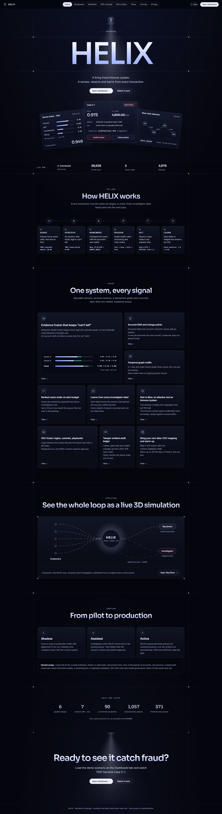
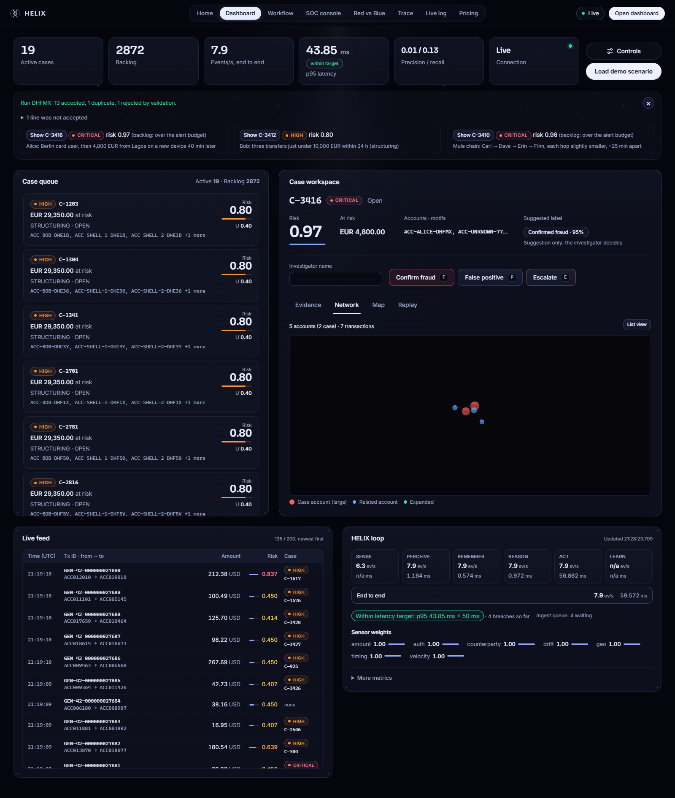
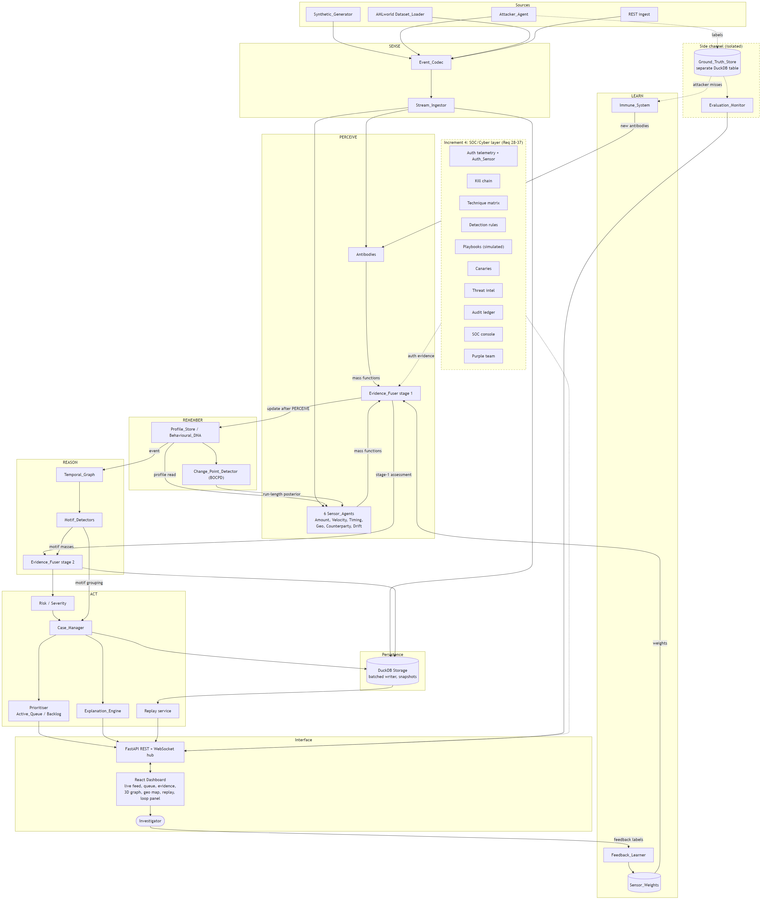
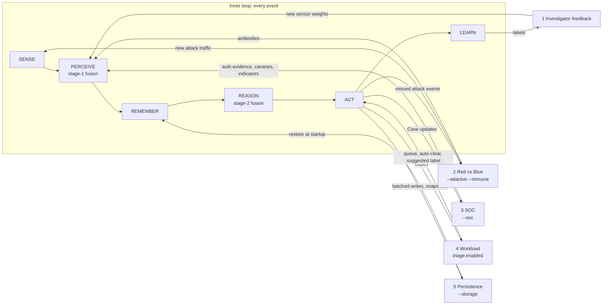
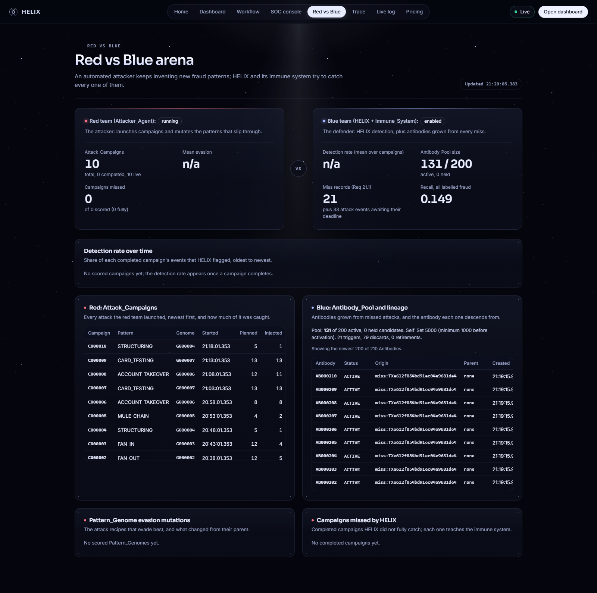
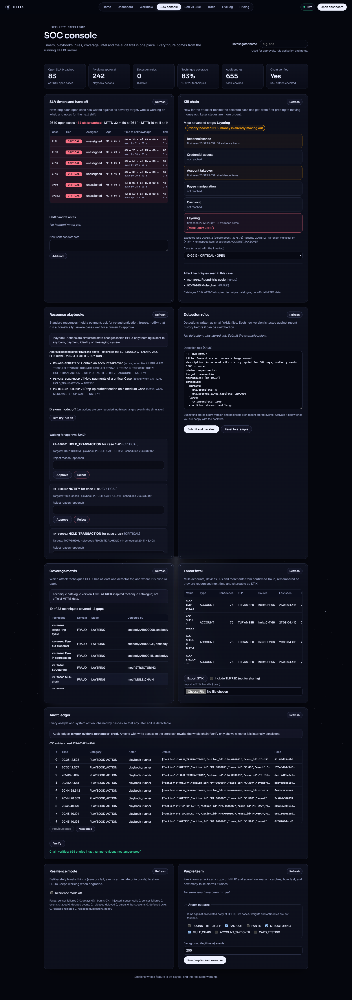
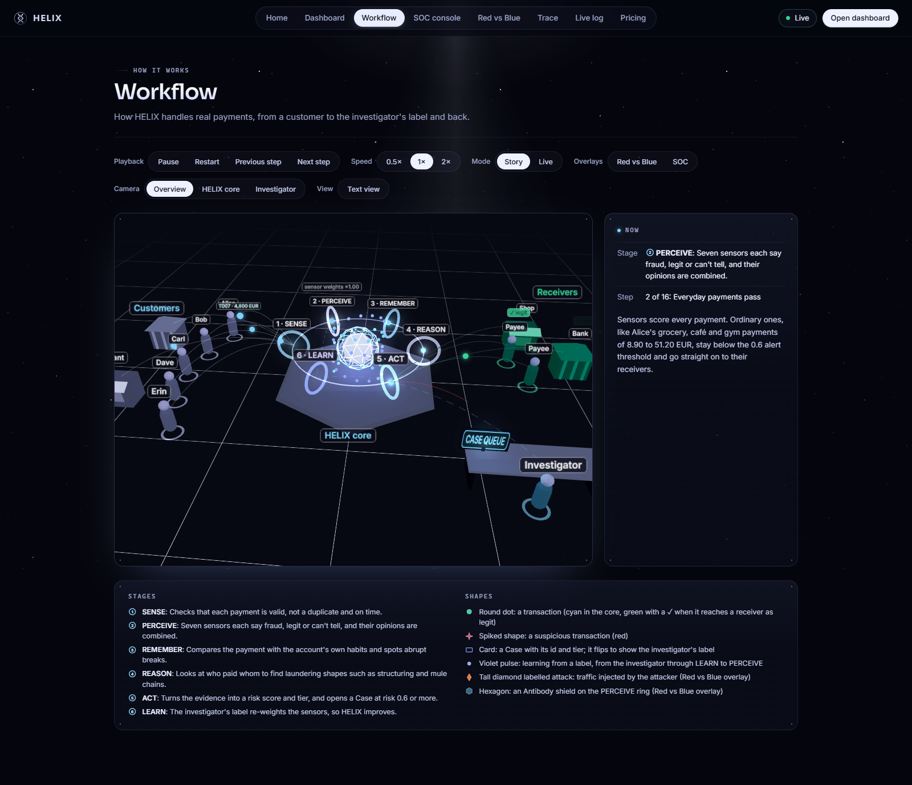
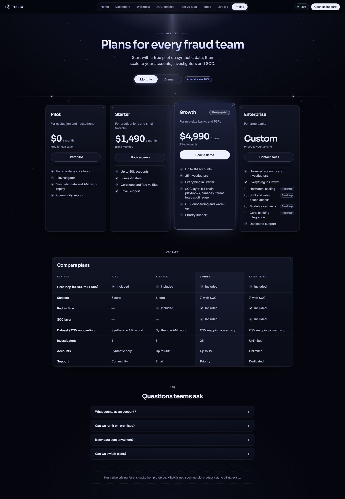

# HELIX: a living fraud immune system

HELIX is a streaming fraud and money-laundering detection system that runs as a closed control loop instead of a nightly batch job. Every transaction goes through six stages, one event at a time: **SENSE → PERCEIVE → REMEMBER → REASON → ACT → LEARN**. Independent sensors give evidence that is fused without hiding uncertainty. Each account carries a behavioural profile that can tell a lasting lifestyle change from an abrupt break. A temporal graph finds multi-account laundering shapes. Investigators get a short, ranked queue of Cases with a deterministic evidence chain. An adversarial attacker keeps probing the system, and an artificial immune system grows new detectors for what it missed. A SOC layer treats fraud as a security incident: login telemetry, kill chains, detection-as-code, simulated response playbooks, canaries, threat intel and a hash-chained audit ledger. It runs on one laptop with synthetic or public benchmark data, and it can stream the IBM AMLworld benchmark or a bank's own CSV export through the same pipeline.





## Contents

- [The story](#the-story) and [How it works](#how-it-works): the idea in one page
- [From scratch to end: what we built](#from-scratch-to-end-what-we-built): the build journey, part by part
- [How one transaction is processed, step by step](#how-one-transaction-is-processed-step-by-step): Alice's account takeover with its real numbers
- [How many stages and loops](#how-many-stages-and-loops): one inner loop, five outer loops
- [Glossary in plain words](#glossary-in-plain-words)
- [Quickstart (Windows, PowerShell)](#quickstart-windows-powershell), [Scenarios](#scenarios), [Evaluation](#evaluation)
- [Using HELIX in an organisation](#using-helix-in-an-organisation), [Data](#data), [Tests](#tests), [Dashboard design](#dashboard-design), [Security](#security), [Known limitations](#known-limitations), [Project structure](#project-structure)

## The story

A mule ring wants to move stolen money out of a customer's account and spread it until it looks clean. Here is what HELIX does at each step. The steps come from the components in this repository. In the demo they are spread over several attacker campaigns and the sample scenario rather than one scripted run.

1. **The break-in.** The ring guesses the victim's password: a burst of `LOGIN_FAILURE`s from one device in one session, then a `LOGIN_SUCCESS` from that new device, then `NEW_PAYEE_ADDED` for a mule account. These are Auth_Events, sent to `POST /api/v1/auth-events` or generated by the Attacker_Agent. HELIX keeps a bounded per-account login history.
2. **SENSE.** A transfer to the new payee arrives. The Stream_Ingestor validates it, de-duplicates it, orders it within the lateness tolerance and applies backpressure if the pipeline falls behind.
3. **PERCEIVE.** Seven sensors each give a Dempster-Shafer mass over {fraud, legit, unknown}: amount, velocity, timing, geo, counterparty, drift and, with the SOC layer on, auth. The amount is far above the account's baseline. The geo sensor sees an impossible travel speed. The counterparty is new. The auth sensor links the failed-login burst, the new device and a new payee that matches this transfer's destination. Learned antibodies add their own masses. The Evidence_Fuser combines everything, discounted by sensor reliability. A missing field stays visible as uncertainty instead of counting as "no risk".
4. **REMEMBER.** The account's Behavioural_DNA (decayed amount, timing, geo, counterparty and channel statistics) and a BOCPD change-point detector say this is an abrupt break, not a gradual relocation or a salary rise. A legitimate regime change becomes the new normal. This break does not.
5. **REASON.** The money moves on: victim → mule 1 → mule 2 → mule 3, each hop slightly smaller and minutes apart. The Temporal_Graph sees a fast pass-through **mule chain**. Other rings show up as cycles, fan-out/fan-in or structuring just under a reporting threshold. Motif evidence is fused in a second stage.
6. **ACT.** The risk score and severity tier open a **Case** that groups the accounts, events and motifs. Cases are bounded in size, and the Prioritiser ranks them under a hard **alert budget**, so only the top Cases reach the Active_Queue. Each Case has an evidence chain with plain-language reasons ("amount 4800.00 vs baseline mean 37.69, z 346.64"; "5196.1 km in 1.17 h"), a related-accounts 3D graph, a geo map and a time-travel replay. With the SOC layer, the Case also gets a **kill chain** (reconnaissance → credential access → account takeover → payee manipulation → cash-out → layering). Its priority is boosted ×1.5 once money is already moving out.
7. **The investigator decides.** HELIX shows a **suggested label** ("Confirmed fraud, confidence 95%, committed evidence supports fraud") marked *suggestion only*. The investigator presses `F` (confirm fraud), `P` (false positive) or `E` (escalate). A batch of similar Cases can be labelled in one step.
8. **LEARN.** The Feedback_Learner re-weights the sensors from the label, within bounds and with rollback. Confirmed fraud also feeds the threat-intel store: the mule accounts, devices and IPs become indicators that are recognised next time and exportable as STIX.
9. **The attacker mutates.** The Attacker_Agent scores which of its pattern genomes got through, then mutates them: fewer hops, smaller amounts, different timing. When a mutated campaign slips past HELIX, the miss detector sees attack events that were not in any admitted Case by their deadline.
10. **The immune system responds.** It clones and mutates candidate **antibodies** from the missed events. It discards any that fire on normal traffic (the self/non-self check against a Self_Set of legitimate events) and activates the ones that catch the new variant. The Red vs Blue arena shows the lineage.
11. **The SOC sees it too.** The ring's transfers touched a **canary**: a decoy account mixed into the attacker's target pool, indistinguishable to the attacker. A canary hit forces a Case. A **response playbook** fires: `HOLD_TRANSACTION` and `NOTIFY` for a critical Case, and `STEP_UP_AUTH` and `FREEZE_ACCOUNT` for a takeover. Actions at tier HIGH and above wait for human approval. All actions are simulated inside HELIX.
12. **Everything is on the record.** Investigator labels, playbook actions and approvals, escalations, weight changes and rule activations go to the **audit ledger**, a SHA-256 hash chain that `Verify` checks end to end.

## How it works



The diagram shows the SOC layer as a dashed side panel. It is fully wired today (`--soc`), and its Auth_Sensor is the seventh PERCEIVE sensor.

| Stage | Component | In plain language |
|---|---|---|
| SENSE | Event_Codec, Stream_Ingestor | Parse and validate JSON or CSV rows, drop duplicates, order late events within a tolerance, slow producers down instead of dropping data. |
| PERCEIVE | Sensor_Agents, Antibodies, Evidence_Fuser (stage 1) | Each sensor says how much it believes "fraud", "legit" or "can't tell". Dempster-Shafer combination keeps "can't tell" separate, discounts each sensor by its learned weight, and falls back to Yager's rule under heavy conflict. |
| REMEMBER | Profile_Store (Behavioural_DNA), Change_Point_Detector | A decayed per-account profile, plus Bayesian Online Change-Point Detection to tell "this account's life changed" from "this account was hijacked". A sensor gives no opinion until an account has 5 events (Minimum_History_Count). |
| REASON | Temporal_Graph, Motif_Detectors, Evidence_Fuser (stage 2) | A sliding-window graph of who paid whom and when. Detectors find round-trip cycles, fan-out, fan-in, structuring and mule chains, and their evidence is fused with stage 1. |
| ACT | Risk, Case_Manager, Prioritiser, Explanation_Engine, Replay | Risk score and tier. Cases bounded to `risk.case_max_accounts` 50, `case_max_events` 500, `case_max_motifs` 100, with overflow Cases when full. Ranking under `prioritiser.alert_budget` (default 20) by expected loss minus investigation cost (`prioritiser.investigation_cost`, default 50). Deterministic evidence chains and time-travel replay. |
| LEARN | Feedback_Learner, Attacker_Agent, Immune_System | Labels re-weight sensors. The attacker evolves fraud genomes against the live system. The immune system grows antibodies for its misses. |
| SOC | Auth_Sensor, kill chain, technique catalogue and coverage matrix, Detection_Rules, Response_Playbooks, Canaries, Indicator_Store, Audit_Ledger, SOC console, purple team, resilience mode | Cyber-fusion on top of the loop (see the SOC console scenario). |
| Side channel | Ground_Truth_Store, Evaluation_Monitor | Labels from the generator, attacker and datasets live here. Detection code cannot read them (see Evaluation). |

The backend is Python 3.10: FastAPI and uvicorn, NumPy, NetworkX, DuckDB and Pydantic. The dashboard is React 18 + Vite + TypeScript, with deck.gl, maplibre and react-force-graph-3d. Everything runs in one process plus the Vite dev server, with no external services.

## From scratch to end: what we built

HELIX was built in the order below (see `.kiro/specs/helix-fraud-immune-system/tasks.md`). Each part solves one problem, and each later part stands on the earlier ones. The examples come from the code, its config defaults, or the sample run described in the next section.

| # | Part | Problem it solves | One-line example |
|---|---|---|---|
| 1 | Event format and ingest (`codec`, `ingest`) | Input is messy: bad values, repeats, late arrivals, floods. | Line `T009` (amount `-20.00`, currency `euro`) is rejected with two named errors. The second `T007` line is reported as a duplicate. |
| 2 | Evidence fusion (`fusion`) | Many detectors each give an opinion, and some say "I can't tell". | Two opinions of 0.60 and 0.50 for fraud combine to 0.759 (worked example below). |
| 3 | Risk and severity (`risk`) | People need one number and a label like HIGH. | Risk = belief + half the uncertainty. Alice's T007: 0.949 + 0.5 × 0.049 = 0.973, tier CRITICAL. |
| 4 | Account memory: Behavioural_DNA and change points (`memory`, `changepoint`) | "Unusual" only means something against this account's own habits. A new job is not a hijack. | Alice's decayed mean amount is 37.69 EUR. T007 is classed as an ABRUPT_BREAK. |
| 5 | Sensors (`sensors`) | Each kind of oddity needs its own specialist. | Geo: 5196.1 km in 1.17 h = 4454 km/h vs a plausible 900 km/h. |
| 6 | Temporal graph and motifs (`graph`, `motifs`) | Laundering hides across many accounts, not in one payment. | Bob's three transfers of 9,650-9,900 EUR form a STRUCTURING motif. |
| 7 | Cases, prioritiser, evidence chain (`cases`, `explain`) | Investigators need a short ranked list with reasons, not thousands of alerts. | Case C-1: expected loss 4,671.76 EUR, priority 4,621.76, reason "amount 4800.00 vs baseline mean 37.69". |
| 8 | Pipeline (`core`) | All parts must run in a fixed order for every event, fast. | T007 went PERCEIVE → ACT in 0.94 ms on this machine. |
| 9 | Synthetic data, AMLworld loader, evaluation (`sim`, `datasets`, `evaluation`) | We need data without real customers, and an honest score. | Labels go to a separate Ground_Truth_Store; an AST test fails the build if detection code reads it. |
| 10 | Storage and replay (`storage`, `replay`) | State must survive a restart, and investigators want to rewind. | Writes are batched every 0.5 s or 1,000 rows; a DNA snapshot is taken every 60 s (default). |
| 11 | API (`api`) | The dashboard and tools need one way in. | `GET /api/v1/trace/T007` returns every stage of one event. |
| 12 | Dashboard (`frontend`) | People understand pictures faster than JSON. | **Load demo scenario** on the Dashboard tab sends the 15 sample lines. |
| 13 | Learning loop (`learn`, `attacker`, `immune`) | Fraud changes, so detection has to change too. | A false-positive label on C-1 lowers four sensor weights from 1.0 to 0.95. |
| 14 | SOC layer (`soc`) | Fraud often starts as a login attack, so security and fraud teams must share one picture. | A takeover Case gets a kill chain and the `PB-ATO-CONTAIN` playbook, with HIGH+ actions waiting for approval. |
| 15 | Integration and hardening | Cases grew without limit, and a restart lost everything. | Cases are capped at 50 accounts, 500 events and 100 motifs; restart restores Cases, weights and DNA. |
| 16 | Showcase views | Judges and managers need a clear, visual story. | Tabs for Home, Dashboard, Workflow (3D simulation), SOC console, Red vs Blue, Trace, Live log and Pricing. |
| 17 | Viability: dataset streaming, onboarding, workload | A bank must be able to plug in its own data and not drown in work. | Warm-up processed 50,000 events in 42.2 s (see Onboarding time); suggested labels, bulk labels and auto-triage cut clicks. |

Size of the result, counted in this repository:

| What | Count |
|---|---|
| Python packages under `backend/helix` | 23 (112 `.py` files) |
| Backend test files (`tests/**/test_*.py`) | 95 |
| Backend tests collected (`pytest --collect-only -q`) | 1,057 of 1,060 (3 perf tests deselected by default) |
| Last full backend run | 1,057 passed |
| Frontend test files | 39 vitest files + 1 Playwright spec (2 tests) |
| Frontend vitest tests (last full run) | 371 |
| Requirements in `requirements.md` | 41 |
| Correctness properties in `design.md` | 90 |

## How one transaction is processed, step by step

This section follows one real event: **T007, Alice's account takeover**. The numbers come from an in-process run of `docs/sample_transactions.jsonl`. It used the same setup as `backend/tests/api/test_trace_api.py`: FastAPI `TestClient`, `HelixConfig(sensors=SensorConfig(min_history_count=5))` (5 is also the default), a manual simulation clock and a constant sensor clock. Every other setting is the built-in default. The trace came from `GET /api/v1/trace/T007`.

Alice is a Berlin card user. T001-T006 are her small grocery, café and gym payments (8.90 to 51.20 EUR). Then T007 arrives:

```json
{"tx_id":"T007","ts":"2024-06-05T11:20:00Z","src":"ACC-ALICE","dst":"ACC-UNKNOWN-77","amount":"4800.00","currency":"EUR","channel":"online","lat":6.52,"lon":3.38,"device_id":"DEV-X9"}
```

That is 4,800 EUR, sent online from Lagos on a new device to a payee she has never paid.

Think of an airport security line. Every passenger goes through the same six checkpoints in the same order. Each checkpoint adds a note to the passenger's file. At the end, a supervisor decides who gets a closer look.

```text
 T007 ──► SENSE ──► PERCEIVE ──► REMEMBER ──► REASON ──► ACT ──► LEARN
          valid?    6 sensors    vs Alice's   graph +    risk,    investigator
          dup?      fused        habits;      motifs     tier,    label →
          late?     (stage 1)    change pt    (stage 2)  Case     new weights
          ✔ new     Bel 0.949    ABRUPT_      none       0.973
                                 BREAK                   CRITICAL, C-1
```

### SENSE: is this a real, new, well-formed event?

The Event_Codec checks every field. The Stream_Ingestor drops repeats and puts events in time order. Three lines from the sample show the three outcomes:

| Line | HTTP status | Result |
|---|---|---|
| First `T007` | 202 | `accepted`, in order, lateness 0 s |
| Second `T007` (same id) | 202 | `duplicate`: acknowledged, not processed again |
| `T009` | 422 | `invalid Transaction_Event`: `amount` must be ≥ 0.01 (it was -20.00), and `currency` must be three capital letters (it was `euro`) |

Of 15 lines, 13 were accepted, 1 was a duplicate and 1 was rejected. Defaults: events up to 300 s late are re-ordered (`ingest.lateness_tolerance_s`), ids are remembered for 7 days (`ingest.dedup_ttl_s`), and producers are slowed down at 10,000 queued events (`ingest.backpressure_limit`) instead of losing data.

### PERCEIVE: what does each specialist think?

Each Sensor_Agent gives a mass function: how much it believes "fraud", "legit" or "can't tell". The three always add up to 1. A sensor stays silent ("can't tell" = 1) until the account has 5 events. Alice has 6 before T007, so every sensor can judge her. T001 is shown beside it as a normal comparison: it was Alice's first event, so every sensor said "can't tell".

| Sensor | T007 fraud / legit / can't tell | Why (T007) | T001 |
|---|---|---|---|
| amount | 0.700 / 0.000 / 0.300 | 4800.00 vs baseline mean 37.69 (sd 13.74), z = 346.64 | 0 / 0 / 1 (no history) |
| geo | 0.638 / 0.000 / 0.362 | 5196.1 km in 1.17 h = 4454 km/h vs plausible 900 km/h | 0 / 0 / 1 (no last location) |
| counterparty | 0.350 / 0.000 / 0.650 | ACC-UNKNOWN-77 not seen before (3 known payees) | 0 / 0 / 1 (no history) |
| timing | 0.300 / 0.000 / 0.700 | 11:00 UTC on Wednesday; Alice's frequency for that hour is 0.000 | 0 / 0 / 1 (no history) |
| velocity | 0.000 / 0.041 / 0.959 | 2 events in 1 h vs 1.00 expected; mildly normal | 0 / 0 / 1 (no history) |
| drift | 0.000 / 0.000 / 1.000 | no change point in the state before this event | 0 / 0 / 1 (no history) |
| **Stage-1 fused** | **0.949 / 0.002 / 0.049** | belief 0.949, plausibility 0.998, conflict 0.039 | belief 0, plausibility 1, uncertainty 1 |

**How the opinions are combined (Dempster-Shafer).** Suppose sensor A says (fraud 0.60, legit 0.10, unknown 0.30) and sensor B says (0.50, 0.20, 0.30). Multiply every pair. Pairs that agree, or where one side says "unknown", keep their product. Pairs that clash (fraud × legit) are **conflict**: 0.60 × 0.20 + 0.10 × 0.50 = 0.17. Throw the conflict away and rescale the rest by 1 - 0.17 = 0.83. The result is fraud 0.759, legit 0.133, unknown 0.108. Two moderate "probably fraud" votes became a stronger one. We checked this with HELIX's own `helix.fusion.fuse` at sensor weight 1.0, which is every sensor's starting weight: it gives K = 0.170, fraud 0.759, legit 0.133, unknown 0.108. HELIX first **discounts** each opinion by its sensor weight w: it keeps w × fraud and w × legit and moves the rest to "unknown". At w = 0.9 for both sensors the same example gives K = 0.138 and fraud 0.707, legit 0.135, unknown 0.159. If conflict ever exceeds 0.95 (`fusion.high_conflict`), HELIX switches to Yager's rule and moves the conflict to "unknown" instead of rescaling.

**Why "unknown" is kept separate.** A plain probability would have to call T001 "50% fraud" or "safe". Both are wrong: HELIX simply knows nothing about Alice yet. With "unknown" kept separate, T001 has belief 0 and plausibility 1. Its risk is exactly 0.5 (belief + half the uncertainty), which is below the 0.6 alert threshold, so no Case is opened. A missing field works the same way: T006 has no location, so the geo sensor said "can't tell" for it, not "safe".

### REMEMBER: is this normal for Alice?

The Profile_Store keeps Alice's Behavioural_DNA: decayed averages (half-life 30 days by default) of her amounts, hours, places, payees and channels. The sensors above read it *before* T007 is added. Then T007 is added, and the change-point detector (BOCPD) asks whether her behaviour just broke.

| Check | Result for T007 |
|---|---|
| Amount vs habit | mean 37.69, sd 13.74 → z 346.64 |
| Payees | 3 known; ACC-UNKNOWN-77 is new |
| Place | last seen in Berlin; now Lagos, 5196.1 km away |
| Time | hour frequency 0.000, weekday frequency 0.341 |
| Change point | **ABRUPT_BREAK**, short-run mass 0.929, start at T007 |

The default change-point threshold is 0.5 (`changepoint.threshold`). A break that keeps going for 10 events (`changepoint.regime_confirmation_count`) is treated as a new normal, such as a move or a salary rise. A single break like T007 stays suspicious.

### REASON: is Alice part of a bigger pattern?

The Temporal_Graph holds who paid whom over a 7-day window (`graph.window_s` = 604,800 s). Motif detectors look for laundering shapes, and their evidence is fused with stage 1 in a second stage. T007 matched no motif, so its stage-2 result equals stage 1 (belief 0.949). Two other groups in the sample did:

| Group | Events | Motif | Motif mass (fraud / unknown) | Stage-2 belief | Risk | Tier |
|---|---|---|---|---|---|---|
| Bob | T010-T012: 9,800, 9,650, 9,900 EUR to three shell accounts within 24 h | STRUCTURING (fires at T012) | 0.6 / 0.4 | 0.60 | 0.80 | HIGH |
| Mule chain | T013-T015: Carl → Dave → Erin → Finn, 5,000 → 4,600 → 4,300 EUR, 25 and 23 min apart | MULE_CHAIN (fires at T014 and T015) | 0.7 / 0.3 | 0.70 | 0.85 | HIGH |

Bob and the mule accounts each have fewer than 5 events, so their sensors all said "can't tell" (risk 0.5). Only the graph caught them. That is the reason for having a REASON stage.

### ACT: open a Case, rank it, explain it

Risk becomes a tier with these default bands (`risk.bands`). Below `risk.alert_threshold` 0.6 no Case is opened.

| Risk | < 0.6 | 0.6-0.7 | 0.7-0.8 | 0.8-0.9 | 0.9-1.0 |
|---|---|---|---|---|---|
| Tier | no Case | LOW | MEDIUM | HIGH | CRITICAL |

T007 (risk 0.973) opened **Case C-1**, tier CRITICAL, with accounts ACC-ALICE and ACC-UNKNOWN-77. Related events are grouped into one Case, so an investigator labels a story, not single payments. Bob's three transfers became C-2, and the mule chain became C-3. T010 and T013 joined their Cases once the motif linked them.

Each Case gets an **expected loss** (risk × amount at risk) and a **priority** (expected loss minus the 50.00 investigation cost, `prioritiser.investigation_cost`). Up to 20 Cases (`prioritiser.alert_budget`) are admitted to the Active_Queue per 3,600 s period (`prioritiser.period_s`). The rest wait in the Backlog.

| Case | Tier | Risk | At risk (EUR) | Expected loss | Priority | Placement | Suggested label |
|---|---|---|---|---|---|---|---|
| C-2 (Bob) | HIGH | 0.80 | 29,350.00 | 23,480.00 | 23,430.00 | ACTIVE | none (belief 0.60 is between the thresholds) |
| C-3 (mule chain) | HIGH | 0.85 | 13,900.00 | 11,815.00 | 11,765.00 | ACTIVE | confirmed fraud, confidence 0.70 |
| C-1 (Alice) | CRITICAL | 0.973 | 4,800.00 | 4,671.76 | 4,621.76 | ACTIVE | confirmed fraud, confidence 0.95 |

Priority follows money at stake, not tier alone: Bob's HIGH Case ranks above Alice's CRITICAL one because more money is at risk. All three fit inside the budget of 20.

The evidence chain for C-1 is deterministic: the same input always gives the same text. From `GET /api/v1/cases/C-1/evidence`:

```text
CRITICAL | risk 0.973 | Bel 0.949 Pl 0.998 U 0.049 K 0.039 | at risk 4800.00 EUR
Amount: amount 4800.00 vs baseline mean 37.69 (sd 13.74, z 346.64) | weight 1.00, F' 0.700 vs L' 0.000, tx T007
Geo: 5196.1 km in 1.17 h = 4454 km/h vs plausible 900 km/h | weight 1.00, F' 0.638 vs L' 0.000, tx T007
Counterparty: payee ACC-UNKNOWN-77 not seen before (baseline 3 known counterparties) | weight 1.00, F' 0.350 vs L' 0.000, tx T007
Timing: 11:00 UTC on Wed vs baseline frequency hour 0.000, weekday 0.341 (p 0.0000) | weight 1.00, F' 0.300 vs L' 0.000, tx T007
Mitigating - Velocity: events 1h 2 vs expected 1.00; 24h 4 vs expected 2.43 (ratio 2.00) | weight 1.00, F' 0.000 vs L' 0.041, tx T007
```

The chain also records the ABRUPT_BREAK change point, and it lists drift under "insufficient evidence". The suggested label reads "Belief 0.95, plausibility 1.00, unknown 0.05: committed evidence supports fraud" (fraud at belief ≥ 0.7, false positive at ≤ 0.2, `triage.suggest_*`). It is a suggestion only. The investigator decides.

### LEARN: the investigator's label changes the sensors

A label needs the Case in review. Labelling C-1 while it was still OPEN returned 409 "case status is OPEN, labels need IN_REVIEW". After `POST /cases/C-1/open` as investigator "ana", the label `CONFIRMED_FRAUD` was accepted. The Feedback_Learner moves each sensor that pointed at fraud (fraud mass > legit mass in the chain) by the learning rate 0.05 (`learn.learning_rate`), kept within 0.1 and 1.0 (`learn.weight_lower`, `learn.weight_upper`). Sensor weights from `GET /metrics` → `weights`:

| Sensor | Before | After CONFIRMED_FRAUD on C-1 | After FALSE_POSITIVE on C-1 (separate fresh run) |
|---|---|---|---|
| amount | 1.0 | 1.0 | 0.95 |
| counterparty | 1.0 | 1.0 | 0.95 |
| geo | 1.0 | 1.0 | 0.95 |
| timing | 1.0 | 1.0 | 0.95 |
| velocity | 1.0 | 1.0 | 1.0 (pointed at legit) |
| drift | 1.0 | 1.0 | 1.0 (said "can't tell") |

Every weight starts at the 1.0 ceiling, so confirming fraud cannot raise them further. To show the mechanism moving, we ran the same scenario again from scratch and labelled C-1 as a false positive instead. The four sensors that had blamed Alice dropped to 0.95. Their next opinions are discounted a little more. Every change is recorded and can be rolled back (`POST /api/v1/weights/rollback`).

### How long it took

Stage timings for T007, measured on this development machine (in-process, no Storage, Python 3.10). The pipeline times PERCEIVE to ACT for each event. SENSE (parsing, validation, de-duplication) runs in the ingestor before that and is not part of this breakdown.

| Stage | PERCEIVE | REMEMBER | REASON | ACT | End to end |
|---|---|---|---|---|---|
| T007 (ms) | 0.174 | 0.196 | 0.111 | 0.456 | 0.938 |

Over all 13 accepted events in one run, `GET /api/v1/latency` reported an end-to-end p50 of 0.76 ms and a maximum of 1.56 ms. The design target is p95 ≤ 50 ms. A tiny sample like this says nothing about load: a dense graph makes REASON much slower (see Known limitations).

## How many stages and loops

HELIX has **one inner loop** that every event runs through, and **five outer loops** that improve and protect it over time.

**Inner loop, per event, 6 stages in this order:** SENSE → PERCEIVE (sensors, then stage-1 fusion) → REMEMBER (DNA and change point) → REASON (graph, motifs, then stage-2 fusion) → ACT (risk, tier, Case, priority, evidence) → LEARN (hand-off to the outer loops). Fusion happens twice. Stage 1 combines the per-transaction sensors, antibodies and, with `--soc`, rules, canaries and indicators. Stage 2 adds motif evidence on top of stage 1.

**Outer loops:**

| Loop | Switch | How often (defaults) | Trigger | What it changes | Example |
|---|---|---|---|---|---|
| 1. Investigator feedback | always on | on every label | `CONFIRMED_FRAUD` or `FALSE_POSITIVE` on a Case in review | Sensor and motif weights (±0.05 within [0.1, 1.0]); with `--soc`, threat-intel indicators from confirmed fraud | FP on C-1: amount, counterparty, geo, timing 1.0 → 0.95 |
| 2. Red vs Blue | `--attacker`, `--immune` | a new campaign every 300 s of stream time (`attacker.launch_interval_s`); miss check every 0.5 s (`immune_tick_s`) with a 600 s deadline (`immune.detection_deadline_s`) | attack events not in an admitted Case by the deadline | Attacker mutates its best genomes (top 5, 3 children each). Immune system clones up to 10 candidate antibodies per miss and activates those that pass the Self_Set check (needs 1,000 legit events) | A mule-chain genome with fewer hops slips through; a new antibody catches the variant |
| 3. SOC | `--soc` | on every Auth_Event and every Case update | 5 failed logins in 600 s, a new device or payee, a canary touch | Auth_Sensor evidence, kill-chain stage (×1.5 priority from cash-out on), playbook actions (HIGH+ wait for approval), audit entries | Takeover Case → `PB-ATO-CONTAIN`: `STEP_UP_AUTH`, `FREEZE_ACCOUNT` waiting for approval |
| 4. Workload | budget always on; auto-triage needs `triage.enabled: true` | budget period 3,600 s; triage sweep every 60 s of stream time, closing LOW Cases idle for 86,400 s (`triage.auto_clear_after_s`) | period boundary; sweep time; each Case update for the suggested label | Active_Queue vs Backlog; AUTO_CLEARED closures (never used as labels); suggested label | 3 sample Cases fit in a budget of 20; C-1 suggests confirmed fraud at 0.95 |
| 5. Persistence | `--storage <file>` | writes flushed every 0.5 s or every 1,000 rows; DNA and change-point snapshot every 60 s (`storage.snapshot_interval_s`) | timer, buffer size, and startup | DuckDB file; at startup restores DNA, change points, Cases, weights and position | `restoring state: N cases, latest event …` in the startup log |

The metrics feed on `/ws/metrics` ticks every 0.5 s (`metrics_interval_s`) and the generator feeds events every 0.05 s (`generator_tick_s`). Both are AppState defaults in `api/state.py`.



## Glossary in plain words

| Term | Meaning |
|---|---|
| Transaction_Event | One payment: who paid whom, how much, when, and optionally where, on which device and channel. |
| Sensor_Agent | A specialist that looks at one thing only, such as amount, place or timing. Like one security officer who only checks passports. |
| Mass function | A sensor's opinion split into three parts that add up to 1: fraud, legit and "can't tell". |
| Belief / plausibility | Belief is how much evidence points firmly at fraud. Plausibility is how high fraud *could* be if every "can't tell" turned out to be fraud. The truth lies between them. |
| Uncertainty | The "can't tell" part: plausibility minus belief. High uncertainty means "we don't know yet", not "safe". |
| Conflict | How much the sensors contradict each other. Very high conflict (above 0.95) switches to a safer combination rule. |
| Behavioural_DNA | A running summary of one account's habits. Like a shop owner who knows a regular's usual order. |
| Change point | The moment an account's behaviour breaks from its past. A lasting change (a move) becomes the new normal; an abrupt break (a takeover) does not. |
| Temporal graph | A map of who paid whom and when, over the last 7 days. |
| Round-trip cycle (ROUND_TRIP) | Money that comes back to where it started through up to 6 accounts within 72 h. |
| Fan-out (FAN_OUT) | One account sends money to at least 8 different accounts within 24 h, like a sprinkler. |
| Fan-in (FAN_IN) | At least 8 accounts send money to one account within 24 h, like a funnel. |
| Structuring (STRUCTURING) | At least 3 transfers within 48 h, each just under the 10,000 reporting threshold (90-100% of it), to avoid a report. |
| Mule chain (MULE_CHAIN) | Money passed quickly down a line of accounts, each hop at least 80% of the one before and within 60 minutes. Like a bucket brigade. |
| Case | A folder that groups related accounts, events and patterns, so one decision covers one story. Bounded to 50 accounts and 500 events. |
| Severity tier | LOW, MEDIUM, HIGH or CRITICAL, set by the risk score bands (0.6, 0.7, 0.8, 0.9). |
| Alert budget | The maximum number of Cases (default 20 per hour) that reach investigators. Like a clinic that books only as many patients as it has doctors. |
| Expected loss | Risk × money at risk. Alice's C-1: 0.973 × 4,800 = 4,671.76 EUR. |
| Evidence chain | The ordered list of every piece of evidence behind a Case, with plain reasons. Same input, same text. |
| Feedback label | The investigator's verdict on a Case: confirmed fraud or false positive. |
| Sensor weight | How much HELIX trusts a sensor, from 0.1 to 1.0. Wrong sensors lose trust after false positives. |
| Attacker genome | The recipe for one simulated fraud pattern: hops, amounts, timing. |
| Campaign | One run of an attacker genome against HELIX, scored as caught or missed. |
| Antibody | A small learned detector grown from fraud HELIX missed. Like a vaccine made from the virus that got through. |
| Self_Set | A sample of normal traffic used to test new antibodies. An antibody that fires on normal customers is thrown away. |
| Kill chain | The stages of an attack in order: reconnaissance, credential access, account takeover, payee change, cash-out, layering. |
| Canary | A decoy account, payee or device that no real customer uses. Touching one is a sure sign of an attacker, like a dye pack in a bank bag. |
| Playbook | A pre-written response, such as "hold the payment and notify". In HELIX all actions are simulated, and HIGH+ actions need human approval. |
| Indicator | A known-bad account, device or IP taken from confirmed fraud and recognised next time. Exportable as STIX. |
| Audit ledger | A tamper-evident log of every human and system action, chained with SHA-256 so any edit breaks the chain. |
| Ground truth | The real answer (fraud or not) for test data. Kept where detection code cannot read it, so the score is honest. |
| Warm-up | Replaying history at full speed to learn every account's habits before going live, with no Cases opened. |
| Column mapping | A YAML file that tells HELIX which column in a bank's CSV export means amount, time, payer and so on. |
| Auto-triage | An optional sweep that closes idle LOW-tier Cases. They are counted separately and never treated as labels. |
| Suggested label | HELIX's proposed verdict with its confidence. It never changes the Case; the investigator decides. |

## Quickstart (Windows, PowerShell)

Prerequisites: Python 3.10 (the backend pins `>=3.10,<3.11`), Node.js 18+ (tested with Node 24), and Microsoft Edge for the browser smoke test.

The workspace path may contain spaces and `&`. Quote paths and prefer the scripts below. npm's `.cmd` shims break on `&`, so `frontend/package.json` scripts call `node node_modules/...` directly, and the scripts start processes without `cmd.exe`.

### Install

From the repository root:

```powershell
py -3.10 -m venv backend\.venv
backend\.venv\Scripts\python.exe -m pip install -r backend\requirements-dev.txt
cd frontend
npm install
cd ..
```

`requirements.txt` holds the pinned runtime dependencies (FastAPI, uvicorn, pydantic, numpy, networkx, DuckDB, sortedcontainers, PyYAML). `requirements-dev.txt` adds pytest, Hypothesis, pytest-asyncio and httpx.

### Run the full demo (one command)

```powershell
powershell -ExecutionPolicy Bypass -File scripts\demo.ps1 -Soc -Attacker -Immune
```

This starts the API_Server on `127.0.0.1:8000` with the synthetic generator, the attacker, the immune system and the SOC layer, and the dashboard dev server. Open **http://localhost:5173**. The CORS and WebSocket origin allow-list accept only that origin; `http://127.0.0.1:5173` also works through the dev proxy. Ctrl+C stops both. Without switches you get the core loop only.

### Manual alternative (two terminals)

```powershell
# terminal 1
cd backend
.venv\Scripts\python.exe -m helix.api --config config\demo.json --storage data\helix.duckdb --generator --soc --attacker --immune
# terminal 2
cd frontend
npm run dev
```

The OpenAPI docs are at http://127.0.0.1:8000/docs.

### `python -m helix.api` flags

| Flag | Effect |
|---|---|
| `--config <file>` | HelixConfig YAML/JSON (built-in defaults when omitted) |
| `--storage <file>` | DuckDB file. State is restored from it at startup. In-memory only when omitted. |
| `--host`, `--port` | override `api.bind_host` / `api.port` (default `127.0.0.1:8000`) |
| `--generator` | start the Synthetic_Generator at startup |
| `--no-generator` | do not configure the generator at all |
| `--seed <n>` | generator / attacker seed (default `generator.default_seed`) |
| `--attacker` | attach and start the Attacker_Agent |
| `--immune` | enable the Immune_System and its miss detection |
| `--soc` | enable cyber fusion and the SOC components |
| `--dataset amlworld\|csv` | stream a dataset file into the live pipeline (excludes `--generator`) |
| `--trans <csv>` | transactions file (AMLworld `*_Trans.csv` or a bank export) |
| `--patterns <txt>` | AMLworld `*_Patterns.txt` for per-pattern metrics (amlworld only) |
| `--mapping <yaml>` | Column_Mapping (required with `--dataset csv`) |
| `--speed max\|1-1000000` | `max` (default: as fast as backpressure allows) or a multiplier on recorded time |
| `--max-rows <n>` | stream only the first n rows in timestamp order (default 20000; 0 = no limit) |
| `--warmup` | Warm_Up_Mode: build DNA, change-point and graph state at max speed with Case creation suppressed |
| `--warmup-until <ISO time>` | with `--warmup`: warm up on rows before this time only, then go live (naive = UTC) |
| `--allow-missing-ws-origin` | accept WebSocket handshakes without `Origin` (non-browser clients). A wrong `Origin` is still rejected. |
| `--log-level` | uvicorn / HELIX log level (default `info`) |

### `scripts\demo.ps1` flags

| Flag | Effect |
|---|---|
| `-Soc` | `--soc` |
| `-Attacker` | `--attacker` |
| `-Immune` | `--immune` |
| `-NoGenerator` | don't start the generator at startup (start it from the UI) |
| `-Config <file>` | HelixConfig file, relative to `backend\` (default `config\demo.json`: 20,000 accounts at 10 ev/s) |
| `-Storage <file>` | DuckDB file relative to `backend\` (default `data\demo.duckdb`, recreated each run) |
| `-Keep` | keep the default DuckDB file (needed for restart restore) |
| `-Dataset amlworld\|csv` | stream a dataset instead of the generator. Requires `-Trans`. |
| `-Trans`, `-Patterns`, `-Mapping` | dataset files, checked before anything starts |
| `-Speed`, `-MaxRows` | `--speed`, `--max-rows` |
| `-Warmup`, `-WarmupUntil <ISO time>` | `--warmup`, `--warmup-until` |

## Scenarios

All scenarios use the dashboard at http://localhost:5173. Its tabs are **Home**, **Dashboard**, **Workflow**, **SOC console**, **Red vs Blue**, **Trace**, **Live log** and **Pricing**. The app opens on Home; **Open dashboard** (top right) jumps to the Dashboard tab.

### 1. Sample scenario: Alice, Bob and a mule chain

```powershell
powershell -ExecutionPolicy Bypass -File scripts\demo.ps1
```

On the Dashboard tab, press **Load demo scenario**. It sends the 15 lines of `docs/sample_transactions.jsonl` through `POST /api/v1/events`. Timestamps are shifted to now and ids get a run suffix, so you can load it repeatedly.

- **Alice** (`ACC-ALICE`): a Berlin card user, then 4,800 EUR from Lagos on a new device 40 minutes later. Expect a CRITICAL Case (risk about 0.97) with amount, geo (about 4,450 km/h vs a plausible 900 km/h), counterparty and timing reasons.
- **Bob**: three transfers just under 10,000 EUR within 24 h. Expect a HIGH Case with a STRUCTURING motif.
- **Mule chain**: Carl → Dave → Erin → Finn, each hop slightly smaller, about 25 minutes apart. Expect a HIGH Case with a MULE_CHAIN motif.
- The result line reads "13 accepted, 1 duplicate, 1 rejected by validation". The duplicate and the invalid line are deliberate.

Press **Show C-…** next to a scenario Case. Read the tier, the suggested label, the evidence chain, the 3D network, the geo map and the replay slider. Type an investigator name and press **Confirm fraud**. The label goes to the Feedback_Learner, and the HELIX loop panel shows the Sensor_Weights. On a fresh start every weight is already at its upper bound of 1.0, so a confirmed-fraud label leaves them at 1.0. A **False positive** label lowers each sensor that pointed at fraud by 0.05 (see LEARN in the walkthrough below).

### 2. Red vs Blue: attacker and immune system

```powershell
powershell -ExecutionPolicy Bypass -File scripts\demo.ps1 -Attacker -Immune
```

Open **Red vs Blue**. The red side lists Attack_Campaigns (pattern, genome, planned and injected events). The blue side shows the Antibody_Pool and its lineage. The scoreboard tracks detection rate, mean evasion, campaigns missed and recall over all labelled fraud. Campaigns are scored once their deadline passes, and antibodies activate only after the Self_Set has 1,000 legitimate events, so let it run for several minutes. Over time, look for evasion mutations on genomes that got through and new antibodies after misses.



### 3. SOC console

```powershell
powershell -ExecutionPolicy Bypass -File scripts\demo.ps1 -Soc -Attacker -Immune
```

Then press **Load demo scenario** on the Dashboard tab and open **SOC console**. Type an investigator name at the top; it is used for approvals, rule activation and notes. Every section loads its own data and has its own error boundary.

- **SLA timers and handoff**: time to acknowledge or resolve per open Case against its tier target, plus shift handoff notes.
- **Kill chain**: stages reached by the selected Case, the most advanced stage, the ×1.5 priority boost once money is moving out, and the techniques seen.
- **Response playbooks**: `PB-ATO-CONTAIN`, `PB-CRITICAL-HOLD`, `PB-MEDIUM-STEPUP`. Actions at tier HIGH and above wait in "Waiting for approval" (Approve / Reject). Dry-run mode records actions without changing anything.
- **Detection rules**: submit a YAML rule (an example is pre-filled), backtest it on recent stored events, then activate or deactivate a version. To load the bundled rules in `backend\rules\` at startup, set `"soc": {"enabled": true, "rules_dir": "rules"}` in the config file.
- **Coverage matrix**: an ATT&CK-inspired technique catalogue (not official MITRE data) showing which techniques have a detector. The bundled catalogue reports 19 of 23 covered, 4 gaps.
- **Threat intel**: indicators harvested from Cases labelled confirmed fraud, STIX export (TLP:RED excluded unless ticked) and size-limited, schema-validated STIX import.
- **Audit ledger**: every recorded action. **Verify** walks the hash chain and reports "Chain verified: N entries intact" or the first broken entry.
- **Resilience mode**: inject sensor failures, delays and bursts and watch HELIX degrade gracefully.
- **Purple team**: fire chosen attack patterns plus background traffic at an isolated copy of HELIX and get a scorecard (caught, time to detect, false alarms). Live Cases, weights and antibodies are not touched.

Canary hits (`GET /api/v1/soc/canaries/hits`) appear when an attacker campaign touches a decoy. The canary list itself is never served.



### 4. Transaction trace

Open **Trace** and enter a transaction id from the live feed (for example `GEN-42-000000000046`) or a scenario id such as `T007-<suffix>`. `GET /api/v1/trace/{tx_id}` shows the event's path through every stage: SENSE (received time, lateness), PERCEIVE (each sensor's mass, features and vacuous reason, plus the stage-1 assessment), REMEMBER, REASON (motif hits), ACT (risk, tier, Case) and LEARN (label). Events still held by the pipeline get the full trace. Older events fall back to stored assessments when Storage is configured. Unknown ids return 404.

### 5. Live log

Open **Live log** for a scrolling, `aria-live` log of what the backend does: INGESTED, REJECTED, DUPLICATE, CASE OPENED, CASE UPDATED, FEEDBACK, ANTIBODY, ANTIBODY RETIRED and PLAYBOOK. **Pause** holds new entries (and counts them); **Resume** releases them. If the immune system or playbooks are off, the log says so.

### 6. Workflow simulation

Open **Workflow** (or **Watch it work** on Home). It is an animated 3D scene of the whole HELIX loop, built from primitives in code: no models, textures or fonts are downloaded. The 3D code is lazy-loaded, so it costs nothing until the tab is opened.



What the scene shows:

- **Customers** on the left (Alice, Bob, Carl, Dave, Erin) send transactions as particles into the **HELIX core** in the middle.
- The core has **six numbered stage rings**: 1 SENSE, 2 PERCEIVE, 3 REMEMBER, 4 REASON, 5 ACT, 6 LEARN. Each particle passes through them in order, and the ring for the current step lights up.
- **Legit payments** are round dots: cyan inside the core, green with a ✓ when they leave for the **Receivers** on the right (shop, payee, bank).
- **Suspicious payments** are red spiked shapes. They do not leave for a receiver.
- When ACT opens a Case, a **Case card** with its id and tier flies to the **Case queue** and on to the **Investigator** at the front. The card flips to show the investigator's label (confirmed fraud or false positive).
- The label sends a violet **learning pulse** from the investigator back through LEARN to PERCEIVE: the sensor weights change.

The **Now** panel beside the scene names the current stage, the step (for example "2 of 16") and what is happening, and a legend under the scene explains every stage and shape in words.

**Modes.** **Story** (the default) plays a scripted 76-second loop at 1× that runs offline: Alice's T007 becomes Case C-1 CRITICAL and is confirmed as fraud, Bob's three transfers become C-2 HIGH (STRUCTURING), the mule chain becomes C-3 HIGH (MULE_CHAIN), and the loop closes. **Live** draws a sample of the real event feed and Cases from the dashboard's WebSocket store instead. If the connection is down, it says "Live data unavailable: showing the story" and keeps playing the story.

**Overlays.** **Red vs Blue** adds the attacker's injected traffic (tall diamonds) that slips through, then an Antibody shield (hexagon) that grows on the PERCEIVE ring and blocks the next attempt. **SOC** adds a probe that touches a canary decoy account and a playbook HOLD on Case C-3.

**Controls.** Playback: **Pause** / **Play**, **Restart**, and in Story mode **Previous step** / **Next step**. Speed: **0.5×**, **1×**, **2×**. Camera: **Overview**, **HELIX core**, **Investigator** (drag to orbit as well). **Text view** replaces the scene with a numbered list of all 16 steps, with the current one marked. A screen-reader-only live region announces each new step.

**Reduced motion and fallbacks.** With `prefers-reduced-motion: reduce` the tab opens paused on a settled first step; Play still works. Without WebGL, or if the scene fails, it shows "3D view unavailable: showing the text view" and the Text view instead. The scene only renders frames while it plays and the tab is visible.

### 7. Pricing

Open **Pricing** for the plans page: Pilot, Starter, Growth and Enterprise, a Monthly / Annual toggle, a comparison table and an FAQ. **The plans and prices are illustrative only.** HELIX is a hackathon prototype, not a commercial product, and no billing exists. Roadmap items (horizontal scaling, SSO and role-based access, model governance, core-banking integration) are marked as such, matching [Using HELIX in an organisation](#using-helix-in-an-organisation).



### 8. AMLworld live stream

Download the dataset first (see Data). Then:

```powershell
powershell -ExecutionPolicy Bypass -File scripts\demo.ps1 -Dataset amlworld -Trans data\HI-Small_Trans.csv -Patterns data\HI-Small_Patterns.txt -MaxRows 20000
```

The server loads the file, writes every label and pattern membership to the Ground_Truth_Store before the first event, and streams the rows through the live pipeline. The dashboard's loop panel shows **Dataset stream** progress. `GET /api/v1/dataset` reports status (LOADING → WARMING_UP → STREAMING → DONE), rows read and skipped (with reasons), and the evaluation block: precision, recall, captured fraud fraction, and per-pattern-type detection rate, recall and precision. Pattern types with no matching HELIX motif are reported as unmapped.

A headless alternative without the dashboard prints the same summary:

```powershell
powershell -ExecutionPolicy Bypass -File scripts\aml.ps1 -Name HI-Small -MaxRows 20000
```

`aml.ps1` flags: `-Name <prefix>` (reads `data\<prefix>_Trans.csv` and `_Patterns.txt`), `-Trans` / `-Patterns`, `-MaxRows` (0 = whole file), `-Speed`, `-LoadOnly`.

### 9. Company CSV onboarding with warm-up

1. Write a Column_Mapping for your export. `mappings\generic_bank.yaml` is a worked example covering column names, timestamp format and time zone, decimal and thousands separators, negative amounts, currency transform, optional fields and an optional label column. `mappings\amlworld.yaml` maps AMLworld itself.
2. Dry-run it. This does not start the loop and writes nothing:

   ```powershell
   powershell -ExecutionPolicy Bypass -File scripts\onboard.ps1 -Mapping mappings\generic_bank.yaml -Trans backend\tests\fixtures\onboarding\generic_bank.csv
   ```

   It prints rows parsed and rejected per reason (with example row numbers), per-field coverage, label counts and the timestamp range. Exit code 1 on a mapping or header error.
3. Stream it, warming up on history first:

   ```powershell
   powershell -ExecutionPolicy Bypass -File scripts\demo.ps1 -Dataset csv -Trans <export.csv> -Mapping mappings\generic_bank.yaml -Warmup -WarmupUntil 2024-06-01T00:00:00 -MaxRows 0
   ```

   During warm-up HELIX builds Behavioural_DNA, change-point and graph state at max speed with Case creation suppressed. It then goes live on the remaining rows. The warm-up report in `GET /api/v1/dataset` gives events, duration, events/s, accounts, and accounts ready (at least 5 events).

### 10. Auto-triage and bulk labelling

- **Suggested label**: every Case shows one (confirmed fraud when Bel(fraud) ≥ 0.7, false positive when ≤ 0.2, otherwise none) with its confidence and the belief, plausibility and uncertainty behind it, marked *suggestion only*. It never changes Case state. The thresholds are `triage.suggest_fraud_belief` and `triage.suggest_fp_belief`.
- **Shortcuts**: with focus in the Evidence panel, `F` confirms fraud, `P` marks a false positive, `E` escalates and `?` shows help.
- **Bulk labelling**: in the Case queue, press **Bulk label**, select Cases and label them in one request (`POST /api/v1/cases/bulk-feedback`). If any Case fails, nothing changes and every failing Case is listed.
- **Auto-triage** is off by default. Enable it in a config file, for example `{"generator": {"accounts": 20000, "rate_eps": 10}, "triage": {"enabled": true, "auto_clear_after_s": 3600}}`, and pass it with `-Config`. OPEN, LOW-tier Cases that are not escalated, not claimed and have no canary reference are closed as AUTO_CLEARED after being idle for that long (stream time). These closures are counted separately and recorded in the audit ledger (`CASE_AUTO_CLEARED`). They are never treated as investigator labels, and they do not train the learner, the immune system or threat intel.
- **Workload metrics** in the loop panel: labels in the last 60 minutes, total labels, auto-cleared, and bulk-label requests.

### 11. Restart restore

```powershell
powershell -ExecutionPolicy Bypass -File scripts\demo.ps1 -Soc -Keep
# load the demo scenario, label a Case, then Ctrl+C
powershell -ExecutionPolicy Bypass -File scripts\demo.ps1 -Soc -Keep
```

With a kept Storage file, the API_Server restores Behavioural_DNA and change-point state from the latest snapshot, plus Cases, Sensor_Weights and their history, and the event sequence position. With `--soc` it also reloads the audit ledger, indicators, handoff notes and purple-team scorecards. The canary set is regenerated from the seed. The startup log line `restoring state: N cases, latest event …` confirms it. See Known limitations for what is not restored.

## Evaluation

Detection is measured by the Evaluation_Monitor against labels that detection code cannot see.

- **Ground-truth isolation.** The Synthetic_Generator, Attacker_Agent and Dataset_Loader write labels to the Ground_Truth_Store, a separate DuckDB table (in memory without Storage). They write before the matching event is emitted. Only `helix.evaluation` and the immune miss detector may import the read side. An AST-scanning test fails the build if any other module imports or queries it. Bank CSV labels are written there too and never placed on the Transaction_Event. This is an architectural guard inside one process, not a security boundary.
- **Detected_Event**: every event in a Case that was admitted to the Active_Queue, counted from the first time it was admitted. Events in Backlog-only Cases are not detected, so the alert budget is part of the measurement.
- **Precision** = FRAUD-labelled detected events / detected events. **Recall** = detected fraud events / ingested fraud events. **Captured fraud fraction** = fraud amount detected / fraud amount ingested. Also reported: alerts per hour and detection latency (fraud event time → first admission).
- **Per pattern** (AMLworld `*_Patterns.txt`): for each laundering type (FAN-OUT, CYCLE, …), detection rate = detected patterns / patterns, member recall, and precision over admitted Cases holding the mapped motif. Types with no HELIX motif are reported as unmapped instead of being scored as misses.
- **Attacker campaigns**: per-campaign detection and evasion, and per-lineage stats, in the Red vs Blue arena.

### AMLworld HI-Small results

Measured on the real IBM AMLworld HI-Small files (`data\HI-Small_Trans.csv`, 5,078,345 rows, 5,177 laundering; `data\HI-Small_Patterns.txt`, 370 patterns). The dataset needs a manual Kaggle download and is not committed; the test suite only runs the loader and evaluation end to end on a small fixture (`tests/fixtures/aml/HI-Tiny_*`).

**Two partial runs of 200,000 rows each, not the full 5 million.** Default config (`prioritiser.alert_budget` 20 per hour, `period_s` 3600, no Storage, no attacker, immune or SOC), headless single process (`scripts\aml_replay.py`), `--speed max`. Machine: Windows laptop, Intel Core i5-12450HX (12 logical cores), while the demo backend and Vite were also running.

- **Run A**, first 200,000 rows by timestamp. HI-Small opens with a burst (344,208 rows stamped in the first hour of 2022-09-01), so these rows cover only **18 minutes** of data and hold just 10 laundering rows and 3 of the 370 patterns.
- **Run B**, the one extra run, with a single change: the replay window starts at 2022-09-03 00:00 UTC (`dataset.scope_start`), to get a full day of data rather than the opening burst. Same 200,000-row cap, same detector config, no tuning.

| | Run A (first 200k rows) | Run B (200k rows from 2022-09-03) |
|---|---|---|
| Data time span | 2022-09-01 00:00 to 00:18 (0.3 h) | 2022-09-03 00:00 to 23:15 (23.2 h) |
| Rows read / skipped | 202,024 / 2,023 | 2,070,517 / 12,442 (1,858,075 parsed rows before the window) |
| Laundering rows in scope | 10 | 379 |
| Patterns in scope (≥ 1 member row in window) | 3 of 370 | 78 of 370 (199 member rows matched) |
| Load (DuckDB external sort of the whole file) | 172.6 s | 142.9 s |
| Replay | 218.6 s, **915 events/s** | 2,165 s, **92 events/s** average (slowing as state grew; about 80/s past 140,000 events) |
| Total wall time | 6 min 50 s | about 39 min |
| Cases opened | 4,039 | 14,032 |
| Alerts (Cases admitted to the Active_Queue) | 99 | 628 (27 per data hour) |
| Detected events | 1,052 | 9,262 |
| Fraud events detected / ingested | 3 / 10 | 17 / 379 |
| **Precision** | **0.003** | **0.002** |
| **Recall** | **0.300** | **0.045** |
| **Captured fraud fraction** (by amount) | 0.997 | 0.196 |
| Median detection latency | 0 s | 600 s |

Rows are skipped when the paid amount, rounded to cents, falls outside the Transaction_Event range 0.01 to 999,999,999.99 (`amount_below_min`: tiny Bitcoin amounts; `amount_above_max`: very large amounts in low-value currencies). That is 0.6-1.0% of rows read.

Per pattern type, Run B (78 patterns in scope):

| Pattern type | HELIX motif | Patterns | Detected | Detection rate | Member recall | Precision |
|---|---|---|---|---|---|---|
| FAN-OUT | FAN_OUT | 12 | 0 | 0.000 | 0.000 | 0.002 |
| FAN-IN | FAN_IN | 7 | 0 | 0.000 | 0.000 | 0.003 |
| CYCLE | ROUND_TRIP_CYCLE | 11 | 0 | 0.000 | 0.000 | 0.000 |
| GATHER-SCATTER | unmapped | 13 | 0 | 0.000 | 0.000 | n/a |
| SCATTER-GATHER | unmapped | 10 | 0 | 0.000 | 0.000 | n/a |
| BIPARTITE | unmapped | 9 | 0 | 0.000 | 0.000 | n/a |
| STACK | unmapped | 9 | 0 | 0.000 | 0.000 | n/a |
| RANDOM | unmapped | 7 | 0 | 0.000 | 0.000 | n/a |

Run A had one pattern each of FAN-OUT, CYCLE and GATHER-SCATTER (unmapped) in scope, none detected (FAN-OUT precision 0.004, CYCLE not applicable because no admitted Case held a cycle motif).

**What this means, in plain words.**

- **HELIX does not detect AMLworld laundering patterns yet.** No pattern was detected in either run, and pattern member recall is 0. The 3 and 17 laundering rows it did catch were all outside the in-scope pattern members.
- **Precision is very low (0.2-0.3%).** HELIX opens many Cases on AMLworld's normal traffic: 14,032 in one day of data. Most admitted events are legitimate. The detectors are tuned for card-style fraud on synthetic data (amount spikes, new merchants and devices, velocity), not for laundering among business accounts.
- **Captured fraud by amount looks better than recall**: in Run A, 3 of 10 laundering rows held 99.7% of the laundered amount, and in Run B 17 of 379 rows held 19.6%. The value-weighted prioritiser picks the largest transfers first. Run A's 0.997 rests on 10 rows and should not be read as a general result.
- **Five of eight AMLworld pattern types have no HELIX motif** (GATHER-SCATTER, SCATTER-GATHER, BIPARTITE, STACK, RANDOM). They are reported as unmapped rather than scored as misses, but they are real gaps. The three mapped types (FAN-OUT, FAN-IN, CYCLE) were also missed. Part of the reason is the window: AMLworld patterns span several days, and Run B matched only 199 member rows over 78 patterns (about 2.6 each), often too few edges to form the motif. We have not checked how a longer window would change this.
- **The alert budget caps recall.** Only Cases admitted to the Active_Queue count as detected. With the default budget of 20 per hour, 628 of 14,032 Cases in Run B were admitted (some later displaced). Fraud in Backlog-only Cases is not counted, so a larger budget would raise recall and, at this precision, mostly add legitimate events. We did not re-run with a different budget, so we have no measured trade-off.
- **Throughput falls as state grows.** Run B averaged 92 events/s against 915 in Run A. It slowed steadily while Cases, Behavioural_DNA and the transaction graph grew over a full day of accounts; we have not profiled which part dominates. A full 5-million-row replay in one process would take many hours at that rate.
- **Accounts start cold.** Each run starts at the window's first row with no warm-up, so for most of the run Behavioural_DNA holds only a few events per account.

These are single-process prototype runs on 200,000 rows each (about 4% of HI-Small), not the full benchmark. Treat them as a first honest baseline, not a comparison with published AMLworld results.

To reproduce:

```powershell
# Check parsing only: row counts, skip reasons, pattern rows matched
powershell -ExecutionPolicy Bypass -File scripts\aml.ps1 -Name HI-Small -LoadOnly
# Run A
powershell -ExecutionPolicy Bypass -File scripts\aml.ps1 -Name HI-Small -MaxRows 200000
# Run B: a config file containing only
#   dataset:
#     scope_start: "2022-09-03T00:00:00+00:00"
backend\.venv\Scripts\python.exe scripts\aml_replay.py data\HI-Small_Trans.csv --patterns data\HI-Small_Patterns.txt --max-rows 200000 --config <that file>
# Whole file (about 5 million rows, very slow in one process)
powershell -ExecutionPolicy Bypass -File scripts\aml.ps1 -Name HI-Small -MaxRows 0
```

### Benchmark vs baselines and ROI (AMLworld)

**Status: method fixed, results not produced yet.** No numbers below are measured. They go in this section only after `benchmarks/run_benchmark.py` has been run; until then, HELIX has not been compared with any baseline. The tables show the layout, not results.

**The question.** With the same investigator capacity (the same number of alerts per hour), does HELIX find more laundering value per investigator-hour than simple, common baselines? The answer is reported whether HELIX wins or loses, and nothing is tuned to favour HELIX during this comparison.

**Systems compared**

| System | Type | Uses labels for detection? |
|---|---|---|
| HELIX (default config, unchanged) | Online streaming loop, no offline training | No (labels go only to the Ground_Truth_Store) |
| Rule baseline | Flag a transfer when its amount is at or above the P99 of the fit window, or when its source account bursts above the fit-window P99 count | No |
| Isolation Forest (scikit-learn) | Unsupervised anomaly detection on simple features | No |
| XGBoost (optional, run last) | Supervised gradient boosting trained on the fit window | Yes, fit window only |

The baselines are standard off-the-shelf models with moderate, equal effort. They are not state of the art.

**Fair-comparison rules**

- **Time split, never a random shuffle.** An earlier fit window (HELIX runs it in Warm_Up_Mode, which builds account memory without opening Cases, and the baselines fit on it) and a later test window. Every system is scored only on the test window.
- **Same features for the ML baselines:** log amount, hour of day, the source account's transaction count in the past 1 h and 24 h (computed from past rows only), whether the destination is new for that source, and payment format.
- **Same unit of alert:** one alert is one investigation of one account. Baseline transactions flagged in the same clock hour are grouped by source account, so one account-hour is one alert, scored by its highest transaction score. A HELIX alert is one Case.
- **Same capacity:** N alerts per hour for every system, at N = 25, 50 and 100. Each system keeps its top N per hour by its own score; HELIX ranks by Case_Priority. HELIX's own budget is 20 per hour, so for N above 20 HELIX is also reported with its Backlog Cases added by priority, labelled as an equal-capacity variant.
- **Same fraud value:** the sum of `Amount Paid` on transactions labelled `Is Laundering` = 1, converted to USD with one fixed, documented rate table. The same conversion applies to every system.
- **Labels are read only by the scoring code.** This matches HELIX's ground-truth isolation property.

**Metrics, for each system at each N**

| Metric | Definition |
|---|---|
| Alerts | Alerts raised in the test window |
| True-positive / false-positive alerts | An alert is true-positive if it contains at least one laundering transaction |
| Fraud value captured | Laundering USD inside alerted accounts or Cases, and as a fraction of all laundering USD in the test window |
| Investigator-hours | alerts x minutes_per_case / 60 |
| Value per investigator-hour | fraud value captured / investigator-hours |
| Cost per true catch | alerts x cost_per_case / true-positive alerts |
| Wasted hours | false-positive alerts x minutes_per_case / 60 |

Assumptions, kept in `benchmarks/config.json`: 20 minutes per case and an analyst cost of $30/hour, so $10 per case. A sensitivity run uses 10, 20 and 30 minutes. Isolation Forest and XGBoost are run with 3 seeds and the range is reported. If Auto_Triage is enabled, the report adds the LOW Cases auto-cleared, the hours saved and the laundering value inside them (which should be near zero).

**Results layout** (filled in after the run; every cell is pending)

| System (N = 50 per hour) | Alerts | TP | FP | Value captured (USD) | Share of laundering value | Value per investigator-hour | Cost per true catch | Wasted hours |
|---|---|---|---|---|---|---|---|---|
| HELIX | pending | pending | pending | pending | pending | pending | pending | pending |
| Rule baseline | pending | pending | pending | pending | pending | pending | pending | pending |
| Isolation Forest | pending | pending | pending | pending | pending | pending | pending | pending |
| XGBoost | pending | pending | pending | pending | pending | pending | pending | pending |

Planned outputs: `benchmarks/results/results.csv` and `results.md` for N = 25, 50 and 100, the chart `benchmarks/results/value_per_hour_N50.png`, and `BENCHMARK_NOTES.md` covering the assumptions, the exact slices, limitations and anything that could make the comparison unfair.

**What to expect, honestly.** The runs above (precision 0.002, recall 0.045, 0 of 78 patterns detected) suggest HELIX's default detectors may lose to these baselines on AMLworld. HELIX ranks Cases by expected loss, so it may do better on value per hour than on alert counts, but that is not measured. Whatever the result, it is reported "on AMLworld test data" and is not a claim about real-world savings.

**After the honest comparison (a separate, later step).** Planned work that is not done yet:

- add motifs for the five unmapped AMLworld types (GATHER-SCATTER, SCATTER-GATHER, BIPARTITE, STACK, RANDOM);
- replay a longer window so that each pattern is complete;
- tune the alert threshold and alert budget on a training window, then test once on a separate window.

That tuned HELIX is reported as a separate row next to the untuned one, never in place of it.

## Using HELIX in an organisation

HELIX is a prototype (see Security and Known limitations). This section describes how its design maps to a real deployment and what is missing.

### Adoption phases

1. **Shadow mode**: stream a copy of production transactions (or replay exports) with playbooks in dry-run. HELIX scores and opens Cases, but nobody acts on them. Compare its Cases with the incumbent system's alerts and confirmed fraud, using the Evaluation_Monitor with historical labels in the Ground_Truth_Store.
2. **Assisted**: investigators work HELIX Cases next to the existing queue, using the suggested label, evidence chain and replay. Their labels train the sensor weights and feed threat intel. Playbook actions stay behind human approval.
3. **Active**: HELIX's queue becomes primary for the covered products. Low-tier playbook actions (step-up auth, notify) run automatically, while HIGH and CRITICAL actions keep the approval gate. Auto-triage is switched on only after its auto-clears have been reviewed in the assisted phase.

### Small vs large organisations

What fits today: a small institution, fintech or pilot team with one product line, tens of thousands of accounts and a modest transaction rate. One process holds DNA, change-point state and the graph window in memory, with a DuckDB file for persistence. The demo config (20,000 accounts at 10 ev/s) runs for long sessions, and the latency target is p95 ≤ 50 ms per event.

What a large bank would need, none of which exists here:

- **Horizontal scaling** by partitioning on account id. SENSE, PERCEIVE and REMEMBER are per-account and partition cleanly. REASON is not: motifs span accounts, so cross-partition edges need a shared graph tier, or partitioning by connected community with a cross-partition pass.
- **A streaming bus** (Kafka or similar) in place of the in-process ingest queue, with replayable offsets for warm-up and recovery.
- **A real database** (a replicated OLTP store for Cases and labels, and an analytical store for history and backtests) in place of one DuckDB file. HA and failover too.
- **Identity and access**: SSO, RBAC for investigators, supervisors and admins, and investigator identity on every label and approval instead of free text.
- **Model governance**: versioned and approved sensor weights, rules and antibodies; champion/challenger runs; drift monitoring; documentation for model-risk review.
- **Integration** with core banking and payment systems (real holds and step-up through the playbook actions), the existing case-management system, and regulatory reporting (SAR/STR).

### Onboarding time

There is no offline training phase. Sensors start judging an account once it has 5 events (`sensors.min_history_count`). Until then they report uncertainty, not "safe". In practice you replay 30-90 days of history in Warm_Up_Mode, then go live.

Measured on this development machine (single process, no Storage, synthetic data): warm-up processed **50,000 events in 42.2 s, about 1,185 events/s**, with 1,790 of 1,865 accounts ready. The run streamed an AMLworld-format CSV produced by the Synthetic_Generator, at 2,000 accounts. At that rate, 90 days of history at 100,000 transactions a day (9 million events) would take about 2 hours. This is an extrapolation, not a measurement, and real data with denser graphs will be slower. Mapping a new export takes as long as writing one Column_Mapping YAML and passing `scripts\onboard.ps1`.

### Investigator workload

- A hard **alert budget** (`prioritiser.alert_budget`, default 20, changeable at runtime) caps the Active_Queue. Everything else waits in the Backlog, ranked by expected loss minus investigation cost.
- **One label per Case**, not per transaction. Related accounts and events are grouped, within the Case size bounds.
- The **suggested label**, **keyboard shortcuts** and **bulk labelling** cut the time per decision.
- **Auto-triage** (opt-in) clears idle LOW-tier Cases. These are counted separately and never treated as labels.
- Workload counters in the loop panel show the load.

The human stays in the loop: HELIX suggests, ranks and explains, and the investigator makes the final decision on every labelled Case and every high-severity playbook action.

## Data

HELIX uses no real bank data. Real transaction data is personal financial data and cannot be used safely in a prototype without an authorised environment and controls. Built-in data comes from:

1. **Synthetic_Generator**: seeded legitimate traffic for a configurable account population, including legitimate behaviour changes (relocation, salary increase, new regular payee, travel) and, with `--soc`, benign login traffic.
2. **Attacker_Agent**: injected, labelled fraud patterns (round-trip cycle, fan-out, fan-in, structuring, mule chain, account takeover with an auth leg, card testing).
3. **IBM AMLworld**: a public, also synthetic, anti-money-laundering benchmark (Altman et al., "Realistic Synthetic Financial Transactions for Anti-Money Laundering Models", NeurIPS 2023 Datasets and Benchmarks). Licence: CDLA-Sharing-1.0.

Your own CSV export can be streamed with a Column_Mapping (scenario 9). Only do that in an environment that meets the requirements under Security.

### AMLworld: manual download

The dataset is not committed (the root `.gitignore` excludes `data/*`) and needs a free Kaggle account:

1. Sign in at https://www.kaggle.com and open "IBM Transactions for Anti Money Laundering (AML)": https://www.kaggle.com/datasets/ealtman2019/ibm-transactions-for-anti-money-laundering-aml
2. Download `HI-Small_Trans.csv` and `HI-Small_Patterns.txt` (about 5 million transactions). The HI/LI × Small/Medium/Large variants also work.
3. Put them in the repository's `data\` folder: `data\HI-Small_Trans.csv`, `data\HI-Small_Patterns.txt`.

Out-of-order files are sorted first, in memory or with DuckDB for large files.

## Tests

```powershell
powershell -ExecutionPolicy Bypass -File scripts\test.ps1             # backend pytest, then frontend typecheck, vitest, build
powershell -ExecutionPolicy Bypass -File scripts\test.ps1 -Backend -PytestArgs "tests/unit -q"
powershell -ExecutionPolicy Bypass -File scripts\test.ps1 -Frontend
```

Or directly:

- Backend (from `backend\`): `.venv\Scripts\python.exe -m pytest -q`. Unit, Hypothesis property tests (one per design correctness property), API and integration tests. `perf` tests are excluded by default (`-m perf` runs them).
- Frontend (from `frontend\`): `npm run typecheck`, `npm test` (vitest + fast-check + axe accessibility checks), `npm run build`.
- Browser smoke tests (Playwright in the installed Edge, nothing mocked): start a backend with `--config config\demo.json --soc --attacker --immune` (generator off: the test starts it) and Vite, then run `npm run e2e` in `frontend\`. Test 1 drives the generator and the demo scenario and checks the live feed, queue, evidence, network, map and loop panel. Test 2 opens every tab, checks its heading, all nine SOC sections and an intact audit chain, and asserts no error boundary, no "feature not enabled" notice, no console errors and no unexpected HTTP errors. On the Workflow tab it also checks that the 3D scene mounts a WebGL canvas and that the story caption moves on to the next step. The tests write `docs/dashboard.png`, `docs/home.png`, `docs/workflow.png`, `docs/soc.png`, `docs/arena.png` and `docs/pricing.png`. Headless Edge renders WebGL in software (`--enable-unsafe-swiftshader` in `playwright.config.ts`), so no GPU is needed.

Last full run: backend **1057 passed** (3 perf tests deselected), frontend **371 vitest tests** in 39 files passed, `tsc -b` and `npm run build` green, e2e **2 passed**.

## Dashboard design

- **Theme**: a dark navy design inspired by WorkOS AuthKit: deep navy surfaces, soft spotlight gradients, thin rules and rounded cards, with a white pill for the primary action.
- **Fonts**: Inter for text and Sora for headings, self-hosted through `@fontsource-variable` and bundled by Vite. The dashboard makes no requests to font CDNs or any other external host.
- **Splash**: the animated HELIX mark plays once per browser session (remembered in `sessionStorage`), takes about 1.8 s, never blocks the page underneath and is skipped under reduced motion.
- **Contrast**: text and controls are chosen for WCAG 2.1 AA contrast on the navy background. vitest runs axe checks on every view; full WCAG validation still needs manual testing with assistive technologies.
- **Reduced motion**: with `prefers-reduced-motion: reduce`, scroll reveals, parallax, the splash and the Pricing number animation are off, and the Workflow scene opens paused.
- **Not colour alone**: tiers are written out (LOW to CRITICAL), Workflow shapes differ in form as well as colour and are named in the legend, legit payments carry a ✓, and the 3D network (List view), the map (located-event summary) and the Workflow scene (Text view) have text equivalents.

## Security

**HELIX is a prototype for local demonstration only, with synthetic or public benchmark data. Do not use it with real customer data or expose it on a network.**

What the prototype does:

- **Loopback bind**: the API_Server binds to `api.bind_host`, default `127.0.0.1`. Any non-loopback address (including `0.0.0.0` and `::`) logs a warning before serving, naming the address and stating that no authentication or authorisation exists.
- **No authentication or authorisation**: anyone who can reach the port can read Cases, label them, approve playbook actions, activate rules, change runtime config and inject events. Investigator names are free text, not identities.
- **CORS allow-list**: REST cross-origin requests are allowed only from `api.dashboard_origin` (default `http://localhost:5173`), echoed exactly, never `*`.
- **WebSocket origin check**: a handshake with a different (or, by default, missing) `Origin` is closed before any data is sent.
- **Other hardening**: 1 MiB request body limit, and `nosniff` / `no-referrer` / `no-store` headers.
- **Ground-truth isolation**: attacker and dataset labels sit in a separate table behind the evaluation/immune boundary. An AST-scanning test fails if any detection module imports or queries it.
- **Safe parsing**: config, catalogue and playbook YAML use `yaml.safe_load`. Detection_Rule YAML is composed with `SafeLoader`, and only plain scalars, mappings and sequences are accepted (no tags, aliases or merge keys), so no code runs and no arbitrary objects are built. Column_Mappings are schema-validated with unknown keys rejected. STIX bundle imports are size-limited (default 10 MB) before parsing and schema-validated, and rejected objects are listed.
- **Simulated playbooks only**: Playbook_Actions (HOLD_TRANSACTION, STEP_UP_AUTH, FREEZE_ACCOUNT, NOTIFY) are state changes recorded inside HELIX. Nothing is sent to any bank, payment, identity, messaging or other external system.
- **Canary secrecy**: the canary list is never served by the API and is not visible to the Attacker_Agent. Only touched canaries appear in hit reports.
- **Tamper-evident, not tamper-proof, audit ledger**: the SHA-256 hash chain detects modification, deletion or reordering of entries when verified. It does not prevent anyone with write access to the DuckDB file from rewriting the whole chain consistently.
- **No external network calls**: the backend and dashboard contain no outbound HTTP clients. The map uses an offline lat/lon grid, so no tiles are fetched. The optional LLM Narrative_Generator is not implemented, so no data goes to any LLM endpoint.

Required before going beyond a local demo, and in particular before any use with real customer data:

- authentication for every REST and WebSocket endpoint, and authorisation (role-based access for investigators, approvers, rule authors and admins);
- TLS in transit and encryption at rest for the Storage file and backups;
- tamper-proof audit logging (append-only, externally anchored or WORM) of every access and change, with real identities;
- secrets management, data-retention and deletion policies, and privacy/compliance review for personal financial data;
- rate limiting, input-size limits on every endpoint, dependency and vulnerability scanning, and a security review / penetration test;
- a production build of the dashboard behind a real web server instead of the Vite dev server.

## Known limitations

- **No authentication**: loopback only, by design of the prototype (see Security).
- **Audit ledger is tamper-evident, not tamper-proof.**
- **Dense default generator**: with the built-in default (1,000 accounts at 50 ev/s), the graph keeps getting denser. After about 4 minutes motif detection finds 100+ instances per event and throughput drops below 50 ev/s. Cases stay bounded (largest 50 accounts). Use `config\demo.json` (20,000 accounts at 10 ev/s), which `demo.ps1` uses by default, for long demos.
- **Partial restore on restart**: antibodies (the Antibody_Pool), feedback labels, the ingestor's de-duplication set and the workload counters are not restored. Restored Cases keep their evidence, but their motif instances are not re-attached to the restored graph.
- **Replay recompute** is exact only up to the first withheld event of a timeline. Replayed stage-1 assessments carry a vacuous auth result, because auth history is not snapshotted.
- **Warm-up does not use labels**, so historical fraud in the warm-up window enters Behavioural_DNA.
- **Single process**: no horizontal scaling or failover. NetworkX motif search bounds REASON throughput. BOCPD is truncated to a maximum run length. 50 ms p95 at 200 ev/s is a target, not a guarantee.
- **AMLworld only partly benchmarked, and weak on it**: two 200,000-row HI-Small runs (18 minutes and 23 hours of data, out of about 5 million rows). In the full-day run, recall was 0.045 and precision 0.002, no laundering pattern was detected, and five of eight pattern types have no HELIX motif. Throughput fell to about 92 events/s as state grew (see Evaluation, AMLworld HI-Small results).
- **Narrative_Generator** (optional LLM case summaries) is not implemented.
- **Architecture image**: `docs/architecture.png` still labels the SOC layer as Increment 4 and lists six PERCEIVE sensors (the Auth_Sensor makes seven with `--soc`).
- **npm audit** reports warnings in the frontend dependency tree.

## Project structure

```text
backend/
  helix/              # codec, ingest, sim, datasets (AMLworld loader, Column_Mapping, CSV_Adapter,
                      # feeder, warm-up, onboard validator), sensors, fusion, memory, changepoint,
                      # graph, motifs, risk, cases (incl. suggested labels, auto-triage), explain,
                      # replay, learn, attacker, immune, evaluation, storage, soc, core, api, config
  config/demo.json    # demo generator settings used by scripts\demo.ps1
  rules/              # example Detection_Rule YAML
  tests/              # unit, property (Hypothesis), api, integration, cases, datasets, immune, soc,
                      # e2e, oracles, fixtures (aml, onboarding)
frontend/
  src/components/     # Shell (header, tabs), Brand (logo, splash), Home, Live (Dashboard grid, Case
                      # workspace, Controls drawer), LiveFeed, CaseQueue (+ bulk label), EvidencePanel
                      # (+ suggested label), Network3D, GeoMap, ReplaySlider, LoopPanel, Controls,
                      # Dataset, Workflow (3D simulation), Soc, Arena, TransactionTrace, LiveLog, Pricing
  src/                # api, store, viz, a11y, demo, test helpers
  e2e/                # Playwright smoke tests
mappings/             # Column_Mapping files: amlworld.yaml, generic_bank.yaml
docs/                 # architecture.png/.mmd, home.png, dashboard.png, workflow.png, soc.png, arena.png,
                      # pricing.png, sample_transactions.jsonl
data/                 # AMLworld files (downloaded manually, gitignored)
scripts/              # demo.ps1, test.ps1, aml.ps1 (+ aml_replay.py), onboard.ps1
```
